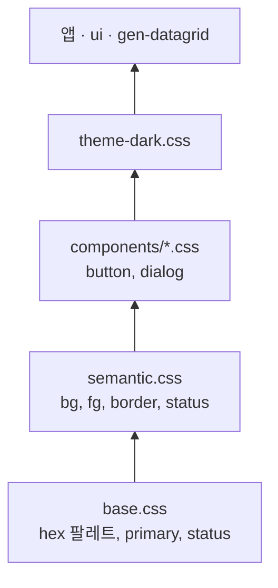
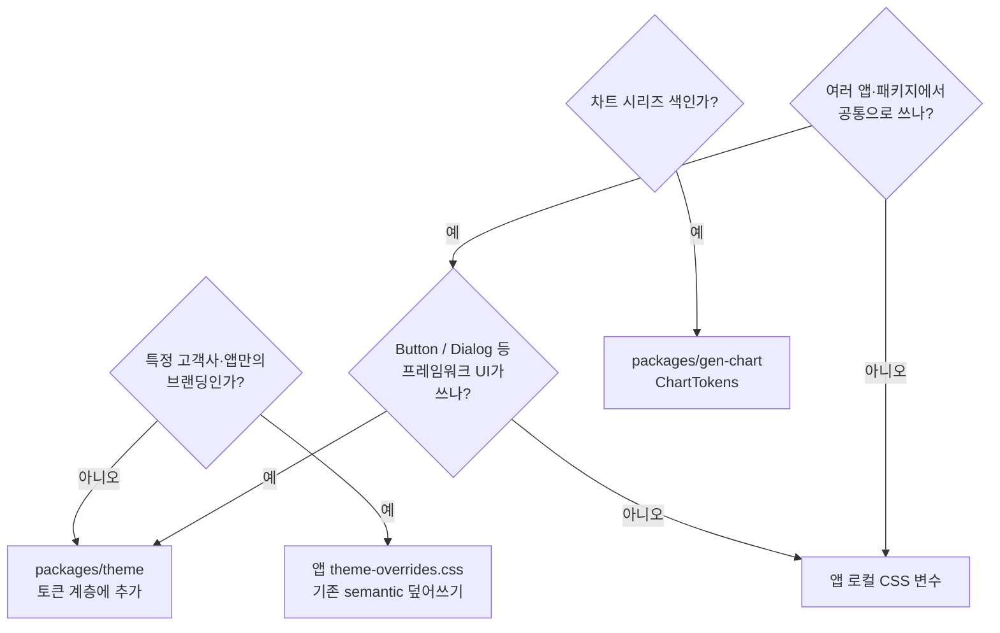

<!--
 @file .docs/08-DESIGN-TOKENS-GUIDE.md
 @description 디자이너·퍼블리셔 온보딩용 디자인 토큰·색상 작업 가이드.

 @created 2026-06-23
-->
# 디자인 토큰·색상 작업 가이드

GenOffice V2에 **디자이너** 또는 **퍼블리셔**로 신규 투입될 때 참고하는 문서입니다.  
색을 정의·변경·적용할 때 **어디에 무엇을 넣어야 하는지**, **무엇을 하지 말아야 하는지**를 정리합니다.

> 개발자·아키텍처 상세: [02-ARCHITECTURE.md](./02-ARCHITECTURE.md), [packages/theme/.docs/architecture.md](../packages/theme/.docs/architecture.md)

---

## 1. 먼저 알아둘 것 (3가지 원칙)

| 원칙 | 설명 |
| --- | --- |
| **CSS 변수가 기준** | 화면에 보이는 색은 `var(--토큰이름)`으로 연결됩니다. JS에 hex를 따로 두지 않습니다. |
| **계층 구조** | 원시 팔레트 → 의미(semantic) → 컴포넌트(component) → 다크 모드 순으로 쌓입니다. |
| **primary 하나** | 주 액션·강조색은 `--color-primary` 계열만 씁니다. V1의 `brand` 별칭은 V2에 **없습니다**. |

라이트/다크 전환은 `ThemeProvider`가 `document`에 `data-theme="light|dark"`를 설정하고, CSS가 그에 맞게 값을 바꿉니다.

---

## 2. 역할별 빠른 시작

### 디자이너

1. [01-OVERVIEW.md](./01-OVERVIEW.md) — 제품 범위 파악 (선택)
2. **본 문서** — 토큰 이름·역할·변경 절차
3. Figma(또는 디자인 툴)에서는 **GenOffice semantic 이름**과 맞춥니다.  
   예: `Primary / Default` → `--color-primary`, `Background / Secondary` → `--color-bg-secondary`
4. 새 색이 필요하면 **§4 결정 트리**로 “앱 전용 vs 프레임워크 공통”을 먼저 정합니다.
5. 핸드오프 시 **hex 값 + 토큰 이름 + light/dark 쌍**을 함께 전달합니다.

### 퍼블리셔

1. **본 문서** — 토큰 계층·파일 위치
2. [packages/theme/.docs/architecture.md](../packages/theme/.docs/architecture.md) — CSS import 체인
3. [packages/theme/.docs/ref/token-mapping.md](../packages/theme/.docs/ref/token-mapping.md) — 컴포넌트별 토큰 목록
4. 스타일 작성 시 **하드코드 hex 금지** — `var(--color-*)`, `var(--button-*)` 사용
5. Storybook: `apps/storybook`에서 컴포넌트·토큰 미리보기 (통합 스토리북)

### 개발자와 협업 시

| 전달 항목 | 예시 |
| --- | --- |
| 토큰 이름 | `--color-primary`, `--color-status-warning` |
| Light hex | `#171717` |
| Dark hex | `#fafafa` |
| 적용 범위 | “앱 전체 CTA” / “한 화면 KPI만” |
| 참조 컴포넌트 | Button primary, Grid selection row |

---

## 3. 토큰 계층 (색이 흐르는 순서)

```text
base.css              원시 팔레트, --color-primary, status 색
    ↓
semantic.css          UI가 읽는 이름 (--color-bg-*, --color-fg-*, --color-status-*)
    ↓
components/*.css      Button, Dialog 전용 (--button-*, --dialog-* …)
    ↓
theme-dark.css        [data-theme="dark"] 일 때 위 값 덮어쓰기
    ↓
앱 / @gen-office/ui   var(--토큰)만 참조
```



### 3.1 자주 쓰는 토큰 (Light 기준)

| 용도 | CSS 변수 | 비고 |
| --- | --- | --- |
| 페이지 배경 | `--color-bg-primary` | `#ffffff` |
| 카드·패널 배경 | `--color-bg-secondary` | surface 계열 |
| 본문 텍스트 | `--color-fg-primary` | |
| 보조 텍스트 | `--color-fg-secondary` | |
| 테두리 | `--color-border-default` | |
| **주 액션·CTA** | `--color-primary` | near-black `#171717` |
| CTA hover | `--color-primary-dark` | `#262626` |
| CTA 배경 tint | `--color-primary-light` | neutral 100 |
| 성공 | `--color-status-success` | Bootstrap green |
| 경고 | `--color-status-warning` | |
| 오류·위험 | `--color-status-error` | danger와 동일 계열 |
| 정보 | `--color-status-info` | |

다크 모드 값은 `packages/theme/src/styles/tokens/theme-dark.css`에 정의됩니다.

### 3.2 컴포넌트 토큰 예 (Button)

Button 스타일은 `packages/ui`가 `packages/theme`의 **component 토큰**을 참조합니다.

| Button 역할 | theme 토큰 (예) |
| --- | --- |
| Primary 배경 | `--button-primary-bg` → 내부적으로 `--color-primary` |
| Primary 텍스트 | `--button-primary-text` |
| Danger 배경 | `--button-danger-bg` |
| Focus ring | `--button-focus-ring` |

정의 위치: `packages/theme/src/styles/tokens/components/button.css`

---

## 4. 새 색이 필요할 때 — 결정 트리



| 상황 | 어디에 작업 | 예 |
| --- | --- | --- |
| 고객사 로고색, 앱 전용 강조색 | **앱**에서 기존 토큰 override | `--color-primary`만 변경 |
| 새 상태 색 (예: `pending`) | **theme** semantic (+ 필요 시 component) | `--color-status-pending` |
| Button·Dialog 공통 스타일 | **theme** `components/*.css` | `--button-*`, `--dialog-*` |
| 데이터 그리드 색 | **gen-datagrid** | `--gen-datagrid-*` (Shell만 theme semantic 브리지 + 폴백) |
| CRUD 셸·Action bar | **gen-datagrid-crud** | `--gen-datagrid-crud-*` (`--gen-datagrid-*` 파생; theme `--color-*` 직참조 금지) |
| 대시보드 차트 색 | **gen-chart** | `ChartTokens` (TS preset + `options.tokens`; chrome은 CSS). [design-tokens-architecture.md](../packages/gen-chart/.docs/architecture/design-tokens-architecture.md) |
| 한 화면·한 배지 | **앱/페이지 CSS** | `--app-*` 또는 기존 status 재사용 |

---

## 5. 작업 절차

### 5.1 앱(고객사) 브랜딩만 바꿀 때 — 가장 흔한 경우

**`packages/theme`을 수정하지 않습니다.** 앱 CSS에서 semantic 토큰을 덮어씁니다.

**파일 예:** `apps/<앱명>/src/styles/theme-overrides.css`

```css
/* @gen-office/theme/index.css 보다 뒤에 import */

:root {
  --color-primary: #a50034;
  --color-primary-dark: #8a002c;
  --color-primary-light: #fde8ef;
  --color-header-bg: var(--color-primary);
}

[data-theme='dark'] {
  --color-primary: #ff6b9d;
  --color-primary-dark: #ffffff;
}
```

`--button-primary-*`는 `--color-primary`를 참조하므로, **primary만 바꿔도** Primary Button·그리드 선택 행 tint 등이 함께 바뀝니다.

**앱 부트스트랩 순서**

```text
1. import '@gen-office/theme/index.css'
2. import './styles/theme-overrides.css'
3. <ThemeProvider> … </ThemeProvider>
```

### 5.2 앱 전용 색 (다른 앱과 공유하지 않음)

theme 패키지에 올리지 않고 앱 스코프 변수를 둡니다.

```css
:root {
  --app-kpi-positive: var(--color-status-success);
  --app-department-sales: #2563eb;
}
```

해당 앱의 CSS Module·페이지 스타일에서만 `var(--app-*)`를 사용합니다.

### 5.3 프레임워크 전역에 새 의미의 색을 추가할 때

여러 앱·`@gen-office/ui`가 같이 쓸 때 `packages/theme`에 반영합니다.

| 단계 | 파일 | 내용 |
| --- | --- | --- |
| 1 | 역할·이름 합의 | semantic 이름 우선 (`--color-status-*`, `--color-bg-*`) |
| 2 | `tokens/base.css` | 새 hex 팔레트가 필요할 때만 |
| 3 | `tokens/semantic.css` | UI·앱이 읽을 공개 이름 |
| 4 | `tokens/components/*.css` | Button 등 컴포넌트 전용 (semantic 참조) |
| 5 | `tokens/theme-dark.css` | **light/dark 쌍 필수** |
| 6 | (선택) `theme.types.ts` + Provider | JS·캔버스에서 `useTheme()`으로 읽어야 할 때 |
| 7 | 검증·기록 | theme 테스트, `implementation-log.md`, 필요 시 `decisions.md` |

**관련 경로**

```text
packages/theme/src/styles/tokens/
├── base.css
├── semantic.css
├── theme-dark.css
└── components/
    ├── button.css
    └── dialog.css
```

> 그리드 색은 theme가 아니라 `@gen-office/gen-datagrid`가 소유합니다: `packages/gen-datagrid/src/styles/tokens.css`의 `--gen-datagrid-*` (Shell만 theme semantic `--color-*` 브리지 + 폴백; Header/Body/Footer/System/Chrome/Feature는 패키지 토큰 파생). 구조: [design-tokens-architecture.md](../packages/gen-datagrid/.docs/architecture/design-tokens-architecture.md).
>
> CRUD Action bar·셸 구분선은 `@gen-office/gen-datagrid-crud`가 `--gen-datagrid-crud-*`로 소유하며, 값은 gen-datagrid Shell에서만 파생합니다. 구조: [gen-datagrid-crud design-tokens-architecture.md](../packages/gen-datagrid-crud/.docs/architecture/design-tokens-architecture.md).

### 5.4 UI 컴포넌트에 새 variant가 필요할 때

1. theme에 component 토큰 추가  
2. `packages/ui`에 variant + CSS Module  
3. Storybook 스토리 추가 (`apps/storybook`)  
4. 공용이면 theme·ui 문서 갱신  

앱에서만 쓰는 버튼 스타일이면 ui 패키지를 건드리지 말고, 앱 CSS + `className`으로 처리하는 것이 좋습니다.

### 5.5 차트 색

차트 시리즈·범례 색은 `@gen-office/theme`이 아니라 **`@gen-office/gen-chart`**에서 관리합니다.  
상세: [05-GEN-CHART.md](./05-GEN-CHART.md)

---

## 6. 하지 말아야 할 것

| 금지 | 이유 |
| --- | --- |
| primary와 같은 의미의 `brand` 토큰·variant 추가 | V2에서 제거된 패턴. `--color-primary`만 사용 |
| `packages/ui` CSS에 hex 직접 기입 | 테마·다크 모드 일관성 깨짐 |
| light만 정의하고 dark 생략 | `data-theme="dark"`에서 깨짐 |
| JS 파일에만 색 상수 정의 | CSS와 불일치. `useTheme()`은 CSS를 읽음 |
| 앱 브랜딩을 위해 theme 패키지 직접 수정 | 다른 앱에 영향. 앱 override 사용 |

---

## 7. 실무 체크리스트

새 색·변경 작업 전후에 확인합니다.

- [ ] 기존 `--color-primary` / `--color-status-*`로 충분한지 검토했는가?
- [ ] Light·Dark **둘 다** 값을 정했는가?
- [ ] ui·grid가 읽는 **semantic 또는 component** 이름인가?
- [ ] JS(`useTheme`)까지 필요한가, CSS만으로 충분한가?
- [ ] 여러 앱 공유 → `packages/theme` / 한 앱만 → `theme-overrides.css`
- [ ] theme 변경 시 테스트·문서(로그) 반영 요청했는가?

---

## 8. 미리보기·검증

| 방법 | 명령·위치 |
| --- | --- |
| Storybook | `pnpm -C apps/storybook dev` — Button 등 ui 컴포넌트 |
| theme 테스트 | `pnpm -C packages/theme test` — 토큰 회귀 검사 |
| 토큰 매핑표 | [packages/theme/.docs/ref/token-mapping.md](../packages/theme/.docs/ref/token-mapping.md) |

브라우저 개발자 도구에서 `:root` 또는 `[data-theme="dark"]`의 computed style로 `--color-primary` 등이 기대값인지 확인할 수 있습니다.

---

## 9. 더 읽을 문서

| 대상 | 문서 |
| --- | --- |
| 토큰 구조·React API | [packages/theme/.docs/architecture.md](../packages/theme/.docs/architecture.md) |
| 색상 정책·결정 배경 | [packages/theme/.docs/ref/token-sources-and-decisions.md](../packages/theme/.docs/ref/token-sources-and-decisions.md) |
| ui 스타일 규칙 | [packages/ui/.docs/architecture.md](../packages/ui/.docs/architecture.md) |
| 모노레포 구조 | [02-ARCHITECTURE.md](./02-ARCHITECTURE.md) |
| 차트 | [05-GEN-CHART.md](./05-GEN-CHART.md) |

---

## 10. 용어 정리

| 용어 | 설명 |
| --- | --- |
| **토큰** | `--color-primary` 같은 CSS 변수 이름 |
| **semantic** | UI 의미 단위 이름 (`bg-primary`, `status-error`) |
| **component** | Button·Grid 등 특정 컴포넌트용 토큰 (`--button-primary-bg`) |
| **primary** | 주 액션·강조색 (V2 기본 near-black / dark에서는 밝은 CTA) |
| **ThemeProvider** | light/dark 모드와 `useTheme()` 제공 React 컴포넌트 |
| **override** | 앱 CSS에서 theme 토큰 값만 덮어쓰는 방식 |

---

*문서 버전: 2026-06-23 — primary near-black 정책, `brand` 토큰·variant 제거 반영*
