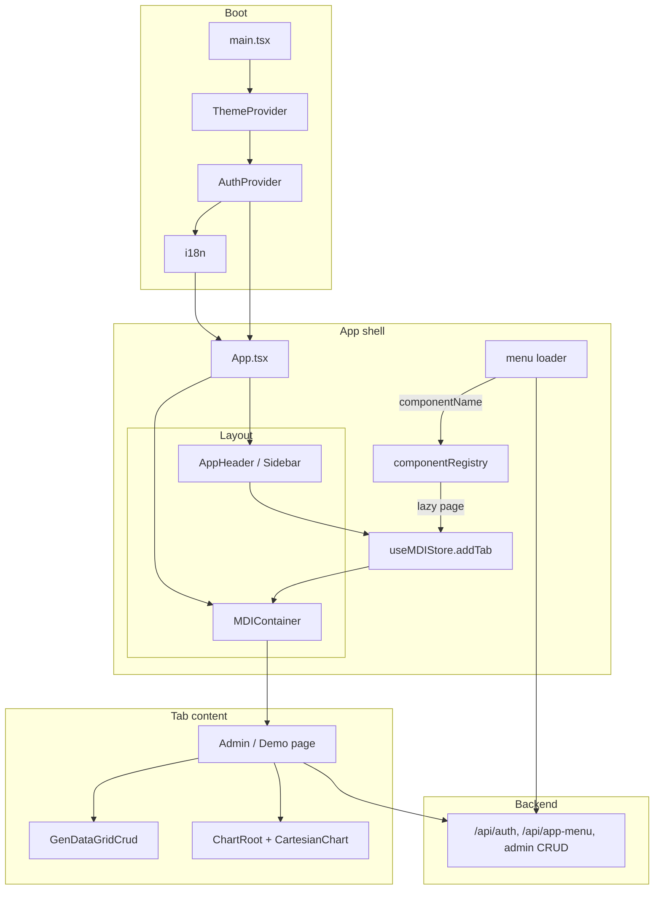

<!--
 @file apps/demo/.docs/architecture/architecture.md
 @description Architecture for @gen-office/demo reference back-office app.

 @created 2026-06-28

 @remark
 - Implementation plan: ../plan/plan.md
 - MDI integration: packages/mdi/.docs/architecture.md §8
-->
# @gen-office/demo 아키텍처

## 1. 역할

`apps/demo`는 GenOffice V2의 **통합 reference 앱**입니다.

**Multi-app persona (설계):** 동일 registry·페이지로 MDI / single·layout·chrome을 바꿔 여러 “앱”처럼 보여주는 App Profile 설계는 [multi-app-frame.md](./multi-app-frame.md)를 참고합니다.

| 책임 | demo | 패키지 |
| --- | --- | --- |
| 라우팅·shell·메뉴·auth | ✅ | — |
| MDI 탭·창 | 배선만 | `@gen-office/mdi` |
| UI·폼·다이얼로그 | 조합 | `@gen-office/ui` |
| 테마·토큰 | Provider | `@gen-office/theme` |
| 데이터 그리드·CRUD | 페이지 조합 | `@gen-office/gen-datagrid-crud` (합류 후) |
| 차트 | 페이지 조합 | `@gen-office/gen-chart` |
| grid→chart | 페이지 조합 | `@gen-office/gen-datagrid-chart` (합류 후) |
| HTTP·비즈니스 API | ✅ | — |

demo는 **feature 패키지를 재export하지 않습니다.** 페이지에서 workspace 패키지를 직접 import합니다.

---

## 2. 레이어 구조

```text
┌─────────────────────────────────────────────────────────────┐
│  apps/demo                                                   │
│  ┌─────────────┐  ┌──────────────┐  ┌──────────────────────┐ │
│  │ app/ shell  │  │ shared/      │  │ pages/               │ │
│  │ menu, auth  │  │ api, hooks   │  │ admin/, demo/        │ │
│  └──────┬──────┘  └──────┬───────┘  └──────────┬───────────┘ │
│         │                │                      │             │
│         └────────────────┴──────────────────────┘             │
│                          │                                    │
└──────────────────────────┼────────────────────────────────────┘
                           │
     ┌─────────────────────┼─────────────────────┐
     ▼                     ▼                     ▼
 @gen-office/mdi    @gen-office/ui         @gen-office/gen-chart
 @gen-office/theme  @gen-office/utils      @gen-office/gen-datagrid-crud (후)
                                         @gen-office/gen-datagrid-chart (후)
```

### 의존 방향

```text
apps/demo → feature packages → gen-datagrid → ui → theme/utils
```

- demo → `gen-datagrid-crud` ✅ (합류 후)
- demo → `gen-grid` ❌
- `ui` → demo ❌

---

## 3. 런타임 데이터 흐름



### 메뉴 → MDI 오픈 계약

V1과 동일한 **이름 유지·구현 교체** 정책 ([03-V1-RELATIONSHIP.md](../../../../.docs/03-V1-RELATIONSHIP.md)):

1. 메뉴 API(또는 mock)가 `componentName`, `title`, `path` 등을 반환
2. `componentRegistry`가 `componentName` → `React.lazy(() => import(...))` 매핑
3. shell의 `onOpenPage`가 `addTab({ id, title, content: <Page /> })` 호출
4. 동일 `id` 재오픈 시 **기존 탭 활성화** (mdi store 정책)

```ts
// 목표 시그니처 (apps/demo)
type OpenPagePayload = {
  pageId: string;
  title: string;
  componentName: string;
  params?: Record<string, string>;
};

function onOpenPage(payload: OpenPagePayload): void;
```

---

## 4. 디렉터리 구조 (목표)

V1 `frontend/apps/demo/src`를 기준으로 V2 경로를 정합니다. 세부 파일명은 이식 시 V1과 diff하며 맞춥니다.

```text
apps/demo/
├── .docs/                    # 본 문서군
├── index.html
├── package.json              # name: @gen-office/demo
├── vite.config.ts
├── tsconfig.json
└── src/
    ├── main.tsx              # ThemeProvider, global CSS, React root
    ├── app/
    │   ├── App.tsx           # auth 분기, shell layout, MDI mount
    │   ├── AppShell.tsx      # header + sidebar + main (flex height chain)
    │   ├── config/
    │   │   ├── componentRegistry.ts      # 정적 registry 타입
    │   │   └── componentRegistry.dynamic.ts  # lazy import 맵
    │   ├── menu/
    │   │   ├── useAppMenu.ts
    │   │   └── MenuSidebar.tsx
    │   └── providers/
    │       ├── AuthProvider.tsx
    │       └── AppProviders.tsx
    ├── shared/
    │   ├── api/
    │   │   ├── httpClient.ts
    │   │   ├── authApi.ts
    │   │   └── csrf.ts
    │   ├── hooks/
    │   └── components/
    │       ├── PageHeader/           # V1 이식·ui 조합
    │       └── AdminPageLayout/      # flex height; grid/chart 부모
    ├── pages/
    │   ├── admin/                    # D4 — gen-datagrid-crud 후
    │   │   ├── UserManagement/
    │   │   └── ...
    │   └── demo/
    │       ├── ChartDemoPage.tsx     # D3 — gen-chart
    │       ├── DashboardDemoPage.tsx
    │       └── placeholders/         # D2 — Coming soon
    ├── i18n/
    │   ├── index.ts
    │   └── locales/
    └── styles/
        └── app.css                 # 앱 전용 (토큰은 theme)
```

### 모듈 책임

| 모듈 | 입력 | 출력 |
| --- | --- | --- |
| `app/providers` | session, theme mode | React context |
| `shared/api` | REST endpoints | typed fetch, CSRF header |
| `app/config/componentRegistry` | `componentName` | lazy React component |
| `pages/*` | route params, API data | MDI tab content |
| `shared/components/AdminPageLayout` | children (grid/chart) | flex `min-height: 0` 체인 |

---

## 5. 레이아웃·높이 계약

백오피스 화면에서 그리드·차트가 **0 높이로 붕괴**되지 않도록 demo shell이 책임집니다.

```text
html, body, #root     height: 100%
AppShell              display: flex; flex-direction: column; height: 100vh
  header              flex-shrink: 0
  body row            flex: 1; min-height: 0
    sidebar           flex-shrink: 0
    main              flex: 1; min-height: 0; display: flex; flex-direction: column
      MDIContainer    flex: 1; min-height: 0  (mdi 패키지 내부도 동일)
        TabPanel      flex column, min-height: 0
          Page        AdminPageLayout — flex: 1; min-height: 0
            content   GenDataGrid / ResponsiveChartContainer
```

| 소비자 | demo가 보장할 것 |
| --- | --- |
| `MDIContainer` | 부모 `flex:1; min-height:0` |
| `GenDataGrid` | 페이지가 **명시적 height** 또는 flex chain 끝까지 `min-height:0` |
| `ResponsiveChartContainer` | 카드/패널 `flex:1; min-height:0` ([gen-chart Dashboard story](../../../../packages/gen-chart/src/react/components/dashboard/Dashboard.stories.tsx)) |

**Page frame:** V1 `AdminPageLayout` + `PageHeader` 패턴을 우선 이식합니다. composable `StandardPageFrame`은 [`.docs/idea/page-frame-composable.md`](../../../../.docs/idea/page-frame-composable.md) draft — **MVP는 V1 레이아웃 이식**, 프레임 패키지화는 후속.

---

## 6. 인증·API

[`backend`](../../../../backend) 저장소를 그대로 사용합니다 ([02-ARCHITECTURE.md §7](../../../../.docs/02-ARCHITECTURE.md#7-백엔드-연동)).

| 영역 | V2 정책 |
| --- | --- |
| 로그인 | V1 `shared/api` 흐름 이식 — session cookie |
| CSRF | mutating request에 토큰 부착 |
| 메뉴 | `/api/app-menu` — DB 또는 mock 전환 가능 |
| admin CRUD | 기존 REST — 페이지별 service 모듈 |
| i18n | 서버 메시지 API + 정적 fallback |

demo 전용 env (`.env.development`):

```bash
VITE_API_BASE_URL=http://localhost:8080
```

---

## 7. 패키지 의존 (목표 `package.json`)

### Phase D0~D3 (지금)

```json
{
  "dependencies": {
    "@gen-office/theme": "workspace:*",
    "@gen-office/ui": "workspace:*",
    "@gen-office/mdi": "workspace:*",
    "@gen-office/gen-chart": "workspace:*",
    "@gen-office/utils": "workspace:*",
    "react": "19.2.7",
    "react-dom": "19.2.7"
  }
}
```

CSS side-effect (앱 `main.tsx`):

```ts
import '@gen-office/theme/index.css';
import '@gen-office/mdi/index.css';
import '@gen-office/gen-chart/index.css';
```

### Phase D4~D5 (합류 후 추가)

```json
{
  "@gen-office/gen-datagrid": "workspace:*",
  "@gen-office/gen-datagrid-crud": "workspace:*",
  "@gen-office/gen-datagrid-chart": "workspace:*"
}
```

---

## 8. 페이지 분류

### 8.1 Shell·인프라 (패키지 무관)

- Login, App shell, menu, i18n, 404/empty

### 8.2 Demo · 비그리드 (Phase D3)

| 페이지 | 패키지 | 비고 |
| --- | --- | --- |
| `ChartDemoPage` | `gen-chart` | line/bar/area/composed/pie/donut — Storybook 패턴 이식 |
| `DashboardDemoPage` | `gen-chart` | 카드 그리드 + `ResponsiveChartContainer` |
| UI 컴포넌트 시연 (선택) | `ui` | storybook 보완용 |

### 8.3 Admin · 그리드 (Phase D4 — 블로커: gen-datagrid)

| 페이지 | V1 우선순위 | V2 패키지 |
| --- | --- | --- |
| UserManagement | 1 | gen-datagrid-crud |
| MenuManagement | 2 | gen-datagrid-crud |
| LkupManagement | 4 | gen-datagrid-crud |
| RoleManagement | 5 | gen-datagrid-crud |
| Notice / Message / UserRole | 6~8 | gen-datagrid-crud |

### 8.4 Grid + Chart (Phase D5)

| 페이지 | 선행 |
| --- | --- |
| ActualsPage | gen-datagrid + gen-datagrid-chart |
| 그리드 시연 (`pages/demo/*`) | gen-datagrid MVP |

---

## 9. gen-chart 연동 (Phase D3)

V1 `GenChart` monolith **사용 금지**. composable API만:

```tsx
import {
  ChartRoot,
  CartesianChart,
  CartesianPlot,
  ResponsiveChartContainer,
  LineSeries,
  ChartTooltip,
  ChartLegend,
} from '@gen-office/gen-chart';
import '@gen-office/gen-chart/index.css';
```

- `DashboardDemoPage`: [gen-chart C7 Dashboard story](../../../../packages/gen-chart/src/react/components/dashboard/Dashboard.stories.tsx) 패턴
- `ChartDemoPage`: [CartesianSeries / PolarSeries stories](../../../../packages/gen-chart/src/react/components/) 조합
- gen-chart **Phase 2 (C8)** 완료 조건에 demo 페이지 포함 — D3에서 선행 구현 가능

---

## 10. 빌드·실행

| 명령 | 목적 |
| --- | --- |
| `pnpm -C apps/demo dev` | Vite dev server |
| `pnpm -C apps/demo build` | production build |
| `pnpm dev` (root) | turbo `--filter=@gen-office/demo` |

Turbo `dev` task는 demo가 workspace에 등록된 뒤 root [package.json](../../../../package.json)과 연동됩니다.

---

## 11. 테스트 전략

| 단계 | 범위 | 도구 |
| --- | --- | --- |
| D1+ | `shared/api` pure helpers | vitest (apps/demo 또는 shared 패키지화 시) |
| D3+ | Chart/Dashboard smoke | 수동 + 이후 Playwright (Phase 5) |
| D4+ | CRUD 페이지 | 페이지별 smoke, grid interaction은 패키지 test에 위임 |

패키지 단위 test를 demo에 중복하지 않습니다.

---

## 12. 명시적 non-goals (Phase D0~D3)

- V1 `gen-grid` / `GenChart` import
- gen-grid → gen-datagrid adapter
- demo 내부에 grid 엔진 fork
- micro-frontend / module federation
- SSR

---

## 13. 관련 문서

- [plan.md](../plan/plan.md) — Phase D0~D5, Gate
- [packages/mdi/.docs/architecture.md](../../../../packages/mdi/.docs/architecture.md)
- [packages/gen-chart/.docs/phase.md](../../../../packages/gen-chart/.docs/phase.md)
- [03-V1-RELATIONSHIP.md §5](../../../../.docs/03-V1-RELATIONSHIP.md#5-demo-화면-이식-우선순위)
