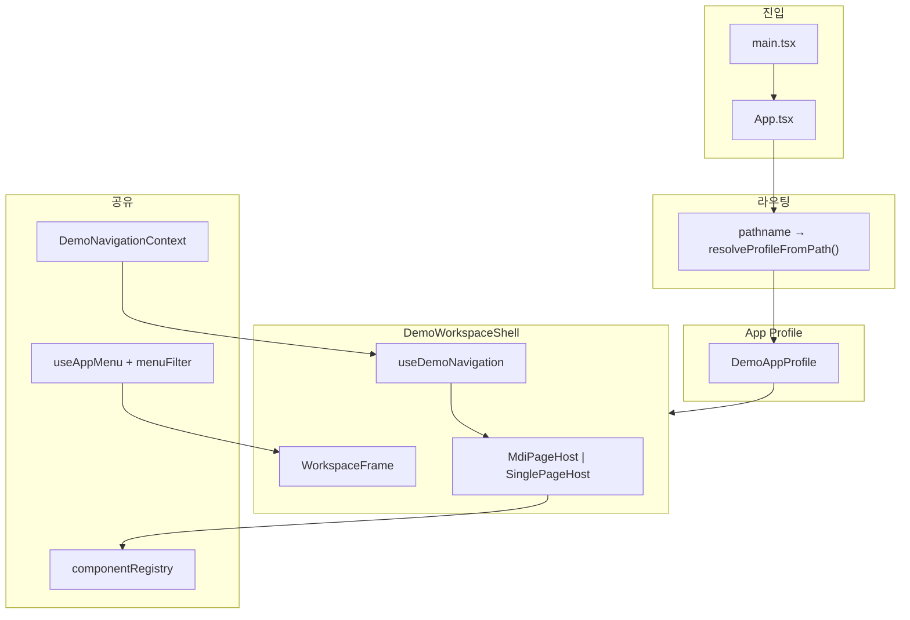

<!--
 @file apps/demo/.docs/architecture/multi-app-frame.md
 @description Multi-app persona design — App Profile, navigation modes, file layout for @gen-office/demo.

 @created 2026-06-29

 @remark
 - gen-frame F5(single host) + layout mode를 demo에서 조합하는 설계안
 - 구현 전 설계 정본; 코드는 Phase M0~M3 순으로 진행
-->
# Demo Multi-App Frame — 설계 및 파일 배치

`apps/demo` 하나로 **여러 “앱 persona”**를 보여주는 설계입니다.  
`/single`은 그중 `navigation: 'single'` 프로필 하나에 해당하며, **필수 경로명이 아닙니다.**

## 1. 목적

| 목표 | 설명 |
| --- | --- |
| **Showcase** | 동일 registry·메뉴로 layout·navigation·chrome만 바꿔 비교 |
| **PoC** | MDI 백오피스 vs 단일 페이지 포털 vs 운영용 titleBar 등을 한 SPA에서 시연 |
| **재사용** | 페이지(`pages/*`)는 공유, shell만 프로필로 교체 |
| **gen-frame 정렬** | `@gen-office/gen-frame`의 `FrameConfig` (`layout` × `navigation`)를 demo에서 구체화 |

**이 문서가 다루지 않는 것:** 별도 배포 단위·별도 번들·테넌트별 백엔드 분리. 그 경우 `apps/*`를 쪼개고 gen-frame을 각 앱 shell로 재사용합니다.

---

## 2. gen-frame이 제공하는 축

`@gen-office/gen-frame`은 백오피스 **작업 공간 엔진**입니다. demo는 여기에 **App Profile** 레이어를 얹습니다.

### 2.1 Layout mode (`FrameLayoutMode`)

| 값 | 설명 | demo 상태 |
| --- | --- | --- |
| `leftPanel` | 좌측 사이드바 메뉴 | ✅ 현재 기본 |
| `titleBar` | 상단 가로 메뉴 | ✅ 환경설정에서 전환 가능 |
| `hybrid` | 상단 모듈 + 좌측 세부 | ⏸ gen-frame 후속 |
| `rail` | 아이콘 레일 | ⏸ gen-frame 후속 |

### 2.2 Navigation mode (`FrameNavigationMode`)

| 값 | Host | Hook | `@gen-office/mdi` |
| --- | --- | --- | --- |
| `mdi` | `MdiPageHost` | `useMdiNavigationController` | 필요 |
| `single` | `SinglePageHost` | `useSingleNavigationController` | 불필요 |

동일한 `NavigationController.open(payload)` 계약으로 메뉴 클릭·딥링크·탭 내 링크를 처리합니다.

**참고:** [packages/gen-frame/.docs/architecture.md](../../../../packages/gen-frame/.docs/architecture.md), [packages/gen-frame/README.md](../../../../packages/gen-frame/README.md)

---

## 3. App Profile 개념

**App Profile** = URL 진입점마다 고정되는 shell 프리셋.

```ts
/** apps/demo/src/app/profiles/types.ts (안) */
import type { FrameLayoutMode, FrameNavigationMode } from '@gen-office/gen-frame';

export type DemoAppProfileId = 'classic-mdi' | 'portal-single' | 'ops-mdi';

export interface DemoAppProfile {
  id: DemoAppProfileId;
  /** 브라우저 탭·empty state 등에 표시 */
  label: string;
  /** URL prefix — 이 경로로 진입 시 이 프로필 적용 */
  urlBase: string;
  layout: FrameLayoutMode;
  navigation: FrameNavigationMode;
  /** layout이 프로필에 고정이면 settings에서 숨김 */
  layoutLocked?: boolean;
  brand: {
    logoSrc?: string;
    alt: string;
  };
  /** chrome 토큰 scope — app-shell.css와 data-attribute 연동 */
  chromeVariant?: 'default' | 'dark';
  /** 전체 메뉴 중 노출할 pageId 화이트리스트 (없으면 전체) */
  menuPageIds?: string[];
  /** MDI 전용 */
  mdi?: {
    maxTabs?: number;
    tabPosition?: 'top' | 'bottom';
  };
  /** URL 쿼리 파라미터 이름 (기본 menu) */
  urlParam?: string;
}
```

### 3.1 예시 프로필

| id | urlBase | layout | navigation | 용도 |
| --- | --- | --- | --- | --- |
| `classic-mdi` | `/` | `leftPanel` | `mdi` | 현재 demo (탭 백오피스) |
| `portal-single` | `/portal` | `titleBar` | `single` | 단일 화면 포털 |
| `ops-mdi` | `/ops` | `leftPanel` | `mdi` | CO 메뉴만, dark chrome |

`layout`은 프로필 기본값이고, `classic-mdi`만 환경설정 모달에서 런타임 전환을 허용할 수 있습니다 (`layoutLocked: false`).

### 3.2 조합 행렬 (개념)

```text
                navigation
              mdi          single
layout  leftPanel   classic-mdi    portal-single*
        titleBar    (showcase)     portal-single

* portal-single은 titleBar + single 조합 예시
```

---

## 4. 런타임 구조



### 4.1 데이터 흐름 (메뉴 → 화면)

```text
메뉴 클릭 / ?menu= 딥링크 / PlaceholderPage 링크
    → NavigationController.open({ pageId, title, meta })
    → [mdi] mdi store addTab / setActiveTab
    → [single] currentPage state 갱신
    → RegistryPageContent(componentName) 렌더
```

페이지 컴포넌트(`pages/*`)는 **프로필과 무관**하게 동일합니다.

---

## 5. URL · 라우팅 전략

### 5.1 권장: react-router-dom

| 경로 | 프로필 | 비고 |
| --- | --- | --- |
| `/*` | `classic-mdi` | 현재 동작 유지 |
| `/portal/*` | `portal-single` | MDI 없음 |
| `/ops/*` | `ops-mdi` | 메뉴 subset |

```tsx
// App.tsx (개념)
<BrowserRouter>
  <Routes>
    {demoAppProfiles.map((profile) => (
      <Route
        key={profile.id}
        path={`${profile.urlBase}/*`}
        element={<DemoWorkspaceShell profile={profile} />}
      />
    ))}
  </Routes>
</BrowserRouter>
```

### 5.2 딥링크 (현행 유지 + 확장)

- **쿼리:** `?menu=<pageId>` — `createQueryTabUrlSyncAdapter` 재사용
- **프로필별 base:** `/portal?menu=demo-chart` → portal 프로필 + 차트 화면
- **뒤로가기:** gen-frame `useUrlSync` + `persist` (Phase M3, 선택)

### 5.3 Vite · 배포

- **dev:** `localhost:5173/portal` — Vite SPA fallback으로 동작
- **production:** `/portal`, `/ops` 등도 `index.html`로 rewrite 필요

---

## 6. 파일 배치안

### 6.1 디렉터리 트리 (목표)

```text
apps/demo/src/
├── main.tsx                          # CSS import, AppProviders (변경 최소)
├── app/
│   ├── App.tsx                       # auth 분기 + BrowserRouter + Profile 라우트
│   │
│   ├── profiles/                     # ★ App Profile 레이어 (신규)
│   │   ├── types.ts                  # DemoAppProfile, DemoAppProfileId
│   │   ├── demoAppProfiles.ts        # 프로필 레지스트리 (const 배열)
│   │   ├── resolveProfileFromPath.ts # pathname → profile (fallback: classic-mdi)
│   │   ├── filterMenuByProfile.ts    # menuPageIds 화이트리스트
│   │   └── index.ts
│   │
│   ├── shell/                        # ★ 공통 shell (신규, AppShell 흡수)
│   │   ├── DemoWorkspaceShell.tsx    # WorkspaceFrame + workarea host 분기
│   │   ├── DemoWorkspaceShell.module.css
│   │   ├── useDemoNavigation.ts      # profile.navigation → mdi | single hook
│   │   └── index.ts
│   │
│   ├── openPage.tsx                  # resolvePageContent() 공통 추출 (리팩터)
│   ├── hooks/
│   │   └── useOpenPage.ts            # deprecated → useDemoNavigation 래퍼 또는 제거
│   │
│   ├── url/
│   │   ├── demoUrlSync.ts            # 기존 ?menu= adapter
│   │   ├── useDemoMenuDeepLink.ts    # profile-aware로 확장
│   │   └── useProfileUrlSync.ts      # (M3) useUrlSync 래퍼
│   │
│   ├── navigation/
│   │   └── DemoNavigationContext.tsx # 변경 없음 — openMenuByPageId 계약 유지
│   │
│   ├── settings/
│   │   └── DemoSettingsModal.tsx     # profile.layoutLocked 시 layout 섹션 숨김
│   │
│   ├── menu/                         # 기존 유지
│   ├── config/                       # componentRegistry — 기존 유지
│   └── providers/                    # 기존 유지
│
├── pages/                            # 기존 유지 — 프로필 무관
├── shared/
└── styles/
    └── app-shell.css                 # [data-app-chrome="dark"] 등 profile scope 확장
    └── datagrid-overrides.css        # gen-datagrid 앱 override (선택)
```

### 6.2 파일별 책임

| 파일 | 책임 |
| --- | --- |
| `profiles/demoAppProfiles.ts` | 프로필 단일 정본. 새 “앱” 추가 시 여기만 등록 + 라우트 자동 매핑 |
| `profiles/resolveProfileFromPath.ts` | `window.location.pathname` 또는 react-router `useLocation`으로 profile 결정 |
| `profiles/filterMenuByProfile.ts` | `AppMenuItem[]` → `FrameMenuItem[]` (화이트리스트·i18n은 기존 mapper 재사용) |
| `shell/DemoWorkspaceShell.tsx` | 현재 `AppShell.tsx`의 WorkspaceFrame·설정·deep link·workarea 통합 |
| `shell/useDemoNavigation.ts` | `navigation === 'mdi'` → `useMdiNavigationController`; `'single'` → `useSingleNavigationController` |
| `openPage.tsx` | `resolvePageContent(payload)` — MDI tab content와 single page content 공통 |
| `App.tsx` | 로그인 후 profile 라우트만 렌더 (shell 로직은 DemoWorkspaceShell로 이동) |

### 6.3 제거·이전 계획

| 현재 | 이후 |
| --- | --- |
| `app/AppShell.tsx` | `shell/DemoWorkspaceShell.tsx`로 이전 후 삭제 또는 thin re-export |
| `hooks/useOpenPage.ts` | `shell/useDemoNavigation.ts`로 통합 |

---

## 7. 핵심 코드 스케치

### 7.1 프로필 레지스트리

```ts
// profiles/demoAppProfiles.ts
export const demoAppProfiles: DemoAppProfile[] = [
  {
    id: 'classic-mdi',
    label: 'GenOffice Demo',
    urlBase: '/',
    layout: 'leftPanel',
    navigation: 'mdi',
    layoutLocked: false,
    brand: { alt: 'GenOffice Demo' },
    mdi: { maxTabs: 10, tabPosition: 'bottom' },
  },
  {
    id: 'portal-single',
    label: 'Portal',
    urlBase: '/portal',
    layout: 'titleBar',
    navigation: 'single',
    layoutLocked: true,
    brand: { alt: 'GenOffice Portal' },
    menuPageIds: ['demo-dashboard', 'demo-chart', 'co-actuals'],
  },
];
```

### 7.2 공통 shell (workarea 분기)

```tsx
// shell/DemoWorkspaceShell.tsx (개념)
export function DemoWorkspaceShell({ profile }: { profile: DemoAppProfile }) {
  const { controller, currentPage, activeMenuId, mdiProps } = useDemoNavigation(profile);
  const menuItems = useProfileMenu(profile);

  return (
    <DemoNavigationProvider openMenuByPageId={(id) => openMenuByPageId(controller, items, id)}>
      <WorkspaceFrame
        layout={layoutFromProfileOrSettings(profile)}
        activeMenuId={activeMenuId}
        onMenuSelect={(item) => controller.open(toPayload(item))}
        workarea={
          profile.navigation === 'mdi' ? (
            <MdiPageHost {...mdiProps} />
          ) : (
            <SinglePageHost page={currentPage} emptyContent={...} />
          )
        }
      />
    </DemoNavigationProvider>
  );
}
```

### 7.3 공통 페이지 content

```tsx
// openPage.tsx — createPageTab과 공유
export function resolvePageContent(payload: OpenPagePayload): ReactNode {
  return (
    <RegistryPageContent
      componentName={payload.componentName}
      params={payload.params}
    />
  );
}
```

---

## 8. UI · 테마 scope

프로필마다 chrome을 다르게 보이려면 `app-shell.css`에 scope를 추가합니다.

```text
[data-gen-frame-root]              — 기본 chrome (현재 dark)
[data-app-workarea]                 — workarea 틴트
[data-app-profile="ops-mdi"]        — ops 전용 chrome override (선택)
```

`DemoWorkspaceShell` 루트에 `data-app-profile={profile.id}`를 부여합니다.  
자세한 토큰 규칙은 [app-styles-naming.md](../guide/app-styles-naming.md), [ui-direction.md](../guide/ui-direction.md)를 따릅니다.

---

## 9. 구현 Phase (제안)

| Phase | 내용 | Gate |
| --- | --- | --- |
| **M0** | 이 문서 정본, `profiles/types.ts` + `demoAppProfiles.ts` scaffold | 문서 리뷰 |
| **M1** | `DemoWorkspaceShell` + `useDemoNavigation` — `classic-mdi`만 이전 (동작 동일) | `pnpm -C apps/demo build` |
| **M2** | `react-router-dom` + `/portal` single 프로필 1개 | 수동: `/` MDI, `/portal` single |
| **M3** | `menuPageIds`, `chromeVariant`, `useProfileUrlSync` (선택) | 딥링크·뒤로가기 |
| **M4** | `ops-mdi` 등 추가 프로필, Storybook 연동 (선택) | showcase |

**선행:** `@gen-office/gen-frame` F5 (`SinglePageHost`, `useSingleNavigationController`) ✅

---

## 10. 한계와 대안

| 이 설계 | 한계 | 대안 |
| --- | --- | --- |
| 한 SPA · 한 `main.tsx` | 번들·auth·배포 단위 분리 불가 | `apps/portal`, `apps/admin` 분리 |
| 공유 registry | 프로필별 완전 다른 페이지 집합은 `menuPageIds`로만 제한 | 프로필별 registry 파일 분리 |
| mdi CSS | single 프로필도 `mdi/index.css` 로드 (무해) | profile별 lazy entry (과도한 최적화) |
| hybrid / rail | gen-frame 미구현 | F6 이후 프로필에 추가 |

---

## 11. 관련 문서

| 문서 | 내용 |
| --- | --- |
| [architecture.md](./architecture.md) | demo 레이어, registry, flex height |
| [ui-direction.md](../guide/ui-direction.md) | chrome / workarea 토큰 |
| [plan.md](../plan/plan.md) | Phase D0~D5 (도메인 페이지) |
| [packages/gen-frame/.docs/architecture.md](../../../../packages/gen-frame/.docs/architecture.md) | NavigationController, URL sync |
| [packages/gen-frame/.docs/plan.md](../../../../packages/gen-frame/.docs/plan.md) | F5 single host |

---

## 12. 변경 이력

| 날짜 | 요약 |
| --- | --- |
| 2026-06-29 | 초안 — App Profile, 파일 배치, URL 전략, Phase M0~M4 |
