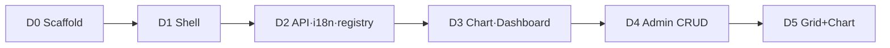

<!--
 @file apps/demo/.docs/plan.md
 @description Implementation plan and quality gates for @gen-office/demo.

 @created 2026-06-28

 @remark
 - Phase D0~D3: grid 없이 착수 가능
 - Phase D4~D5: gen-datagrid 합류 후
 - Architecture: architecture.md
-->
# @gen-office/demo 구현 Plan

gen-datagrid가 아직 workspace에 없어도 **shell·인프라·차트 demo 페이지**부터 진행합니다. 그리드 CRUD 화면은 **합류 후** 일괄 전환합니다.

## 0. 진행 방식



| 단계 | 명령 | 통과 기준 |
| --- | --- | --- |
| dev | `pnpm -C apps/demo dev` | 로그인·shell·탭 오픈 |
| build | `pnpm -C apps/demo build` | Vite build error 0 |
| monorepo | `pnpm build` | turbo chain demo 포함 |
| 수동 | backend 연동 또는 mock | 메뉴 1건 → MDI 탭 |

**Gate 규칙:** D(n) 완료 전 D(n+1) 착수 금지. 완료 시 `implementation-log.md`에 기록.

---

## 1. Phase 요약

| Phase | 이름 | grid 필요 | 선행 | 상태 |
| --- | --- | --- | --- | --- |
| **D0** | Scaffold | 아니오 | `theme`, `ui`, `mdi` | ✅ |
| **D1** | App shell + MDI | 아니오 | D0 | ✅ |
| **D2** | API · menu · registry · i18n | 아니오 | D1 | ✅ |
| **D3** | Chart / Dashboard demo | 아니오 | D2, gen-chart Phase 1 ✅ | ✅ |
| **D4** | Admin CRUD 페이지 | **예** | D3, gen-datagrid-crud | ⏸ |
| **D5** | Actuals · grid 시연 | **예** | D4, gen-datagrid-chart | ⏸ |

```text
[지금]     D0 → D1 → D2 → D3
[합류 후]  gen-datagrid MVP → gen-datagrid-crud → D4 → gen-datagrid-chart → D5
```

---

## 2. D0 — Scaffold

**목표:** `pnpm -C apps/demo dev` 및 turbo `pnpm dev` 복구.

### 완료 조건

- [x] `package.json` — `name: @gen-office/demo`, workspace deps
- [x] Vite 6 + TS (`esbuild` JSX — `@vitejs/plugin-react` 6는 vite 6.4 exports 이슈)
- [x] `index.html`, `src/main.tsx` — theme CSS, React 19 root
- [x] `App.tsx` placeholder — "GenOffice V2 Demo"
- [x] `tsconfig.json` — extends `packages/tsconfig`
- [x] turbo / root scripts 인식

### 검증

```bash
pnpm install
pnpm -C apps/demo dev
pnpm -C apps/demo build
```

### V1 참조

- `frontend/apps/demo/package.json`, `vite.config.ts`, `index.html`

### 제외

- auth, MDI, 페이지 이식

---

## 3. D1 — App shell + MDI

**목표:** 로그인 분기·전체 높이 shell·MDI 탭 1개 오픈.

### 완료 조건

- [x] `AppProviders` — `ThemeProvider`, 기본 context
- [x] `AppShell` — header + `main` flex (`min-height: 0`)
- [x] `MDIContainer` mount — `maxTabs`, `tabPosition`
- [x] `onOpenPage` stub — 하드코딩 탭 1개 (Placeholder 페이지)
- [x] Login 화면 분기 (mock login 허용)
- [x] `onMaxTabsReached` — ui toast 또는 alert (앱 책임, [mdi README](../../packages/mdi/.docs/README.md))

### 레이아웃 Gate

- [x] `100vh` chain — MDI TabPanel 내부 스크롤만 발생
- [x] Storybook `MDI/MDIContainer`와 동일 flex 규칙

### V1 참조

- `app/App.tsx`, `AppShell`, login 컴포넌트

---

## 4. D2 — API · menu · registry · i18n

**목표:** 메뉴 클릭 → registry → lazy page → MDI 탭 (backend 또는 mock).

### 완료 조건

- [x] `shared/api/httpClient` — base URL, credentials, error shape
- [x] `csrf` — mutating request 정책
- [x] `authApi` — login / logout / session check
- [x] `useAppMenu` — API 또는 static mock
- [x] `componentRegistry.dynamic.ts` — `componentName` → `lazy()`
- [x] 최소 registry 항목: `PlaceholderPage`, (D3용) `ChartDemoPage`, `DashboardDemoPage` 슬롯
- [x] `i18n` bootstrap — ko 기본, 키 구조 V1 호환
- [x] `PageHeader` / `AdminPageLayout` — V1 CSS 모듈 이식 또는 ui 조합

### mock 모드

backend 없이 개발할 수 있도록:

```ts
// .env.development — VITE_USE_MOCK_MENU=true (기본)
const menuItems = [{ componentName: 'PlaceholderPage', titleKey: 'menu.placeholder', pageId: '...' }];
```

### Gate

- [x] 메뉴 3클릭 — 탭 추가·전환·닫기
- [x] 동일 `pageId` 재오픈 — 새 탭 없이 activate
- [x] lazy chunk 로드 — build 산출물에서 페이지별 chunk 분리 확인

---

## 5. D3 — Chart / Dashboard (gen-chart)

**목표:** V1 `ChartDemoPage` / `DashboardDemoPage` 시나리오를 V2 composable API로 demo에 구현.  
gen-chart **C8의 demo 부분을 선행** 완료 ([phase.md](../../packages/gen-chart/.docs/phase.md)).

### 완료 조건

- [x] `pages/demo/ChartDemoPage.tsx`
  - line, bar, area, composed, pie, donut 섹션 (또는 탭/앵커)
  - `ResponsiveChartContainer` + `ChartRoot`
- [x] `pages/demo/DashboardDemoPage.tsx`
  - 카드 그리드 2×2 — C7 Dashboard story 패턴
  - tooltip / legend where applicable
- [x] registry 등록 + 메뉴 항목
- [x] MDI 탭 안에서 resize 시 차트 reflow

### 검증

- [x] 창 리사이즈 · MDI 탭 전환 후 차트 정상 (수동)
- [x] V1 demo와 **시각·시나리오** 대등 (픽셀 동일 불필요)

### 제외 (gen-chart Phase 2)

- motion emphasis / selection
- treemap

---

## 6. D4 — Admin CRUD (합류 후)

**상태:** ⏸ `gen-datagrid` Gate 8 + `gen-datagrid-crud` scaffold 선행

### 선행 조건

- [ ] `packages/gen-datagrid` workspace 존재 · public API 안정
- [ ] `packages/gen-datagrid-crud` — 최소 `GenDataGridCrud` smoke
- [ ] column meta · handle 타입 합의 ([06-PACKAGE-REVIEW-PLAN §6](../../.docs/06-PACKAGE-REVIEW-PLAN.md#6-다른-agentgen-datagrid와의-합류))

### 완료 조건 (우선순위)

| 순서 | 페이지 | V1 참조 |
| --- | --- | --- |
| 1 | UserManagement | reference CRUD 패턴 |
| 2 | MenuManagement | 계층·트리 |
| 3 | LkupManagement | lookup modal |
| 4 | RoleManagement | |
| 5 | Notice / Message / UserRole | |

각 페이지:

- [ ] `GenGrid*` import **zero**
- [ ] `AdminPageLayout` + `GenDataGridCrud`
- [ ] flex height — grid 스크롤 정상
- [ ] mock·실 API smoke

### Gate

- [ ] `apps/demo` 전체 grep — `gen-grid` 없음
- [ ] UserManagement CRUD 한 사이클 (조회·추가·저장·취소)

---

## 7. D5 — Grid + Chart 통합 (합류 후)

**상태:** ⏸ `gen-datagrid-chart` 선행

### 완료 조건

- [ ] `packages/gen-datagrid-chart` — `rangeToChartOptions`
- [ ] ActualsPage — grid selection → chart preview
- [ ] `pages/demo/*` 그리드 시연 페이지 V2 전환
- [ ] gen-chart Phase 2 C8 체크리스트 완료

### Gate

- [ ] demo에 V1 `GenChart` import 없음
- [ ] range select → preview dialog 동작

---

## 8. V1 이식 체크리스트

### 그대로 이식 (D0~D2)

| 영역 | V1 경로 |
| --- | --- |
| shell·login | `app/` |
| API client | `shared/api/` |
| menu·registry | `app/menu/`, `app/config/` |
| i18n | `i18n/` |
| PageHeader | `components/PageHeader/` |

### 재작성 (D3~D5)

| 영역 | V2 |
| --- | --- |
| Chart/Dashboard | `gen-chart` composable |
| admin CRUD | `gen-datagrid-crud` |
| range chart | `gen-datagrid-chart` |

### 이식 안 함

- `gen-grid`, `gen-grid-crud`, `gen-grid-chart`
- V1 `packages/gen-chart`

---

## 9. 리스크·대응

| 리스크 | 대응 |
| --- | --- |
| grid API 미확정으로 admin 착수 | D4까지 보류; D3로 chart 검증 선행 |
| backend 미기동 | mock menu + mock auth (D2) |
| MDI·grid height 붕괴 | architecture §5 flex chain Gate |
| V1·V2 메뉴 componentName 불일치 | registry에 alias map |
| React 19 + Radix | ui 패키지와 동일 peer |

---

## 10. 로드맵 · 패키지 리뷰 매핑

| 본 Plan | [04-ROADMAP](../../.docs/04-ROADMAP.md) | [06-PACKAGE-REVIEW](../../.docs/06-PACKAGE-REVIEW-PLAN.md) |
| --- | --- | --- |
| D0~D2 | Phase 3 전반 (shell) | §9 apps/demo |
| D3 | Phase 4 일부 (chart demo) | gen-chart Phase 2 선행 |
| D4 | Phase 3 admin | gen-datagrid-crud 후 |
| D5 | Phase 4 | gen-datagrid-chart |

---

## 11. 구현 로그

완료·설계 변경은 [implementation-log.md](./implementation-log.md)에 역시간순(한국어)으로 기록합니다.
