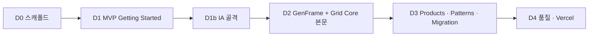

<!--
 @file apps/docs/.docs/plan/docs-site-plan.md
 @description Development plan for the GenOffice public documentation site (apps/docs).

 @created 2026-07-13

 @updated 2026-07-13

 @remark
 - AG Grid Getting Started / Key Features 학습 경로를 벤치마크하되, React 전용·모노레포에 맞게 축소한다.
 - 공개 Docs ≠ 내부 `.docs`(Gate/architecture). Storybook·demo와 역할 분리.
 - 스택: **Fumadocs + Next.js** (MDX). 배포: Vercel. 언어: 한/영. 범위: 외부 공개.
 - Vercel: demo / docs 각각 독립 Project (동일 Git repo).
 - §8 결정은 2026-07-13 확정. 추가 변경 시 decisions 로그와 함께 갱신.
 - 2026-07-13: Quick Start 정본 경로 = GenFrame 첫 앱 (그리드-only는 Key Features).
 - 2026-07-13: D0·D1·D1b 완료. 다음 = D2 (GenFrame + Grid Core 본문). Phase §6 재정리.
-->
# GenOffice Docs 사이트 개발 계획

`apps/docs`에 **외부 공개 문서 사이트**를 두는 계획이다.  
벤치마크: [AG Grid Getting Started](https://www.ag-grid.com/javascript-data-grid/getting-started/) · Key Features 학습 경로.

구현 착수 전 본 문서로 IA·스택·Phase·배포를 고정한다. 앱 스캐폴드는 Phase D0 이후.

---

## 0. 목표·비목표

### 목표

- **새 백오피스 앱**을 GenFrame(셸 · 메뉴 · workarea)으로 시작하는 Quick Start를 제공한다.
- GenDataGrid / GenDataGridCrud를 shell 이후(또는 그리드-only 트랙) **Key Features → Tutorials** 순으로 학습할 수 있게 한다.
- 문서 페이지에 **동작하는 React 라이브 예제**를 둔다 (AG Grid의 live example에 대응).
- `apps/demo`·`apps/storybook`과 **역할이 겹치지 않게** 배포·유지한다.
- 동일 monorepo에서 **Vercel로 docs / demo를 각각 배포**할 수 있게 한다.

### 비목표 (초기)

- AG Grid식 멀티 프레임워크(JS/Angular/Vue) 문서·예제 codegen
- Astro + Markdoc + SystemJS example runner 전체 복제
- 내부 Gate 번호·architecture 문서를 공개 사이트로 그대로 승격
- Day-1 CodeSandbox/Plunker 자동화 파이프라인
- Community vs Enterprise 라이선스 IA

---

## 1. 문서·앱 역할 분리

```text
1) 루트·packages `.docs/`     → 내부: Gate, architecture, agent, 결정 로그
2) apps/storybook             → 컴포넌트 카탈로그 · 시각/interaction 검증
3) apps/docs (본 계획)        → 설치 · 개념 · 튜토리얼 · API · Patterns
4) apps/demo                  → 통합 레퍼런스 백오피스 (실전 화면 deep-link)
```

| 층 | 독자 | 톤 |
| --- | --- | --- |
| 내부 `.docs` | 기여자·에이전트 | Gate, 계약, 이력 |
| Storybook | 기여자·QA | 스토리·controls |
| **Docs** | 앱 개발자 | 제품 기능 언어 (Columns, Editing, ActionBar) |
| Demo | 제품·연동 검증 | 전체 앱 시나리오 |

공개 Docs는 **기능 이름**으로 쓰고, Gate/QA 문서는 링크만 유지한다.

---

## 2. AG Grid에서 가져올 것 / 버릴 것

| 가져올 것 | GenOffice 적용 | 복제하지 않음 |
| --- | --- | --- |
| Quick Start → Key Features → Tutorials | 60초 그리드 / First CRUD Page | 멀티 프레임워크 탭 |
| 기능별 문서 + 라이브 예제 | React MDX/컴포넌트 임베드 | Astro+Markdoc 전체 |
| “Next Steps” 카드 | 패키지 간 학습 경로 | Enterprise 라이선스 분기 |
| Code 보기 / 외부 샌드박스 | 후순위 StackBlitz 또는 Storybook 링크 | Plunker 필수 |
| API Reference 분리 | MDX 또는 TypeDoc 부분 생성 | Day-1 자동 codegen |

GenOffice는 **React 단일 스택**이므로 AG Grid 문서 공수의 상당 부분이 불필요하다.

---

## 3. 정보 구조 (IA)

```text
Getting Started
  Quick Start              ← GenFrame 첫 백오피스 앱 (셸 · 메뉴 · 첫 페이지 그리드)
  Installation             ← pnpm / workspace · 스타터 패키지 세트
  Key Features             ← GenDataGrid 선택·편집·필터·정렬 등 요약 (그리드 트랙)
  First CRUD Page          ← GenDataGridCrud + ActionBar
  Theme & UI Setup         ← ThemeProvider · tokens

Products (패키지)
  GenFrame / MDI
  GenDataGrid
  GenDataGridCrud
  GenChart
  UI / Theme

GenDataGrid — Core
  Columns · Rows · Cells · Filtering · Selection
  Editing · Clipboard · Virtualization · Layout

GenDataGrid — Advanced
  Master Detail · Tree · Merge/Span · Nested Grid · Performance

Patterns
  Admin CRUD · FilterBar + Grid · Lookup Modal · Chart from selection

API Reference
  패키지별 props / handle / types

Migration (V1 → V2)
  gen-grid → gen-datagrid (기존 api-comparison 재가공)
```

홈의 첫 CTA는 **Create your first app (GenFrame Quick Start)** 로 둔다.  
그리드-only 임베드는 Key Features / 별도 트랙으로 안내한다.

**사이드바:** 위 IA 섹션은 Left Panel에 **폴더 골격으로 고정**한다. Getting Started만 본문이 채워져 있고, Products 이하는 placeholder MDX(추후 Phase에서 채움). 재생성: `node apps/docs/scripts/scaffold-ia-skeleton.mjs` (스텁만 덮어씀).

---

## 4. 기술 스택

### 후보

| 옵션 | 장점 | 단점 | 판정 |
| --- | --- | --- | --- |
| A. Storybook Docs only | 이미 존재 | 튜토리얼·SEO·검색 약함 | 비채택 |
| B. `apps/docs` + Vite + MDX | React 라이브 예제 자연스러움 | 문서 UX·검색을 직접 구축 | 비채택 |
| **C. Fumadocs + Next.js** | MDX·검색·레이아웃·Vercel 적합 | 모노레포에 Next 런타임 추가 | **채택 (2026-07-13)** |
| D. Docusaurus / VitePress | 문서 사이트 관례 | React playground 연동 부담 | 비채택 |
| E. AG Grid식 Astro+Markdoc | 확장성 | React-only에 과투자 | 비채택 |

**채택: Fumadocs + Next.js + Fumadocs MDX.**

- 검색: Orama (Fumadocs 기본)
- i18n: 한/영 (Fumadocs i18n — D0 스캐폴드 후 D1에서 본문 병행)
- Storybook: 카탈로그 유지, Docs에서는 “Open in Storybook” 링크
- 패키지명: `@gen-office/docs` (private app)
- 예제: MDX 안 React 컴포넌트 / `src/examples` (D1+) — `@gen-office/*` workspace 의존

### 예제 전략

1. Canonical examples: `apps/docs/src/examples/` (또는 공유 모듈) — Docs·필요 시 Storybook이 재사용
2. 페이지 패턴: 짧은 설명 → 최소 코드 → **Live preview** → Next Steps
3. Day-1에 CodeSandbox 자동화 없음. 필요 시 StackBlitz / Storybook 링크
4. `GenDataGrid.baseline.stories.tsx` 등 대형 baseline은 **공개 Docs에 복붙하지 않음** — 짧은 시나리오만 추출

### 콘텐츠 소스 매핑 (재가공)

| 공개 Docs | 내부 소스 |
| --- | --- |
| Quick Start (앱) | `gen-frame` stories · architecture · `apps/demo` AppShell |
| Key Features / Editing | `gen-datagrid` stories · `api-structure.md` |
| CRUD 튜토리얼 | `gen-datagrid-crud` stories · `workflow-patterns.md` |
| Theme | `.docs/08-DESIGN-TOKENS-GUIDE.md` (개발자용으로 재구성) |
| V1 차이 | `api-comparison-with-gen-grid.md` |
| Chart | `.docs/05-GEN-CHART.md` · `packages/gen-chart/.docs` |

Gate/QA 문서는 공개 사이트로 **승격하지 않는다**.

---

## 5. Vercel 배포

동일 Git 저장소에 **Vercel Project를 두 개**(또는 세 개) 둔다.

| Vercel Project | 대상 | 도메인 예 |
| --- | --- | --- |
| `genoffice-demo` | `apps/demo` | `demo.…` |
| `genoffice-docs` | `apps/docs` | `docs.…` |
| (선택) `genoffice-storybook` | `apps/storybook` | `storybook.…` |

### 권장 빌드 설정 (pnpm monorepo)

- **Root Directory**: 저장소 루트 `/` (workspace install 유지)
- **Install**: `pnpm install`
- **Build (docs)**: `pnpm turbo run build --filter=@gen-office/docs...`  
  (의존 패키지까지 포함)
- **Output**: Next.js (`.next`) — Vercel Framework Preset **Next.js**
- SPA `vercel.json` rewrite는 **불필요** (Next App Router)

한 Project에서 `/`와 `/docs`를 path로 합치는 방식은 빌드·라우팅이 복잡해 **비권장**.

레포에 `vercel.json`은 아직 없음 — D0/D1에서 앱별 또는 루트 설정을 추가한다.

---

## 6. Phase 계획



| Phase | 이름 | 내용 | 완료 기준 | 상태 |
| --- | --- | --- | --- | --- |
| **D0** | 결정·스캐폴드 | §8 확정, Fumadocs 앱, workspace | `dev` · `build` 통과 | ✅ |
| **D1** | MVP Getting Started | 홈 · Quick Start(GenFrame) · Install · Key Features · First CRUD · Theme · 한/영 · 라이브 예제 | 6페이지 + build | ✅ |
| **D1b** | IA 골격 | Left Panel에 Products / Grid Core·Advanced / Patterns / API / Migration 폴더 + placeholder | 사이드바 구조 고정 · build | ✅ |
| **D2** | GenFrame + Grid Core 본문 | (1) Products GenFrame 개요·네비 경로 (2) Gate 완료 범위의 Core 페이지 + live example | GenFrame 개요 실문서 + Core 4페이지 이상 | ⏸ **다음** |
| **D3** | Products · Patterns · Migration | Crud/Chart/UI 개요, Patterns 3+, Migration 초안, demo deep-link | Patterns 3 · Migration 1 | ⏸ |
| **D4** | 품질·배포 | Vercel docs Project, metadataBase, 검색 점검, broken-link, 버전 표기, PR 체크리스트 | preview URL | ⏸ |

**Gate 규칙:** D(n) 완료 전 D(n+1) 본격 착수 금지. 완료 시 `implementation-log.md`에 기록.  
Advanced / API Reference는 D2~D3에서 **Gate·공개 API가 안정된 항목만** 채우고, 나머지는 placeholder 유지.

### 현재 진행 스냅샷 (2026-07-13)

| 영역 | 상태 |
| --- | --- |
| 스택·i18n·로컬 build | ✅ |
| Getting Started 본문 (en/ko) | ✅ (Quick Start = GenFrame 첫 앱) |
| 라이브 예제 | ✅ QuickStartApp / Grid / Editable / Crud |
| Left Panel IA | ✅ 골격만 (Products 이하 placeholder) |
| theme/ui CSS ↔ Fumadocs 격리 | ✅ (tokens + ui-modules extract) |
| next-themes React script 경고 | ✅ (docs shim) |
| Vercel docs Project | ❌ |
| Grid Core·Advanced·Patterns·API 본문 | ❌ placeholder |
| ko Getting Started 일부 영문 타이틀 잔여 | 소량 polish |

### D1 / D1b 체크리스트

- [x] Home — 첫 앱 CTA
- [x] Quick Start — GenFrame + SinglePageHost + 그리드
- [x] Installation · Key Features · First CRUD · Theme
- [x] 한/영 i18n
- [x] IA 폴더 골격 (placeholder)

### D2 체크리스트 (다음 착수)

- [ ] `products/gen-frame` — 셸·layout·single vs MDI·높이 계약 (architecture 재가공)
- [ ] `products/gen-datagrid` — 한 페이지 개요 (Key Features와 중복 최소화)
- [ ] `grid-core` — Gate 완료 기능부터 채움 (권장 순서: Columns → Editing → Selection → Filtering)
- [ ] 페이지당 짧은 live example (`src/examples`)
- [ ] Storybook “Open in …” 링크 (해당 시)
- [ ] Advanced·미완료 Gate는 placeholder 유지

### D3 체크리스트

- [ ] Products: Crud · Chart · UI/Theme 개요
- [ ] Patterns 3종 (Admin CRUD · FilterBar+Grid · Lookup 등, demo 링크)
- [ ] Migration: gen-grid → gen-datagrid 초안
- [ ] API Reference: 수동 props 표 또는 TypeDoc 부분 (범위 축소 가능)

### D4 체크리스트

- [ ] Vercel `genoffice-docs` Project (루트 install · filter build)
- [ ] `metadataBase` · OG
- [ ] 검색(Orama) 한/영 스모크
- [ ] broken-link / placeholder 표시 정책
- [ ] PR Docs 체크리스트

### 로드맵 타이밍

| 시점 | 권장 |
| --- | --- |
| **지금** | D2 — GenFrame 제품 문서 + Grid Core 본문 (IA는 이미 고정) |
| **데모·패키지 API 안정 구간** | D3 Patterns · Migration |
| **외부 공개 직전** | D4 Vercel · 품질 |

Demo가 흔들릴 때 Patterns·deep-link를 많이 쓰면 이중 유지보수 비용이 크다.  
**D2의 GenFrame·Grid Core는 demo와 독립**이므로 지금 진행해도 된다.

---

## 7. 디렉터리 예상 (D0 이후)

```text
apps/docs/
  .docs/                 ← 본 계획 (내부)
  package.json           ← @gen-office/docs
  next.config.ts
  source.config.ts
  content/docs/          ← MDX (한/영은 i18n 경로로 확장)
  src/app/               ← Next App Router (+ Fumadocs)
  src/examples/          ← canonical live examples (D1+)
  public/
```

D0에서 Fumadocs CLI 템플릿(`+next+fuma-docs-mdx`)으로 고정. SPA `vercel.json` rewrite는 Next 사용 시 불필요.

---

## 8. 결정 (2026-07-13 확정)

| # | 항목 | 결정 |
| --- | --- | --- |
| 1 | 언어 | **한/영** (이중 언어) |
| 2 | 공개 범위 | **외부 공개** |
| 3 | 호스트 | **Vercel** (커스텀 도메인은 추후) |
| 4 | 문서 스택 | **Fumadocs** (Next.js + Fumadocs MDX) |
| 5 | 착수 | **지금** (D0부터) |

정본 로그: [`.docs/logs/decisions.md`](../../../../.docs/logs/decisions.md) (2026-07-13).

---

## 9. 검증

| 단계 | 명령 | 통과 기준 |
| --- | --- | --- |
| dev | `pnpm -C apps/docs dev` | Fumadocs 셸·샘플 MDX 렌더 |
| build | `pnpm -C apps/docs build` | Next build error 0 |
| monorepo | `pnpm turbo run build --filter=@gen-office/docs` | turbo 통과 |
| encoding | `pnpm check:encoding` (해당 시) | UTF-8 가드 |

---

## 10. 참고

- [AG Grid Quick Start](https://www.ag-grid.com/javascript-data-grid/getting-started/)
- [AG Grid Key Features](https://www.ag-grid.com/javascript-data-grid/key-features/)
- [`.docs/01-OVERVIEW.md`](../../../../.docs/01-OVERVIEW.md)
- [apps/demo plan](../../../demo/.docs/plan/plan.md)
- [gen-datagrid-crud workflow-patterns](../../../../packages/gen-datagrid-crud/.docs/workflow-patterns.md)
