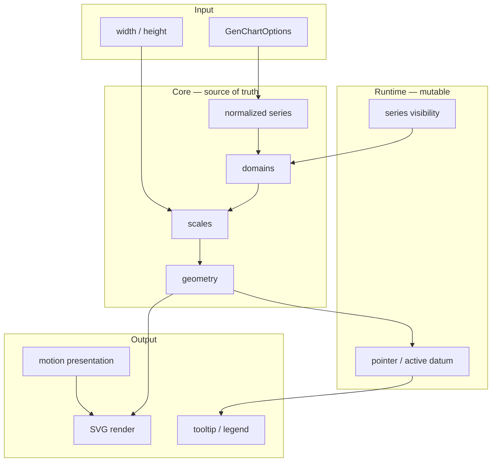

<!--
 @file packages/gen-chart/.docs/architecture.md
 @description Package structure, state model, public API, and data flow for @gen-office/gen-chart.

 @created 2026-06-27

 @remark
 - V1 참조: frontend/docs/gen-chart, frontend/packages/gen-chart (코드 이식 금지)
 - Gates: gates.md
 - Repository overview: .docs/05-GEN-CHART.md
-->
# @gen-office/gen-chart 아키텍처

GenOffice V2 **재사용 차트 엔진** 패키지입니다.

- **Headless core** — domain, scale, geometry, hit-test (React·visx 무관)
- **Composable React** — plot별 chart + slot primitives + chrome
- **Internal renderer** — visx는 `internal/visx`에만 격리; core는 `d3-scale` 직접 사용
- **V1 monolith `GenChart` API** — 채택하지 않음 (코드 이식 금지)

gen-datagrid와 같은 분리 패턴:

```text
gen-datagrid:  TanStack Table state  +  div renderer
gen-chart:     createChartModel      +  SVG renderer (visx internal)
```

---

## 1. 패키지 역할·경계

| OK (`gen-chart`) | NOT OK (다른 패키지) |
| --- | --- |
| 차트 모델, scale, geometry, hit-test | grid selection UI (`gen-datagrid-chart`) |
| SVG series / axis / grid 렌더 | CRUD·그리드 로직 |
| tooltip, legend, motion presentation | 범용 Dialog·Button (`ui`) |
| `ChartTokens` 정의·해석 | CSS semantic 토큰 소스 (`theme`) |

### 의존 방향

```text
apps/demo, apps/storybook-all
        ↓
gen-datagrid-chart  (range → GenChartOptions, preview dialog)
        ↓
@gen-office/gen-chart
        ↓
@gen-office/theme , d3-scale , d3-array , d3-shape
        ↓
@visx/* (internal/visx only)
        ↓
react , react-dom
```

`gen-chart`는 `gen-datagrid`·`mdi`와 **역방향 의존 없음**.

---

## 2. V1 분석 (중립적)

### 2.1 V1의 세 레이어

| 레이어 | 내용 | V2 판단 |
| --- | --- | --- |
| `api-draft.md` | headless + composable | **공식 API 방향** — 구현은 V2에서 새로 |
| `visx-rewrite-plan.md` | monolith `GenChart` + `kind` | 참고만 (visx 범위·kind 목록) |
| `GenChart.tsx` (~1,700줄) | visx + CSS enter motion | **이식 금지** — 수용 기준·정책 참고 |

### 2.2 V1 실패 원인 (라이브러리 문제 아님)

1. 계산과 렌더 경계 부재 — scale/domain/tooltip이 JSX에 혼재
2. 공개 API 이중화 — composable 초안 vs monolith 구현
3. headless 계약 미완 — visibility·hit-test 미동작 (`api-draft` Phase 1 pending)
4. core 단위 테스트 부재
5. Cartesian / polar / treemap이 `kind` 단일 분기

### 2.3 V1에서 가져올 것 / 버릴 것

| 버림 | 가져옴 (개념·수용 기준) |
| --- | --- |
| `GenChart` monolith, `kind` union | demo `ChartDemoPage` / `DashboardDemoPage` 시나리오 |
| V1 API 호환 | warning `GC001`~`GC005` |
| monolith 내 motion 로직 | enter CSS 정책, `mode: enter \| reset-on-change` |
| `api-draft`의 “motion 미구현” 전제 | monolith에는 CSS enter **있음** — V2는 분리 재구현 |

---

## 3. 디렉터리 구조

```text
packages/gen-chart/
├── .docs/
│   ├── README.md
│   ├── architecture.md        # 본 문서
│   ├── gates.md
│   └── implementation-log.md
├── src/
│   ├── index.ts               # public barrel export ONLY
│   ├── index.css              # chrome + motion keyframes
│   │
│   ├── types/                 # public-facing 타입
│   │   ├── options.ts
│   │   ├── series.ts
│   │   ├── model.ts
│   │   └── interaction.ts
│   │
│   ├── core/                  # React ❌  visx ❌
│   │   ├── warnings.ts
│   │   ├── normalizeSeries.ts
│   │   ├── domain/
│   │   ├── scale/             # d3-scale
│   │   ├── geometry/
│   │   │   ├── cartesian/
│   │   │   └── polar/
│   │   ├── layout/
│   │   ├── hit-test/
│   │   └── model/
│   │       ├── createCartesianModel.ts
│   │       └── createPolarModel.ts
│   │
│   ├── themes/
│   │   ├── resolveChartTokens.ts
│   │   ├── lightChartTokens.ts
│   │   └── darkChartTokens.ts
│   │
│   ├── react/
│   │   ├── context/
│   │   ├── hooks/
│   │   │   ├── useGenChart.ts
│   │   │   ├── useChartInteraction.ts
│   │   │   └── useChartMotion.ts
│   │   ├── components/
│   │   │   ├── ChartRoot.tsx
│   │   │   ├── ResponsiveChartContainer.tsx
│   │   │   ├── cartesian/
│   │   │   ├── polar/
│   │   │   └── chrome/
│   │   └── motion/
│   │
│   └── internal/              # deep import 금지
│       └── visx/
│
├── test/
│   ├── core/
│   └── react/
└── stories/
```

### 모듈 책임

| 모듈 | 입력 | 출력 | 검증 |
| --- | --- | --- | --- |
| `core/domain` | series, axis options, visibility | domain tuples | vitest |
| `core/geometry` | scales, datum | rect, path, points | vitest |
| `core/hit-test` | geometry, pointer | nearest datum | vitest |
| `internal/visx` | geometry | SVG JSX | Storybook |
| `react/motion` | motion options | className, render key | Storybook |

---

## 4. 상태·데이터 모델

### 4.1 상태 종류



| 종류 | 설명 |
| --- | --- |
| **Options** | consumer 입력 — `series`, axis, tokens, motion |
| **Model (core)** | domain·scale·geometry·hit-test; visibility 반영 후 **즉시** 재계산 |
| **Interaction (react)** | pointer, tooltip position |
| **Motion (react)** | render key, CSS; **core는 모름** |

### 4.2 Plot 분리 (monolith `kind` 대체)

차트 전역 `type` / `kind` 대신 **plot 컴포넌트**로 분기합니다.

| Plot | 컴포넌트 | model 팩토리 |
| --- | --- | --- |
| Cartesian | `CartesianChart` | `createCartesianModel` |
| Polar | `PolarChart` | `createPolarModel` |
| Hierarchy | `TreemapChart` (Phase 2) | `createTreemapModel` |

**composed**는 별도 plot이 아닙니다. `CartesianChart` 안에서 **시리즈별 `type: 'line' \| 'bar' \| 'area'`** 로 처리합니다.

### 4.3 `CartesianChartModel` 계약 (요약)

```ts
interface CartesianChartModel<TDatum> {
  options: CartesianChartOptions<TDatum>;
  visibleSeries: ChartSeries<TDatum>[];
  plotArea: { x: number; y: number; width: number; height: number };

  xScale: Scale;
  yScale: Scale;

  visibility: ReadonlyMap<string, boolean>;
  toggleSeries(id: string): void;
  setSeriesVisibility(id: string, visible: boolean): void;

  getNearestDatum(xPx: number, yPx: number): NearestDatumResult<TDatum> | null;

  getLineGeometry(seriesId: string): LineGeometry | null;
  getBarGeometries(seriesId: string): BarRect[];
  // ...
}
```

- `toggleSeries` 시 `visibleSeries` + `yDomain` + geometry **동기 재계산**
- `getNearestDatum`은 **목표 geometry** 기준 (motion 중 tooltip 안정)

### 4.4 Layout

legend는 **HTML chrome**, plot은 **SVG** (V1 flex 패턴 계승):

```text
ChartRoot (flex column)
├── ChartLegend?          HTML
└── CartesianPlot         SVG (flex 1)
    ├── Grid / Axes / Series
    └── ChartTooltip      absolute HTML overlay
```

`computePlotArea` — tokens padding + legend reserve 높이 반영.

---

## 5. Public API

### 5.1 Export 계층

| 계층 | 대상 | 예 |
| --- | --- | --- |
| **L0 Headless** | `gen-datagrid-chart`, 테스트 | `createCartesianModel`, `CartesianChartOptions` |
| **L1 Hook** | 앱·커스텀 UI | `useGenChart` |
| **L2 Composable** | 일반 소비자 | `ChartRoot`, `CartesianChart`, `LineSeries`, … |
| **L3 Convenience** | (비-MVP) | `SimpleCartesianChart` — 필요 시 Phase 3+ |

MVP는 **L0~L2**. V1 `GenChart` 단일 진입점은 만들지 않습니다.

### 5.2 사용 예 (목표)

```tsx
<ResponsiveChartContainer minHeight={240}>
  {({ width, height, ready }) =>
    ready ? (
      <ChartRoot
        width={width}
        height={height}
        options={{
          series: [
            { id: 'revenue', type: 'line', data, x: (d) => d.date, y: (d) => d.revenue },
            { id: 'cost', type: 'bar', data, x: (d) => d.date, y: (d) => d.cost },
          ],
          xAxis: { tickFormat: formatMonth },
          interactive: { tooltip: true, legend: true },
          motion: { mode: 'enter', durationMs: 240 },
        }}
      >
        <CartesianChart>
          <ChartGrid />
          <ChartXAxis />
          <ChartYAxis />
          <BarSeries seriesId="cost" />
          <LineSeries seriesId="revenue" />
          <ChartTooltip />
          <ChartLegend />
        </CartesianChart>
      </ChartRoot>
    ) : null
  }
</ResponsiveChartContainer>
```

`ChartRoot` — context + `useGenChart`. `CartesianChart` — plot context 설정.

### 5.3 Public export (`src/index.ts` 목표)

| 그룹 | 심볼 |
| --- | --- |
| Core | `createCartesianModel`, `createPolarModel` |
| Types | `CartesianChartOptions`, `ChartSeries`, `ChartMotionOptions`, … |
| Hooks | `useGenChart` |
| Layout | `ChartRoot`, `ResponsiveChartContainer` |
| Cartesian | `CartesianChart`, `ChartGrid`, `ChartXAxis`, `ChartYAxis`, `LineSeries`, `BarSeries`, `AreaSeries` |
| Polar | `PolarChart`, `PieSeries`, `DonutSeries` |
| Chrome | `ChartTooltip`, `ChartLegend` |
| Themes | `resolveChartTokens`, `lightChartTokens`, `darkChartTokens` |

소비자는 deep import (`gen-chart/src/core/...`) **금지**.

---

## 6. 합의된 설계 결정

| 주제 | 결정 |
| --- | --- |
| 렌더러 | visx — `internal/visx` only; Recharts **미채택** |
| core scale | `d3-scale` 직접 (visx scale을 core에 넣지 않음) |
| composed | chart-level `type` 없음; **시리즈별 `type`** |
| Date 축 | 기본 `Intl.DateTimeFormat`; `xAxis.tickFormat` override |
| dual Y축 | MVP 제외; `yAxisId` 타입만 reserved |
| motion MVP | C6b — lifecycle enter만; emphasis/selection/visibility motion은 [motion.md](./motion.md) Phase 2 |
| bar 용어 | API `bar`, 문서/UI `column` 허용 |
| ChartTokens | **gen-chart/themes** 소유 ([decisions.md](../../../.docs/logs/decisions.md) D4) |
| treemap | Cartesian MVP 이후 Phase 2 (`@visx/hierarchy`) |

---

## 7. Motion · Interaction Animation

상세: **[motion.md](./motion.md)**

차트의 **움직임은 네 계층**으로 나눕니다. API를 `ChartMotionOptions` 하나에 몰지 않습니다.

| 계층 | 옵션 (목표) | 트리거 | core 영향 | 시점 |
| --- | --- | --- | --- | --- |
| **Lifecycle** | `motion` | mount, `changeKey` | 없음 | C6b ✅ |
| **Emphasis** | `interactive.emphasis` | hover / nearest | 없음 | Phase 2 |
| **Selection** | `interactive.selection` | click | 없음 | Phase 2 |
| **Visibility** | `interactive.visibilityMotion` | legend toggle | geometry 즉시 재계산 (C6); 연출만 Phase 2 | C6 기능 ✅ / motion Phase 2 |

```text
core              → 항상 최종값 (domain, bar height, visibility 반영 geometry)
react/motion      → lifecycle enter만 (CSS, render key)
react/emphasis    → (Phase 2) hover overlay — tooltip hit 공유
react/selection   → (Phase 2) click 유지 강조
react/visibility-motion → (Phase 2) legend fade / y-tween 등
```

### Lifecycle (C6b — 현재 구현)

| 항목 | 정책 |
| --- | --- |
| 기본 | `enabled: true`, `240ms`, `easeOut`, `mode: 'enter'` |
| `prefers-reduced-motion` | lifecycle 비활성 |
| 대용량 | 포인트 합 ≥ 2000 → 자동 비활성 + `GC006` |
| v1 enter | line dash, bar scaleY, area/pie fade-scale |

### Phase 2 (연구·구현 연기)

- line point hover 확대, bar click dim, legend toggle fade/scale
- `staggerMs` (pie 30ms 하드코딩 통합), path morph, exit, `y-tween`
- **C7·C8에 필수 아님** — [motion.md §7](./motion.md#7-지금-시점-c6b-완료--c7에서-할-일)

**불변:** hit-test·tooltip은 motion/emphasis 프레임이 아닌 **목표 geometry** 기준.

---

## 8. gen-datagrid-chart 연동

```ts
// gen-datagrid-chart (별 패키지)
interface RangeChartInput<T> {
  rows: T[];
  xField: keyof T;
  yFields: Array<keyof T>;
  chartType?: 'line' | 'bar' | 'area';
}

function rangeToChartOptions<T>(input: RangeChartInput<T>): CartesianChartOptions<T>;
```

- 변환 결과는 **`CartesianChartOptions`만** — React 트리 불필요
- preview dialog — `ChartRoot` + `CartesianChart` preset
- grid 패키지에 대한 **역의존 없음**

---

## 9. 의존성 (목표)

```json
{
  "dependencies": {
    "@gen-office/theme": "workspace:*",
    "d3-scale": "^4.x",
    "d3-array": "^3.x",
    "d3-shape": "^3.x",
    "@visx/axis": "^3.12",
    "@visx/grid": "^3.12",
    "@visx/group": "^3.12",
    "@visx/shape": "^3.12",
    "@visx/tooltip": "^3.12",
    "@visx/text": "^3.12"
  },
  "peerDependencies": {
    "react": "18.3.1",
    "react-dom": "18.3.1"
  }
}
```

- `@visx/responsive` 대신 자체 `ResizeObserver` wrapper
- `@visx/hierarchy` — treemap Phase 2까지 보류

---

## 10. 구현 Phase

**패키지 Phase 정본:** [phase.md](./phase.md)

| Phase | Gate | 상태 | 핵심 |
| --- | --- | --- | --- |
| **Phase 1** — 차트 엔진 MVP | C0 ~ C7 | ✅ 마감 (2026-06-27) | core, render, interaction, motion enter, responsive |
| **Phase 2** — 연동·확장 | C8 + backlog | ⏸ 보류 | demo, gen-datagrid-chart, motion 고급, treemap |

```text
[완료] gen-chart Phase 1 (C0~C7)
[대기] gen-datagrid MVP → crud/demo → gen-datagrid-chart → gen-chart Phase 2 (C8+)
```

Gate 상세: [gates.md](./gates.md)

---

## 11. 리스크

| 리스크 | 대응 |
| --- | --- |
| legend·plot layout 순환 | legend HTML 고정 추정 → 추후 measure |
| composed + stacked | C4에서 stacked 우선 |
| ChartTokens vs theme CSS | `.docs`에 D4 임시 정책; 수동 정렬 |
| motion + hit-test | 목표 geometry 고정 |
| scope creep (crosshair, dual Y) | backlog 명시 (crosshair Phase 1.5) |

---

## 12. 관련 문서

- [motion.md](./motion.md) — lifecycle vs emphasis vs selection vs visibility
- [phase.md](./phase.md)
- [gates.md](./gates.md)
- [implementation-log.md](./implementation-log.md)
- [`.docs/05-GEN-CHART.md`](../../../.docs/05-GEN-CHART.md)
- [`.docs/04-ROADMAP.md`](../../../.docs/04-ROADMAP.md)
- V1 `frontend/docs/gen-chart/api-draft.md`
- V1 `frontend/packages/gen-chart/src/GenChart.tsx` (참고만)
