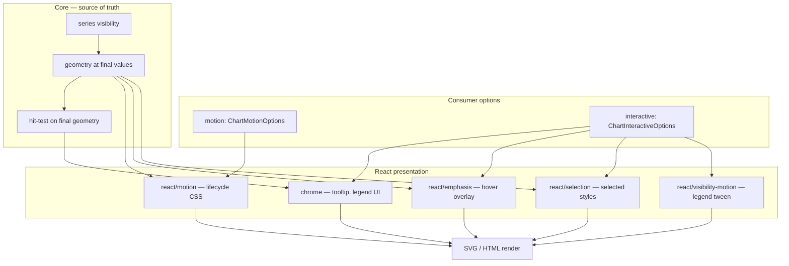

<!--
 @file packages/gen-chart/.docs/motion.md
 @description Motion and interaction-animation architecture for @gen-office/gen-chart.

 @created 2026-06-27

 @remark
 - C6b 구현 범위: lifecycle enter only
 - emphasis / selection / visibility motion은 Phase 2 (별 Gate 없음, 연구 후 착수)
 - 상위 요약: architecture.md §7
-->
# Motion · Interaction Animation 아키텍처

차트에서 **움직임**은 한 가지가 아닙니다. 트리거·상태 소스·core 영향 여부가 다르므로 API와 구현 레이어를 분리합니다.

## 1. 분류

| 계층 | ID | 트리거 | 상태 소스 | core 영향 | C6b | Phase 2 |
| --- | --- | --- | --- | --- | --- | --- |
| **Lifecycle** | `motion` | mount, `changeKey` | `ChartMotionOptions` | 없음 | ✅ enter | exit, path morph |
| **Emphasis** | `interactive.emphasis` | pointer hover | nearest datum | 없음 | — | point 확대, line halo |
| **Selection** | `interactive.selection` | click / keyboard | selected datum(s) | 없음 | — | bar highlight, drill-down hook |
| **Visibility** | `interactive.visibility` | legend toggle | `model.visibility` | **있음** (domain·geometry 즉시 재계산) | — | fade/scale exit·enter, yDomain tween |

### 왜 분리하는가

- **Lifecycle (`motion`)** — 차트가 처음 그려지거나 데이터 키가 바뀔 때 **전체 시리즈**에 일괄 enter. core는 항상 최종 geometry.
- **Emphasis** — tooltip과 같은 pointer 루프. **한 점·한 막대**만 시각 강조. geometry는 변하지 않음.
- **Selection** — 클릭으로 **유지되는** 강조. 앱이 `onDatumSelect` 등으로 비즈니스 로직 연결.
- **Visibility** — legend가 `toggleSeries` → core가 **즉시** visible series·yDomain·bar height를 재계산. motion은 그 결과를 **어떻게 보여줄지**만 담당.

`ChartMotionOptions`에 bar 클릭·legend 애니메이션·hover 확대를 넣지 **않습니다**. 그렇게 하면 lifecycle 정책(`GC006`, `prefers-reduced-motion`)과 상호작용 정책이 섞입니다.

---

## 2. 레이어 다이어그램



**불변 규칙**

1. core는 **애니메이션 중간 프레임**을 모른다.
2. hit-test·tooltip nearest는 **목표 geometry** 기준 (C6b와 동일).
3. presentation만 CSS `transform` / `opacity` / stroke-width / overlay circle을 바꾼다.

---

## 3. Public API (목표 형태)

### 3.1 Lifecycle — `motion` (구현됨, C6b)

```ts
interface ChartMotionOptions {
  enabled?: boolean;
  mode?: 'enter' | 'reset-on-change' | 'none';
  durationMs?: number;
  easing?: 'linear' | 'easeOut' | 'easeInOut';
  changeKey?: string | number;
  /** Phase 2 — enter 시리즈/막대/슬라이스 간 지연 (pie 내부 30ms는 임시 하드코딩) */
  staggerMs?: number;
}
```

| 정책 | 내용 |
| --- | --- |
| 기본 | `enabled: true`, `240ms`, `easeOut`, `mode: 'enter'` |
| `prefers-reduced-motion` | lifecycle 비활성 |
| 대용량 | 포인트 합 ≥ 2000 → `GC006` + lifecycle 비활성 |
| v1 enter 범위 | line dash, bar `scaleY`, area/pie fade-scale |

모듈: `react/motion/*`, `ChartContext.motion`, series별 motion class + CSS variables.

### 3.2 Emphasis — `interactive.emphasis` (Phase 2)

```ts
interface ChartEmphasisOptions {
  enabled?: boolean;
  /** @default 'nearest' — tooltip과 동일 hit 대상 */
  target?: 'nearest' | 'series';
  line?: { pointRadius?: number; strokeWidth?: number };
  bar?: { opacity?: number; strokeWidth?: number };
  durationMs?: number;
}
```

- **트리거:** `ChartTooltip` hit layer의 pointer move (기존 `getNearestDatum` 재사용).
- **렌더:** 활성 datum에만 overlay (`<circle>`, `<rect>` stroke) 또는 CSS class. **기본 geometry path는 수정하지 않음.**
- **정책:** lifecycle과 독립; reduced-motion 시 **즉시 최종 강조 스타일** (transition 0ms).

예: line point hover 시 반경 확대 — `emphasis.line.pointRadius` + transition on overlay only.

### 3.3 Selection — `interactive.selection` (Phase 2)

```ts
interface ChartSelectionOptions<TDatum = unknown> {
  enabled?: boolean;
  mode?: 'single' | 'multiple';
  /** bar: rect hit; line: point hit; area: nearest point */
  onSelect?: (payload: ChartSelectionPayload<TDatum>) => void;
  bar?: { dimOpacity?: number };
  line?: { pointRadius?: number };
}
```

- **트리거:** plot hit layer click (bar rect / line point geometry).
- **상태:** `useChartInteraction` 내부 `selectedIds` / `selectedDatums` (core 밖).
- **렌더:** non-selected dim + selected highlight. core geometry 불변.

예: bar 클릭 시 해당 막대 강조·나머지 dim — selection state + CSS.

### 3.4 Visibility — legend toggle motion (Phase 2)

legend **토글 자체**는 C6에서 완료 (`toggleSeries` → 즉시 재계산). Phase 2는 **전환 연출**만 추가.

```ts
interface ChartVisibilityMotionOptions {
  enabled?: boolean;
  /** @default 'instant' — C6 현재 동작 */
  mode?: 'instant' | 'fade' | 'scale' | 'y-tween';
  durationMs?: number;
}
```

| mode | 동작 |
| --- | --- |
| `instant` | C6 — geometry 즉시 반영, motion 없음 |
| `fade` | 제거 시리즈 opacity 0 → unmount; 추가 시 reverse |
| `scale` | bar `scaleY` 0↔1, pie slice scale |
| `y-tween` | **유일하게** bar height / y scale을 presentation에서 보간; core는 target domain 즉시 계산 후 **display scale**만 tween (연구 필요) |

`y-tween`은 lifecycle enter와 구현 경로가 다릅니다. domain 변경 + layout tween이므로 **별 모듈** `react/visibility-motion/` 후보.

### 3.5 `ChartInteractiveOptions` 통합 (목표)

```ts
interface ChartInteractiveOptions<TDatum = unknown> {
  tooltip?: boolean | ChartTooltipOptions<TDatum>;
  legend?: boolean | ChartLegendOptions;
  crosshair?: boolean;
  emphasis?: boolean | ChartEmphasisOptions;      // Phase 2
  selection?: boolean | ChartSelectionOptions<TDatum>; // Phase 2
  visibilityMotion?: boolean | ChartVisibilityMotionOptions; // Phase 2
}
```

`motion`은 chart options **최상위**에 유지 (`GenChartOptions.motion`). lifecycle과 interactive를 형제로 두는 현재 구조를 유지합니다.

---

## 4. 구현 전략 (Phase 2 연구 항목)

| 기법 | 적합 | 비고 |
| --- | --- | --- |
| CSS keyframes + variables | lifecycle enter, pie/bar stagger | C6b 현재 방식 |
| CSS `transition` on overlay | emphasis, selection dim | pointer 빈번 — GPU-friendly |
| `transform` only | bar scale enter, emphasis scale | layout thrash 방지 |
| FLIP / rAF tween | `y-tween`, path morph | visx path d 보간 비용·품질 검증 필요 |
| exit animation | legend off, series remove | DOM 유지 vs `animationend` 후 visibility 동기 |

### reduced-motion

| 계층 | 동작 |
| --- | --- |
| lifecycle | 비활성 (C6b) |
| emphasis / selection | 기능 유지, **transition 0** |
| visibility | `instant` 강제 |

### 대용량 (≥ 2000 points)

| 계층 | 동작 |
| --- | --- |
| lifecycle | 비활성 `GC006` |
| emphasis | nearest만 overlay 1개 — 허용 가능 |
| selection | 허용 (클릭 빈도 낮음) |
| visibility fade | 시리즈 수 적으면 허용; 전체 포인트 stagger는 금지 |

---

## 5. 모듈 배치 (목표)

```text
src/react/
  motion/              # C6b lifecycle — 유지
  emphasis/            # Phase 2 — useChartEmphasis, EmphasisLayer
  selection/           # Phase 2 — useChartSelection, SelectionLayer
  visibility-motion/   # Phase 2 — legend toggle tween (optional)
  components/chrome/   # tooltip, legend — hit layer 공유
```

Context 확장 (Phase 2):

```ts
interface ChartContextValue {
  model: CartesianChartModel;
  motion: ResolvedChartMotion;           // C6b
  emphasis?: ResolvedChartEmphasis;      // Phase 2
  selection?: ChartSelectionState;       // Phase 2
  visibilityMotion?: ResolvedVisibilityMotion;
}
```

---

## 6. 시나리오별 매핑

| 사용자 시나리오 | 계층 | C6b | Phase 2 작업 |
| --- | --- | --- | --- |
| 차트 최초 로드 시 line 그려짐 | lifecycle | ✅ dash draw | — |
| 데이터 `changeKey` 변경 시 재 enter | lifecycle | ✅ render key | — |
| line point hover 확대 | emphasis | — | overlay + `interactive.emphasis` |
| bar 클릭 강조 | selection | — | click handler + dim non-selected |
| legend 클릭으로 시리즈 숨김 | visibility (instant) | — (C6 기능만) | optional fade/scale |
| legend 토글 시 y축 부드럽게 | visibility `y-tween` | — | 연구 Gate — core/display 분리 |
| 막대 enter stagger | lifecycle | pie만 30ms 하드코딩 | `staggerMs` + `--gen-chart-motion-delay` |

---

## 7. 지금 시점 (C6b 완료 → C7)에서 할 일

### 반드시 지금 구현할 것

**없음.** C7(responsive + dashboard)과 C8(demo 통합)에 lifecycle enter가 필수는 아닙니다. C6b로 MVP enter는 충족.

### 지금 하지 않는 것 (의도적 연기)

- `interactive.emphasis` / `selection` / `visibilityMotion` 타입 export 및 컴포넌트
- bar click handler, legend fade, point hover expand
- `staggerMs` 공개 API (pie 하드코딩은 Phase 2에서 `staggerMs`로 통합 가능)
- path morph, exit animation

### 구조적으로 이미 갖춰진 것 (Phase 2 전제)

- core geometry = 최종값, hit-test 안정 (C6·C6b)
- `ChartInteractiveOptions`와 `ChartMotionOptions` 형제 분리
- tooltip hit layer 전체 차트 (`inset: 0`) — emphasis/selection이 같은 레이어 확장 가능
- `toggleSeries` → 즉시 model 재계산 (visibility motion은 presentation만 추가)

---

## 8. 구현 순서 제안 (Phase 2 착수 시)

1. **연구 스파이크** — Storybook sandbox: bar click dim, line point overlay, legend fade (CSS only)
2. **`interactive.emphasis`** — tooltip nearest 공유, line/bar overlay
3. **`interactive.selection`** — click + `onSelect`, bar dim
4. **`staggerMs`** — lifecycle API 확장, pie 하드코딩 제거
5. **`visibilityMotion.fade`** — legend toggle 연출 (instant 기본 유지)
6. **`y-tween` / path morph`** — 필요성·성능 검증 후 별 결정

Gate 번호는 부여하지 않음. C7·C8 완료 후 또는 demo 요구가 생기면 위 순서로 package review track에서 착수.

---

## 9. 관련 문서

- [architecture.md](./architecture.md) §7 — 요약
- [gates.md](./gates.md) — C6b 완료, Motion Phase 2 백로그
- [implementation-log.md](./implementation-log.md)
