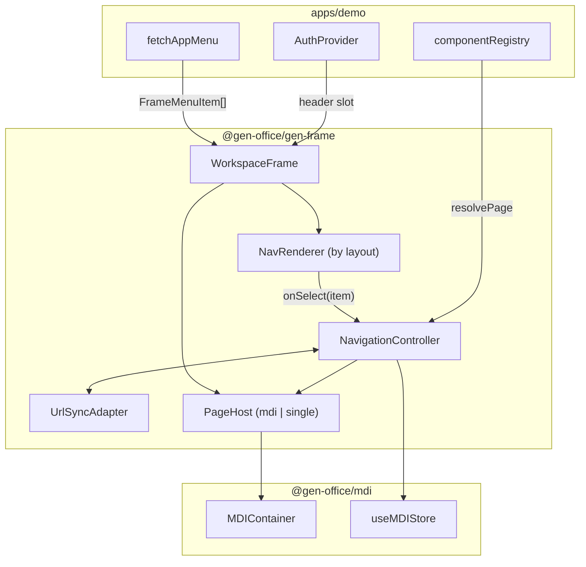

<!--
 @file packages/gen-frame/.docs/architecture.md
 @description Package structure, navigation model, public API, and data flow for @gen-office/gen-frame.

 @created 2026-06-29

 @remark
 - V1 참조: frontend/apps/demo App shell, TitleBar/LeftPanel layout (개념 이식)
 - MDI 연동: packages/mdi/.docs/architecture.md §8
 - demo 현재: apps/demo/src/app/AppShell.tsx (이전 대상)
-->
# @gen-office/gen-frame 아키텍처

GenOffice V2 **앱 프레임워크** 패키지입니다.

- **Layout chrome** — TitleBar / LeftPanel / (후속) hybrid·rail 등 **표현 모드**
- **Navigation orchestration** — 메뉴 선택·URL·페이지 오픈을 **한 계약**으로 연결
- **Page host abstraction** — MDI 탭 또는 단일 페이지 중 **앱이 선택**
- **Showcase 친화** — 동일 메뉴·동일 registry로 layout만 바꿔 비교 가능

`gen-chart`가 “차트 엔진”, `gen-datagrid`가 “그리드 엔진”이라면, `gen-frame`은 **“백오피스 앱 작업 공간 엔진”** 입니다.

---

## 1. 패키지 역할·경계

### 1.1 OK (`gen-frame`)

| 책임 | 설명 |
| --- | --- |
| Layout mode | `leftPanel`, `titleBar`, `hybrid`, `rail` (단계적 제공) |
| Chrome skeleton | header, navigation 영역, workarea — flex height contract |
| Nav renderer | layout mode별 메뉴 UI (동일 `FrameMenuItem` 트리) |
| `NavigationController` | `open`, `activate`, `close`, `syncFromUrl`, `syncToUrl` |
| Page host adapter | `mdi` 어댑터 / `single` 어댑터 |
| URL sync (선택) | History API ↔ 현재 페이지/탭 상태 |
| Storybook showcase | layout matrix, navigation mode 비교 |

### 1.2 NOT OK (다른 레이어)

| 항목 | 소유 |
| --- | --- |
| 탭 store·TabBar DOM | `@gen-office/mdi` |
| `componentRegistry`, lazy page import | `apps/demo` |
| 메뉴 REST fetch, mock | `apps/demo` `shared/api` |
| 로그인·세션 | `apps/demo` providers |
| 탭 **안** PageHeader·FilterBar·그리드 | `apps/demo` + `ui` + `gen-datagrid-crud` |
| 비즈니스 API | `apps/demo` |

### 1.3 의존 방향

```text
apps/demo, apps/storybook-all
        ↓
@gen-office/gen-frame
        ↓
@gen-office/mdi (optional peer — mdi 모드일 때)
@gen-office/ui
@gen-office/theme
        ↓
react , react-dom
```

- `gen-frame` → `gen-datagrid` / `gen-chart` ❌
- `mdi` → `gen-frame` ❌
- `ui` → `gen-frame` ❌

`mdi`는 **peer dependency (optional)** 로 두는 방안을 권장합니다. `navigation: 'single'` 앱은 mdi 없이 설치 가능.

---

## 2. 설계 배경 (대화에서 정리된 요구)

### 2.1 Showcase 목적

프레임워크 소비자에게 **여러 layout을 같은 앱·같은 메뉴로 비교**할 수 있게 합니다.

- Shell 패키지를 layout마다 복제하지 않음
- `FrameLayout` + `layout` prop + `NavRenderer` registry
- demo: header에 layout 토글 (개발·showcase용)

### 2.2 메뉴 데이터 vs layout 표현

| 축 | 내용 | 소유 |
| --- | --- | --- |
| **메뉴 데이터** | 트리 (`id`, `label`, `icon`, `children`, `meta`) | 앱이 API에서 로드 → gen-frame에 전달 |
| **layout 표현** | 좌측 / 상단 / 하이브리드 | gen-frame `layout` mode |
| **페이지 오픈** | registry → React content | 앱이 `resolvePage` 콜백 제공 |

API에 layout 힌트를 넣는 것은 **3단계(운영)** 선택 사항. Showcase 1~2단계는 `app.config` / localStorage로 충분.

### 2.3 MDI vs 단일 페이지

동일한 `NavigationController.open(payload)` 가 mode에 따라:

- `navigation: 'mdi'` → `mdi.addTab` / `setActiveTab`
- `navigation: 'single'` → `setCurrentPage` + router `navigate`

앱은 MDI를 쓰지 않아도 gen-frame으로 페이지를 열 수 있습니다.

### 2.4 URL 연동

URL ↔ Page 연동은 **gen-frame 책임** (mdi는 URL을 모름).

```text
URL change (popstate / initial load)
    → NavigationController.syncFromUrl()
    → open / activate page

Menu click / tab activate
    → NavigationController.open / activate
    → UrlSyncAdapter.syncToUrl()  (replaceState / pushState)
```

**Source of truth 정책 (권장):**

- **진입·새로고침:** URL 우선
- **앱 내 조작:** controller 상태 우선 → URL 반영
- `pageId` 규칙은 앱과 합의 (`user-detail:42` 등)

---

## 3. V1 대응 (개념)

V1 demo (`frontend/apps/demo`) 참고 항목:

| V1 | gen-frame |
| --- | --- |
| TitleBar layout | `layout: 'titleBar'` + `TitleBarNav` |
| LeftPanel layout | `layout: 'leftPanel'` + `LeftPanelNav` |
| layout 전환 | `FrameLayout` `layout` + persistence hook |
| MDI 탭 | `MdiPageHost` 어댑터 (`@gen-office/mdi`) |
| 메뉴 → 페이지 | 앱 `onMenuSelect` → `resolvePage` (registry) |

V1 소스 **통째 이식 금지**. demo의 `AppShell`·`useOpenPage`에서 **계약만 추출**합니다.

---

## 4. 핵심 타입 (초안)

### 4.1 메뉴 (layout 무관)

```ts
/** gen-frame이 이해하는 중립 메뉴 노드 */
export interface FrameMenuItem {
  id: string;
  label: string;
  icon?: string;
  disabled?: boolean;
  children?: FrameMenuItem[];
  /** 앱 전용: path, componentName, 권한 키 등 */
  meta?: Record<string, unknown>;
}

export interface FrameMenuModel {
  items: FrameMenuItem[];
}
```

앱은 API `AppMenuItem` → `FrameMenuItem`으로 **얇게 매핑**합니다. `componentName`은 gen-frame 타입에 넣지 않습니다.

### 4.2 페이지 오픈

```ts
export interface OpenPagePayload {
  pageId: string;
  title: string;
  params?: Record<string, string>;
}

/** 앱이 registry로 content를 만듦 */
export type ResolvePageContent = (
  payload: OpenPagePayload,
  meta?: Record<string, unknown>,
) => React.ReactNode;
```

### 4.3 프레임 설정

```ts
export type FrameLayoutMode =
  | 'leftPanel'
  | 'titleBar'
  | 'hybrid'   // Phase F2+
  | 'rail';    // Phase F3+ showcase

export type FrameNavigationMode = 'mdi' | 'single';

export interface FrameConfig {
  layout: FrameLayoutMode;
  navigation: FrameNavigationMode;
  /** URL ↔ page 동기화 (기본 false → Phase F4에서 활성) */
  urlSync?: boolean;
}
```

### 4.4 NavigationController

```ts
export interface NavigationController {
  open(payload: OpenPagePayload, meta?: Record<string, unknown>): void;
  activate(pageId: string): void;
  close(pageId: string): void;
  closeAll(): void;
  syncFromUrl(url: URL | string): void;
  syncToUrl(): void;
}
```

구현체:

- `createMdiNavigationController(deps)` — mdi store + resolvePage
- `createSingleNavigationController(deps)` — React state + optional router

### 4.5 URL 어댑터

```ts
export interface UrlSyncAdapter {
  pageToUrl(pageId: string, params?: Record<string, string>): string;
  urlToPage(url: URL): OpenPagePayload | null;
}
```

앱이 path 규칙(`/app/users`, `/app?tab=`)을 주입. gen-frame은 History API 래핑만 담당.

---

## 5. 컴포넌트 계층

### 5.1 DOM 트리 (`layout: 'leftPanel'`, `navigation: 'mdi'`)

```text
WorkspaceFrame                    # public root (별칭: FrameLayout)
├── FrameHeader                   # brand, user slot, actions slot
├── FrameBody
│   ├── LeftPanelNav              # FrameMenuItem[] 렌더
│   └── FrameWorkarea
│       └── MdiPageHost           # MDIContainer (adapter)
│           └── TabPanel → page content
```

`layout: 'titleBar'` 이면 `LeftPanelNav` 대신 `TitleBarNav`가 header 아래 또는 header 안에 배치됩니다.

### 5.2 컴포넌트 관계



### 5.3 Slot API (`WorkspaceFrame`)

| Slot / Prop | 용도 |
| --- | --- |
| `header` | 브랜드·사용자·로그아웃 (앱 조합) |
| `headerActions` | layout 토글, 설정 (showcase) |
| `menu` | `FrameMenuModel` |
| `onMenuSelect` | 기본: `controller.open`에 위임 |
| `workarea` | override 가능; 기본은 `PageHost` |
| `layout` | `FrameLayoutMode` |
| `navigation` | `FrameNavigationMode` |
| `controller` | `NavigationController` (hook으로 생성) |
| `labels` | i18n 문자열 |

---

## 6. 디렉터리 구조 (목표)

```text
packages/gen-frame/
├── .docs/
│   ├── README.md
│   ├── architecture.md       # 본 문서
│   ├── plan.md
│   └── implementation-log.md
├── src/
│   ├── index.ts              # public barrel
│   ├── index.css             # frame chrome tokens (theme 위)
│   ├── types/
│   │   ├── menu.types.ts
│   │   ├── navigation.types.ts
│   │   ├── frame.types.ts
│   │   └── url.types.ts
│   ├── navigation/
│   │   ├── createMdiNavigationController.ts
│   │   ├── createSingleNavigationController.ts
│   │   └── useNavigationController.ts
│   ├── url/
│   │   ├── createUrlSyncAdapter.ts
│   │   └── useUrlSync.ts
│   ├── components/
│   │   ├── WorkspaceFrame/
│   │   ├── FrameHeader/
│   │   ├── FrameWorkarea/
│   │   ├── nav/
│   │   │   ├── LeftPanelNav/
│   │   │   ├── TitleBarNav/
│   │   │   └── NavRenderer.tsx      # layout → component map
│   │   └── hosts/
│   │       ├── MdiPageHost/
│   │       └── SinglePageHost/
│   ├── hooks/
│   │   ├── useFrameLayout.ts        # layout persistence (showcase)
│   │   └── useFrameConfig.ts
│   └── stories/                     # layout showcase
├── test/
├── package.json
├── tsconfig.json
└── vite.config.ts
```

---

## 7. Public API (목표)

| 그룹 | 심볼 |
| --- | --- |
| Components | `WorkspaceFrame`, `FrameBrand`, `MdiPageHost`, `SinglePageHost`, `LeftPanelNav`, `TitleBarNav` |
| Navigation | `createMdiNavigationController`, `createSingleNavigationController`, `useMdiNavigationController`, `useSingleNavigationController` |
| URL | `createQueryTabUrlSyncAdapter`, `useUrlSync` |
| Hooks | `useFrameLayout`, `useFrameConfig` |
| Types | `FrameMenuItem`, `FrameMenuModel`, `OpenPagePayload`, `FrameLayoutMode`, `FrameNavigationMode`, `FrameConfig`, `NavigationController`, `UrlSyncAdapter` |

소비자 일반 경로:

```tsx
import {
  WorkspaceFrame,
  MdiPageHost,
  SinglePageHost,
  useMdiNavigationController,
  useSingleNavigationController,
} from '@gen-office/gen-frame';
import '@gen-office/gen-frame/index.css';
```

---

## 8. 높이·레이아웃 계약

[apps/demo/.docs/architecture.md §5](../../../apps/demo/.docs/architecture.md) 와 동일. gen-frame이 **보장**합니다.

```text
html, body, #root     height: 100%
WorkspaceFrame        display: flex; flex-direction: column; height: 100%
  FrameHeader         flex-shrink: 0
  FrameBody           flex: 1; min-height: 0; display: flex
    Nav (optional)    flex-shrink: 0
    FrameWorkarea     flex: 1; min-height: 0; display: flex; flex-direction: column
      PageHost        flex: 1; min-height: 0
        MDI / Single  flex: 1; min-height: 0
          Page        AdminPageLayout, grid, chart…
```

gen-frame을 쓰는 앱은 `AppShell`에서 height chain을 **직접 조립하지 않아도** 됩니다.

---

## 9. demo 연동 (목표 형태)

현재 (`apps/demo`):

```text
AppShell → MenuSidebar + MDIContainer
useOpenPage → useMDIStore.addTab
```

목표:

```text
App.tsx / AppShell
  → WorkspaceFrame (layout, navigation from config or showcase toggle)
  → useNavigationController({ mode: 'mdi', resolvePage, mdiStore })
  → menu: mapAppMenuToFrameItems(items)
  → header: auth, layout toggle (showcase)
```

demo 전용 Soft Modern (`demo-ui.css`, `DemoSurface`)는 **앱 스킨**으로 유지. gen-frame chrome은 **theme 토큰**만 사용.

---

## 10. Storybook showcase

`apps/storybook-all` 또는 패키지 로컬 stories:

| Story | 목적 |
| --- | --- |
| `GenFrame/Layout/LeftPanel` | 좌측 메뉴 + mock workarea |
| `GenFrame/Layout/TitleBar` | 상단 메뉴 |
| `GenFrame/Layout/Matrix` | Controls로 layout 전환 |
| `GenFrame/Navigation/Mdi` | 탭 열기·전환 |
| `GenFrame/Navigation/Single` | 단일 페이지 |
| `GenFrame/UrlSync` | URL ↔ active page |

동일 `mockMenu` 트리를 모든 story에서 재사용 → **framework showcase** 메시지.

---

## 11. Layout mode 로드맵

| Mode | Phase | 비고 |
| --- | --- | --- |
| `leftPanel` | F1 | V2 demo 현재 형태 일반화 |
| `titleBar` | F2 | V1 전환 대응 |
| `hybrid` | F3 | 상단 모듈 + 좌측 세부 (showcase) |
| `rail` | F3+ | 아이콘 레일 + 확장 패널 (선택) |

---

## 12. 리스크·주의

| 리스크 | 완화 |
| --- | --- |
| gen-frame이 registry·auth를 끌어안음 | `resolvePage`·slots만 앱에 두기 |
| mdi와 URL sync 이중 source of truth | controller 단일 진입점, 문서화된 sync 규칙 |
| layout마다 Shell 복제 유혹 | `NavRenderer` registry만 추가 |
| 과도한 추상화 | Phase F1은 leftPanel+mdi만; single·URL은 후속 |
| `page-frame` 아이디어와 혼동 | gen-frame = **앱** shell; page frame = **탭 안** (별 패키지/앱) |

---

## 13. 관련 문서

- [plan.md](./plan.md) — Phase F0~F5, Gate
- [packages/mdi/.docs/architecture.md](../../mdi/.docs/architecture.md)
- [apps/demo/.docs/ui-direction.md](../../../apps/demo/.docs/ui-direction.md) — demo 스킨 (gen-frame과 분리)
- [.docs/idea/page-frame-composable.md](../../../.docs/idea/page-frame-composable.md) — 탭 **내부** 프레임 (별 트랙)
