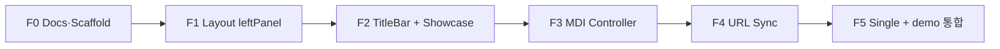

<!--
 @file packages/gen-frame/.docs/plan.md
 @description Implementation plan and quality gates for @gen-office/gen-frame.

 @created 2026-06-29

 @remark
 - Phase F0: documentation + package scaffold (current)
 - demo 연동: F2 이후 본격; F1은 Storybook only
 - 선행: mdi P0~P2 완료, theme, ui
-->
# @gen-office/gen-frame 구현 Plan

`gen-chart` · `gen-datagrid`와 같은 **gen-\*** 제품군으로, 백오피스 앱의 layout·navigation·URL 오케스트레이션을 제공합니다.

**설계 정본:** [architecture.md](./architecture.md)

---

## 0. 진행 방식



| 단계 | 명령 | 통과 기준 |
| --- | --- | --- |
| test | `pnpm -C packages/gen-frame test` | navigation·url 단위 test green |
| build | `pnpm -C packages/gen-frame build` | dist·d.ts·index.css, TS error 0 |
| story | `pnpm -C apps/storybook-all dev` | GenFrame layout matrix |
| demo | `pnpm -C apps/demo dev` | layout 토글 + MDI + 메뉴 오픈 |
| monorepo | `pnpm build` | turbo chain gen-frame 포함 |

**Gate 규칙:** F(n) 완료 전 F(n+1) 착수 금지. 완료 시 `implementation-log.md`에 기록.

---

## 1. Phase 요약

| Phase | 이름 | mdi 필요 | 선행 | 상태 |
| --- | --- | --- | --- | --- |
| **F0** | Docs · scaffold | 아니오 | mdi, theme, ui 검토 완료 | ✅ |
| **F1** | `WorkspaceFrame` + `leftPanel` | Storybook mock | F0 | ✅ |
| **F2** | `titleBar` + layout showcase | Storybook | F1 | ✅ |
| **F3** | `NavigationController` + MDI host | 예 | F2, mdi stable | ✅ |
| **F4** | URL sync adapter | 예 | F3 | ⏸ |
| **F5** | `single` host + demo 통합 | 선택 | F4 | ⏸ |

```text
[지금]     F0 문서·디렉터리
[다음]     F1 패키지 scaffold + leftPanel Storybook
[showcase] F2 TitleBar + layout matrix
[핵심]     F3 demo AppShell → gen-frame (MDI)
[심화]     F4 URL ↔ page, F5 non-MDI 앱 패턴
```

---

## 2. F0 — Docs · scaffold

**목표:** 패키지 경계·API 초안 확정. 구현 코드 최소.

### 작업

| # | 작업 | 산출 |
| --- | --- | --- |
| F0.1 | `packages/gen-frame/` 디렉터리 | README, package.json |
| F0.2 | architecture.md | 역할·타입·흐름·경계 |
| F0.3 | plan.md | 본 문서 |
| F0.4 | 저장소 아키텍처 반영 | `.docs/02-ARCHITECTURE.md`, `decisions.md` |
| F0.5 | 패키지 검토 순서 등록 | `.docs/06-PACKAGE-REVIEW-PLAN.md` |

### Gate F0

- [x] `.docs/architecture.md`, `plan.md` 존재
- [x] `gen-frame`이 mdi·demo·registry 경계 문서화
- [x] `implementation-log.md` F0 기록
- [ ] (선택) turbo에 build 스크립트 placeholder — F1에서 추가

---

## 3. F1 — WorkspaceFrame + leftPanel

**목표:** flex height contract + 좌측 메뉴 layout. **demo 미연동** — Storybook만.

### 작업

| # | 작업 | 대상 |
| --- | --- | --- |
| F1.1 | 패키지 빌드 scaffold | `vite.config.ts`, `tsconfig.json`, `src/index.ts` |
| F1.2 | 타입 | `FrameMenuItem`, `FrameConfig`, `WorkspaceFrameProps` |
| F1.3 | `WorkspaceFrame` | header / body / workarea slots |
| F1.4 | `LeftPanelNav` | 트리·flat 메뉴 렌더, `onSelect` |
| F1.5 | `index.css` | theme 토큰 기반 chrome |
| F1.6 | Storybook | `GenFrame/Layout/LeftPanel` |
| F1.7 | test | WorkspaceFrame smoke, LeftPanelNav click |

### Gate F1

- [x] `pnpm -C packages/gen-frame build`
- [x] `pnpm -C packages/gen-frame test` (6 tests)
- [x] Storybook — `GenFrame/Layout/LeftPanel` (mock menu + workarea)
- [x] height contract: workarea `min-height: 0` 문서·CSS 일치

---

## 4. F2 — titleBar + layout showcase

**목표:** V1 TitleBar 모드 + **동일 메뉴로 layout 비교** showcase.

### 작업

| # | 작업 | 대상 |
| --- | --- | --- |
| F2.1 | `TitleBarNav` | 1차 horizontal, 2차 dropdown (children) |
| F2.2 | `NavRenderer` | `layout` → LeftPanelNav \| TitleBarNav |
| F2.3 | `useFrameLayout` | localStorage persistence (showcase) |
| F2.4 | Storybook | `GenFrame/Layout/Matrix` — Controls `layout` |
| F2.5 | Storybook | headerActions에 layout SegmentedControl 예시 |

### Gate F2

- [x] leftPanel ↔ titleBar 전환 시 메뉴·workarea 동일 데이터 유지 (`GenFrame/Layout/Matrix`)
- [x] Storybook — `GenFrame/Layout/TitleBar`, `GenFrame/Layout/Matrix`
- [x] `useFrameLayout` localStorage persistence
- [x] a11y: nav `aria-label`, `aria-pressed` on layout toggle

---

## 5. F3 — NavigationController + MDI host

**목표:** `apps/demo`의 `useOpenPage`·`AppShell` 배선을 gen-frame으로 **추출**.

### 작업

| # | 작업 | 대상 |
| --- | --- | --- |
| F3.1 | `createMdiNavigationController` | open, activate, close, closeAll |
| F3.2 | `MdiPageHost` | `MDIContainer` 래핑, maxTabs, labels |
| F3.3 | `resolvePage` 주입 | 앱 registry — gen-frame은 ReactNode만 수신 |
| F3.4 | `useNavigationController` hook | |
| F3.5 | demo 연동 (1차) | `AppShell` → `WorkspaceFrame` + `MdiPageHost` |
| F3.6 | demo | `mapAppMenuToFrameItems`, layout showcase 토글 |
| F3.7 | test | controller: same pageId → activate only |

### demo 마이그레이션 체크리스트

- [x] `MenuSidebar` → gen-frame `NavRenderer` (via `WorkspaceFrame`)
- [x] `useOpenPage` → `useMdiNavigationController`
- [x] `AppShell.module.css` chrome → gen-frame CSS (demo-ui workarea tint 유지)
- [x] `pnpm -C apps/demo build`

### Gate F3

- [x] demo: mock 메뉴 → MDI 탭 오픈 동작 유지
- [x] demo: layout 토글 (leftPanel / titleBar)
- [x] mdi `onMaxTabsReached` demo toast 연동 유지

---

## 6. F4 — URL sync

**목표:** URL ↔ active page/탭 양방향 동기화. gen-frame 오케스트레이션.

### URL 스키마 (demo 초안)

| 방식 | 예 | 장점 |
| --- | --- | --- |
| **query (권장 1차)** | `/app?tab=demo-chart` | MDI 탭 id와 1:1, 구현 단순 |
| path | `/app/demo/chart` | 공유 URL 가독성 |

1차는 **query `tab=`** 로 고정. 앱이 `UrlSyncAdapter` 구현 주입.

### 작업

| # | 작업 | 대상 |
| --- | --- | --- |
| F4.1 | `UrlSyncAdapter` 타입·팩토리 | `pageToUrl`, `urlToPage` |
| F4.2 | `useUrlSync` | popstate, initial load |
| F4.3 | controller 연동 | open/activate → `replaceState` / `pushState` |
| F4.4 | demo | 새로고침 시 활성 탭 복원 |
| F4.5 | test | urlToPage ↔ pageToUrl roundtrip |

### Gate F4

- [x] URL 직접 입력 → 해당 탭 오픈/활성
- [x] 탭 전환 → URL 갱신
- [x] 뒤로가기 → 이전 탭 활성

---

## 7. F5 — Single page host + 비MDI showcase

**목표:** MDI 없이 gen-frame만으로 페이지 전환 가능함을 showcase.

### 작업

| # | 작업 | 대상 |
| --- | --- | --- |
| F5.1 | `createSingleNavigationController` | `currentPage` state |
| F5.2 | `SinglePageHost` | 단일 content 영역 |
| F5.3 | Storybook | `GenFrame/Navigation/Single` |
| F5.4 | (선택) demo 서브 라우트 | `/simple/*` 비MDI 데모 페이지 |
| F5.5 | peer deps 정리 | `@gen-office/mdi` optional peer 문서화 |

### Gate F5

- [ ] Storybook: mdi / single 동일 메뉴·다른 host
- [ ] gen-frame README에 navigation mode 선택 가이드
- [ ] architecture·plan 최종 갱신

---

## 8. 후속 (F5 이후)

| 항목 | 비고 |
| --- | --- |
| `hybrid` layout | 상단 모듈 + 좌측 세부 — 메뉴 2단 필요 |
| `rail` layout | 아이콘 레일 — showcase |
| API `navigation.layout` | 테넌트별 layout — 운영 요구 시 |
| `gen-datagrid-crud` 페이지 | AdminPageLayout은 탭 **안** — gen-frame과 무관 |
| page-frame 패키지 | [.docs/idea/page-frame-composable.md](../../../.docs/idea/page-frame-composable.md) 별 트랙 |

---

## 9. 패키지 검토 순서 (제안)

```text
theme → utils → ui → mdi → gen-frame → apps/demo (shell 마이그레이션)
```

`gen-frame`은 `mdi`·`ui`·`theme`에 의존. `gen-datagrid` 완료를 **기다리지 않음**.

---

## 10. 검증 명령 모음

```bash
# F1+
pnpm -C packages/gen-frame test
pnpm -C packages/gen-frame build

# F2+
pnpm -C apps/storybook-all dev   # GenFrame stories

# F3+
pnpm -C apps/demo dev
pnpm -C apps/demo build

# monorepo
pnpm build
```

---

## 11. V1 참조 (개념만)

| V1 (frontend) | F Phase |
| --- | --- |
| demo App shell, layout switch | F2, F3 |
| TitleBar / LeftPanel | F1, F2 |
| MDI + menu open | F3 |
| URL routing (있는 경우) | F4 |

코드 경로는 V1 `frontend/apps/demo` — **복사 이식 금지**, V2 `apps/demo`에서 계약 추출.
