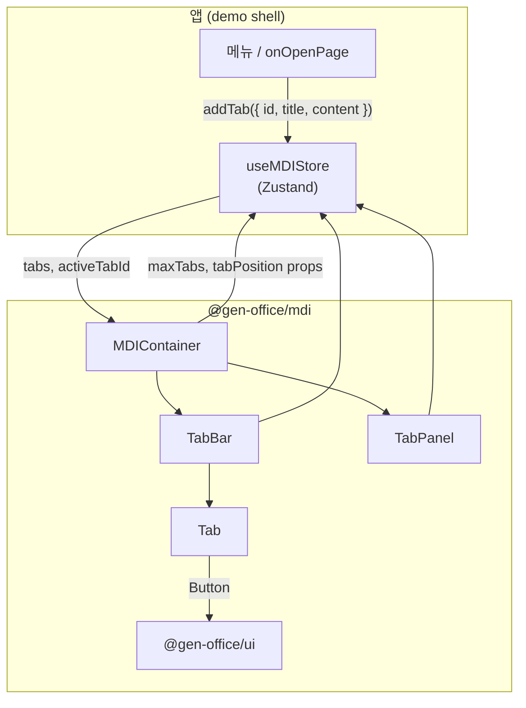
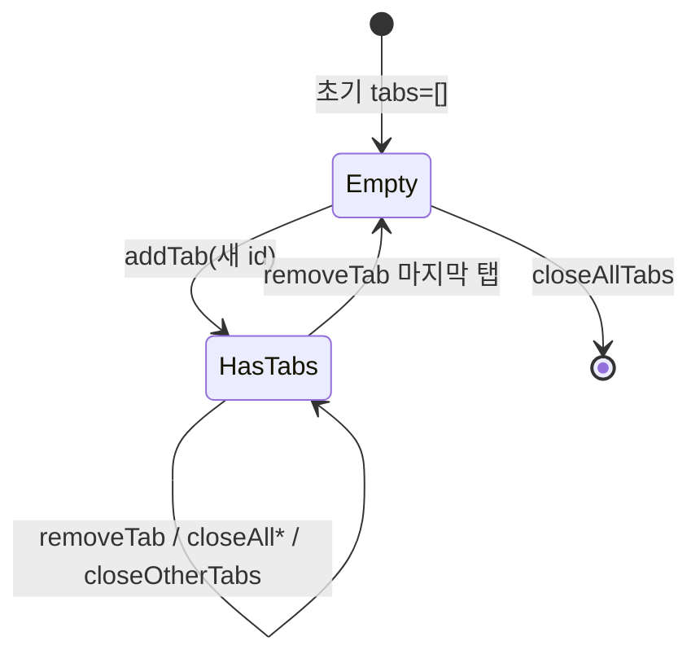
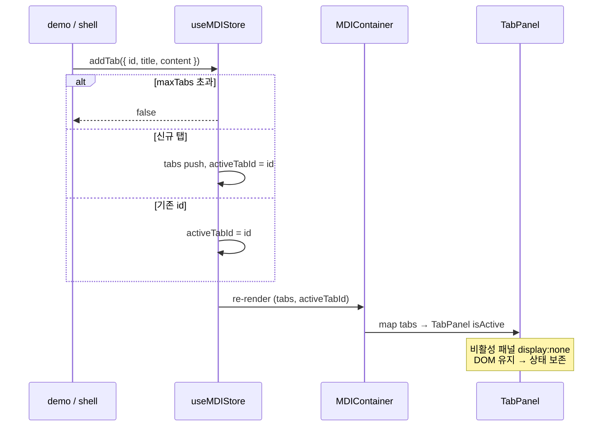
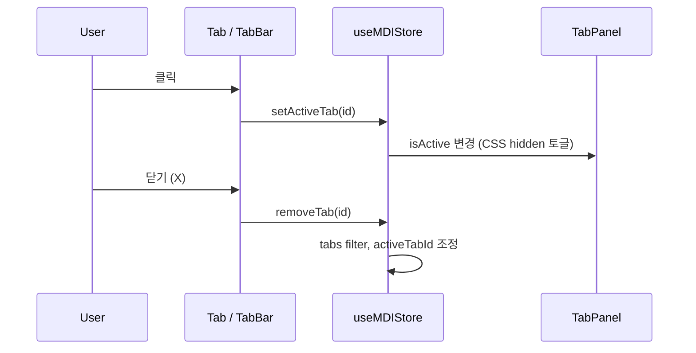
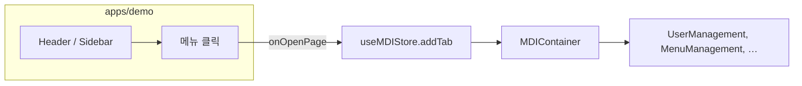

<!--
 @file packages/mdi/.docs/architecture.md
 @description Package structure, component hierarchy, state model, and data flow for @gen-office/mdi.

 @created 2026-06-27

 @remark
 - V1 참조: frontend/packages/mdi
 - 검토 로그: review-log.md
-->
# @gen-office/mdi 아키텍처

GenOffice V2의 **Multiple Document Interface(MDI)** 패키지입니다.  
백오피스 앱(`apps/demo` 등)에서 메뉴·액션으로 열리는 **다중 탭 화면**의 레이아웃·탭 상태를 담당합니다.

- **상태:** Zustand 전역 store (`useMDIStore`)
- **UI:** 탭 바 + 패널 (상태 보존을 위해 `display: none`으로 숨김, unmount 없음)
- **의존:** `@gen-office/ui`(Button), `@gen-office/utils`(cn), `@gen-office/theme`(토큰), `zustand`, `lucide-react`

---

## 1. 패키지 역할·경계

| OK (`mdi`) | NOT OK (다른 패키지) |
| --- | --- |
| 탭 열기/닫기/전환 전역 상태 | 개별 화면 CRUD·그리드 로직 |
| TabBar·TabPanel 레이아웃 | 라우팅·메뉴 트리 데이터 |
| `maxTabs`·`tabPosition` 등 MDI 정책 | 도메인 API fetch |
| 탭별 `content: ReactNode` 보관 | 범용 Button/Dialog (`ui`) |

### 의존 방향

```text
apps/demo (shell, menu, onOpenPage)
        ↓
   @gen-office/mdi
        ↓
   @gen-office/ui , @gen-office/utils , @gen-office/theme
        ↓
   react , zustand , lucide-react
```

`mdi`는 **`ui` 위** feature 패키지입니다. 그리드·차트 패키지와 **역방향 의존 없음**.

---

## 2. 디렉터리 구조

```text
packages/mdi/
├── .docs/
│   ├── README.md              사용법·API 초안 (V1 기준)
│   ├── architecture.md        본 문서
│   └── review-log.md          검토·스캐폴딩 로그
├── src/
│   ├── index.ts               public barrel export
│   ├── env.d.ts               *.module.css 타입
│   ├── types/
│   │   └── index.ts           MDITab, Props, MDIStore 타입
│   ├── store/
│   │   └── mdiStore.ts        useMDIStore (Zustand)
│   └── components/
│       ├── index.ts           컴포넌트 re-export
│       ├── MDIContainer/      루트 레이아웃 + props → store 동기화
│       ├── TabBar/            탭 목록 + 컨텍스트 메뉴
│       ├── Tab/               개별 탭 (제목·아이콘·닫기)
│       └── TabPanel/          탭 콘텐츠 영역 (show/hide)
├── test/
│   └── setup.ts               Vitest jsdom 셋업
├── package.json
├── tsconfig.json
├── vite.config.ts             lib build → dist/index.mjs, dist/index.css
└── vitest.config.ts
```

### public export (`src/index.ts`)

| 그룹 | 심볼 |
| --- | --- |
| Components | `MDIContainer`, `TabBar`, `Tab`, `TabPanel` |
| Store | `useMDIStore` |
| Types | `MDITab`, `TabPosition`, `MDIContainerProps`, `TabBarProps`, `TabProps`, `TabPanelProps`, `MDIState`, `MDIActions`, `MDIStore` |

소비자는 보통 **`MDIContainer` + `useMDIStore`** 만 사용합니다. `Tab`/`TabBar`/`TabPanel`은 고급 커스터마이징·테스트용으로 export 됩니다.

---

## 3. 컴포넌트 계층

### DOM 트리 (탭 있음, `tabPosition="top"`)

```text
MDIContainer
├── TabBar                    role="tablist"
│   └── Tab × N               role="tab"  (× 닫기 Button from ui)
│       └── [context menu]    Close / Close Others / Close All
└── .contentArea
    └── TabPanel × N          role="tabpanel"  (비활성: display:none)
        └── {tab.content}     ReactNode — unmount 되지 않음
```

`tabPosition="bottom"` 이면 TabBar가 contentArea **아래**에 렌더됩니다.

### 컴포넌트 관계 다이어그램



### 역할 요약

| 컴ponent | 책임 | Store 사용 |
| --- | --- | --- |
| **MDIContainer** | 전체 레이아웃, empty state, props → store 동기화 | read + `setMaxTabs`, `setTabPosition` |
| **TabBar** | 탭 목록 렌더, 우클릭 컨텍스트 메뉴 | read + `setActiveTab`, `removeTab`, `closeOtherTabs`, `closeAllClosableTabs` |
| **Tab** | 단일 탭 UI, ARIA, 닫기 버튼 | props만 (stateless) |
| **TabPanel** | `tab.content` 표시, 활성/비활성 토글 | props만 (stateless) |

---

## 4. 상태 모델 (Zustand)

### State

```typescript
interface MDIState {
  tabs: MDITab[];              // 열린 탭 목록 (순서 = TabBar 순서)
  activeTabId: string | null;  // 현재 보이는 탭 id
  maxTabs: number | undefined; // undefined = 제한 없음
  tabPosition: TabPosition;    // 'top' | 'bottom'
}
```

### MDITab

```typescript
interface MDITab {
  id: string;           // 고유 id — 동일 id 재 addTab → 활성화만
  title: string;
  content: ReactNode;   // 패널에 그대로 렌더
  closable?: boolean;   // default true
  icon?: ReactNode;
  meta?: Record<string, any>;
}
```

### Actions

| Action | 동작 | 반환 |
| --- | --- | --- |
| `addTab(tab)` | maxTabs 초과 시 거부; 동일 id 있으면 활성화만; 없으면 append | `boolean` |
| `removeTab(id)` | 탭 제거; 활성 탭이면 인접 탭 활성화 | — |
| `setActiveTab(id)` | id가 tabs에 있을 때만 전환 | — |
| `updateTab(id, partial)` | title/icon/content 등 부분 갱신 | — |
| `closeAllTabs()` | 전부 제거 | — |
| `closeAllClosableTabs()` | `closable !== false` 만 제거; `closable: false` 유지 | — |
| `closeOtherTabs(id)` | 대상 탭 + `closable: false` 탭만 남김 | — |
| `setMaxTabs` / `setTabPosition` | MDIContainer props와 sync | — |

### 상태 전이 (addTab / removeTab)



> **참고:** `addTab`이 maxTabs에 걸리면 `console.warn`만 출력하고 `false`를 반환합니다. `MDIContainerProps.onMaxTabsReached`는 **아직 store와 연결되지 않음** (미결).

---

## 5. 데이터 흐름

### 탭 열기 (앱 → MDI)



### 탭 전환·닫기



### 상태 보존 전략

```text
  Tab A (active)     Tab B (hidden)     Tab C (hidden)
  ┌─────────────┐    ┌─────────────┐    ┌─────────────┐
  │ display:    │    │ display:    │    │ display:    │
  │   block     │    │   none      │    │   none      │
  │             │    │             │    │             │
  │ <PageA />   │    │ <PageB />   │    │ <PageC />   │
  │ (mounted)   │    │ (mounted)   │    │ (mounted)   │
  └─────────────┘    └─────────────┘    └─────────────┘
```

모든 `TabPanel`은 **항상 mount** 상태입니다. 비활성 탭은 `TabPanel.module.css`의 `.hidden`(`display: none`)으로 숨깁니다.  
React state·form 입력·스크롤 등이 탭 전환 후에도 유지됩니다.

---

## 6. 스타일·빌드

| 항목 | 설명 |
| --- | --- |
| CSS Modules | 컴포넌트별 `*.module.css`, `localsConvention: camelCaseOnly` |
| dist 산출물 | `index.mjs` + `index.css` (모듈 CSS 번들) |
| theme | `@gen-office/theme` CSS 변수 사용 (TabBar/Tab 높이 등) |
| 소비 | `import '@gen-office/mdi/index.css'` + `MDIContainer` |

`ui`와 달리 `src/index.css` side-effect 진입점은 **아직 없음**. CSS는 lib 빌드 시 컴포넌트 import 체인으로 `dist/index.css`에 합쳐집니다.

---

## 7. 접근성 (ARIA)

| 요소 | 속성 |
| --- | --- |
| TabBar | `role="tablist"`, `aria-orientation="horizontal"` |
| Tab | `role="tab"`, `aria-selected`, `aria-controls`, `id="tab-{id}"` |
| TabPanel | `role="tabpanel"`, `aria-labelledby`, `aria-hidden`, `id="tabpanel-{id}"` |
| 닫기 | `Button` + `aria-label="Close {title}"` |

---

## 8. 앱 연동 패턴 (목표)

demo shell에서의 전형적인 사용 형태입니다. (Phase 3 포팅 시)

```tsx
import { MDIContainer, useMDIStore } from '@gen-office/mdi';
import '@gen-office/mdi/index.css';

function AppShell() {
  const addTab = useMDIStore((s) => s.addTab);

  const onOpenPage = (pageId: string, title: string, content: React.ReactNode) => {
    addTab({ id: pageId, title, content, closable: true });
  };

  return (
    <div style={{ display: 'flex', flexDirection: 'column', height: '100vh' }}>
      <AppHeader onOpenPage={onOpenPage} />
      <main style={{ flex: 1, minHeight: 0 }}>
        <MDIContainer maxTabs={10} tabPosition="top" />
      </main>
    </div>
  );
}
```



**레이아웃 주의:** `MDIContainer` 부모는 `flex: 1` + `min-height: 0` 체인이 필요합니다 (백오피스 전체 높이 fill).

---

## 9. 테스트·Storybook (현재)

| 항목 | 상태 |
| --- | --- |
| Vitest | `test/setup.ts` 준비, 테스트 파일 0건 (`passWithNoTests`) |
| Storybook | `apps/storybook` glob 대상; mdi story 미작성 |
| 권장 1차 테스트 | `mdiStore` add/remove/maxTabs/closeOther, `MDIContainer` empty state |

---

## 10. 미결·개선 후보

상세 우선순위·Gate·작업 목록: **[review-plan.md](./review-plan.md)** (P0 ✅)

| 항목 | 우선순위 | 설명 |
| --- | --- | --- |
| 파일 헤더 | P2 | V1 `// packages/mdi/...` → V2 JSDoc `@file` 형식 |
| `src/index.css` | P1 | theme side-effect 진입점 (`ui` 패턴) |
| Storybook | P1~ | TabBar overflow·context menu·maxTabs 시나리오 |

---

## 관련 문서

- [review-plan.md](./review-plan.md) — P0~P3 우선순위·Gate
- [review-log.md](./review-log.md) — 스캐폴딩·검토 이력
- [README.md](./README.md) — API·사용 예제
- [06-PACKAGE-REVIEW-PLAN.md](../../../.docs/06-PACKAGE-REVIEW-PLAN.md) — 패키지 리뷰 순서
- [packages/ui/.docs/architecture.md](../../ui/.docs/architecture.md) — 하위 UI 패키지
