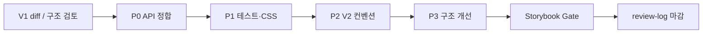

<!--
 @file packages/mdi/.docs/review-plan.md
 @description Phased review and improvement plan for @gen-office/mdi (V1→V2).

 @created 2026-06-27

 @remark
 - 근거: architecture.md 구조 검토, review-log.md 스캐폴딩 상태
 - 패키지 리뷰 순서: 06-PACKAGE-REVIEW-PLAN.md §4 mdi
-->
# @gen-office/mdi 검토 Plan

V1 `frontend/packages/mdi` → V2 `packages/mdi`  
**우선순위(P0~P3) + Gate** 방식으로 API 정합·테스트·demo 연동 준비까지 진행합니다.

관련 문서:

- [architecture.md](./architecture.md) — 현재 구조·데이터 흐름
- [review-log.md](./review-log.md) — 완료·검증 이력
- [README.md](./README.md) — 사용법·API (검토 후 갱신)

---

## 0. 진행 방식

| 단계 | 명령 | 통과 기준 |
| --- | --- | --- |
| 단위 test | `pnpm -C packages/mdi test` | store·container smoke green |
| 빌드 | `pnpm -C packages/mdi build` | dist·d.ts·index.css, TS error 0 |
| 수동 test | `pnpm -C apps/storybook dev` | mdi story 체크리스트 |
| monorepo | `pnpm build` | turbo chain mdi 포함 |

**Gate 규칙:** P0 완료 전 demo shell 연동 착수하지 않음. 각 우선순위 블록 완료 시 `review-log.md`에 날짜·체크리스트 기록.

---

## 1. 우선순위 요약

| 우선순위 | 테마 | demo 연동 | 비고 |
| --- | --- | --- | --- |
| **P0** | public API·동작·문서 정합 | **블로커** | ✅ 2026-06-27 |
| **P1** | 테스트·소비자 setup | 연동 직전 | ✅ 2026-06-27 |
| **P2** | V2 컨벤션·a11y·i18n | shell UX | clsx, types, 키보드·포커스 |
| **P3** | 장기 구조 | MVP 이후 | page registry, DropdownMenu |

---

## 2. P0 — public API·동작 정합 (블로커)

**목표:** README/architecture에 적힌 계약과 실제 소스가 일치. TS6133 제거.

| # | 작업 | 대상 파일 | 완료 기준 |
| --- | --- | --- | --- |
| P0.1 | **`onMaxTabsReached` 연동** | `mdiStore.ts`, `MDIContainer.tsx`, `types` | `addTab` maxTabs 실패 시 콜백 호출; `console.warn` 유지 또는 정책 문서화 |
| P0.2 | **TabPanel 숨김 방식 결정** | `TabPanel.module.css`, `.docs/*` | `visibility:hidden` 유지 vs `display:none` 전환 중 **하나로 확정**; architecture·README와 CSS 일치 |
| P0.3 | **미사용 코드 정리** | `MDIContainer.tsx` | `onMaxTabsReached` 사용, `activeTab` 제거 또는 활용; `pnpm build` TS6133 0 |
| P0.4 | **maxTabs 하향 시 정책** | `mdiStore.ts`, README | (A) addTab만 차단 **또는** (B) 초과 탭 trim — 선택 후 문서·test 반영 |

### P0 Gate

- [x] `onMaxTabsReached` story 또는 test로 재현 가능 — `test/store/mdiStore.test.ts`
- [x] TabPanel 숨김: 문서 ↔ CSS ↔ architecture 3者 일치 — `display: none`
- [x] `pnpm -C packages/mdi build` — dts 생성 시 TS error 없음
- [x] `review-log.md` P0 완료 항목 기록

---

## 3. P1 — 테스트·소비자 setup

**목표:** regression 방지, 앱에서 theme CSS 누락 실수 방지, 탭 id 정책 명확화.

| # | 작업 | 대상 | 완료 기준 |
| --- | --- | --- | --- |
| P1.1 | **store 단위 테스트** | `test/store/mdiStore.test.ts` | ✅ P0에서 maxTabs·callback 4건; P1에서 remove/close 확장 |
| P1.2 | **`reset` 또는 test helper** | `mdiStore.ts`, `test/setup.ts` | ✅ P0에서 `reset()` 추가; P1에서 setup 연동 확인 |
| P1.3 | **`src/index.css` side-effect** | `src/index.ts`, `vite.config.ts` | `@import @gen-office/theme/index.css` 패턴 (`ui` 동일); 소비자 import 단순화 |
| P1.4 | **동일 id 재오픈 정책** | `types`, README, architecture | “focus only” vs “refresh content” 문서화; 필요 시 `openTab`/`focusTab` API 분리 |
| P1.5 | **MDIContainer smoke test** | `test/components/MDIContainer.test.tsx` | empty state, tab render, maxTabs prop sync |

### P1 Gate

- [x] `pnpm -C packages/mdi test` — store + container 18 tests
- [x] theme 토큰 — `test/setup.ts` + `src/index.css` `@import theme`
- [x] `review-log.md` P1 완료 항목 기록

---

## 4. P2 — V2 컨벤션·접근성·i18n

**목표:** `ui` 패키지와 동일한 코드·문서 규칙; 백오피스 a11y baseline.

| # | 작업 | 대상 | 완료 기준 |
| --- | --- | --- | --- |
| P2.1 | **`cn` → `clsx`** | components 전체, `package.json` | utils `cn` 제거; V2 utils 가이드 준수 |
| P2.2 | **타입 파일 분리** | `*/Component.types.ts` 또는 `types/` 세분화 | public Props·MDITab store 타입 export 경로 유지 |
| P2.3 | **JSDoc `@file` 헤더** | `src/**` | AGENTS.md 신규 파일 규칙 |
| P2.4 | **Tab 닫기 Button 스타일** | `Tab.tsx`, `Tab.module.css` | `.closeButton.closeButton` hack 제거 (ui API 또는 mdi 전용 스타일) |
| P2.5 | **키보드 탐색** | `TabBar`, `Tab` | WAI-ARIA tabs: ←/→, Home/End (최소) |
| P2.6 | **포커스 관리** | `setActiveTab`, `removeTab` | 활성 전환·탭 닫기 시 포커스가 tablist로 이동 |
| P2.7 | **컨텍스트 메뉴 i18n** | `TabBar.tsx` | 문자열 props `labels?: { close, closeOthers, closeAll }` 또는 demo i18n 훅 연동 설계 |
| P2.8 | **`meta` 타입** | `MDITab` | `Record<string, unknown>` 또는 generic; `any` 제거 |

### P2 Gate

- [ ] Storybook: keyboard·focus 수동 체크리스트 통과
- [ ] `pnpm -C packages/mdi build` green
- [ ] `review-log.md` P2 완료 항목 기록

---

## 5. P3 — 장기 구조 (MVP 이후)

**목표:** 탭 수 증가·화면 복잡도 대비. demo MVP **블로커 아님**.

| # | 작업 | 설명 | 트리거 |
| --- | --- | --- | --- |
| P3.1 | **Page registry** | store에 `ReactNode` 대신 `pageId` + 앱 쪽 render map | 탭 10+·메모리 이슈 |
| P3.2 | **Context menu → ui DropdownMenu** | TabBar raw menu 제거 | ui overlay 패턴 통일 시 |
| P3.3 | **TabBar 분리** | `useTabContextMenu`, `TabContextMenu` | TabBar 200줄+ 또는 reuse |
| P3.4 | **multi-instance store** | `createMDIStore()` factory / Context | MDI 2영역 필요 시 |
| P3.5 | **Zustand `useShallow`** | selector 구독 최적화 | perf 프로파일링 후 |

---

## 6. Storybook Gate (P1 이후 착수)

**위치:** `packages/mdi/src/**/*.stories.tsx` → `apps/storybook` glob 자동 수집

| story | 검증 항목 |
| --- | --- |
| Default | 탭 3개, 전환, 상태 보존 (input 값) |
| MaxTabs | limit 도달, `onMaxTabsReached` |
| BottomTabs | `tabPosition="bottom"` |
| ContextMenu | Close / Close Others / Close All |
| ClosableFalse | pin 탭 + closeOther 동작 |
| Empty | `emptyContent` |

**완료 기준:** architecture §9 checklist → [x], Storybook 수동 Gate `review-log` 기록.

---

## 7. demo 연동 (Phase 3 선행 조건)

[04-ROADMAP.md](../../../.docs/04-ROADMAP.md) Phase 3 admin 화면 포팅 **전** mdi에서 아래를 만족:

| 조건 | Plan 항목 |
| --- | --- |
| `MDIContainer` + `useMDIStore.addTab` 계약 확정 | P0, P1.4 |
| CSS import 경로 (`@gen-office/mdi/index.css`) | P1.3 |
| maxTabs·onMaxTabsReached demo shell 연동 | P0.1 |
| flex `min-height: 0` 레이아웃 문서화 | architecture §8 (완료) |

---

## 8. 진행 상태

| 우선순위 | 상태 | 완료일 |
| --- | --- | --- |
| Wave 0 — 스캐폴딩 | ✅ 완료 | 2026-06-27 |
| P0 | ✅ 완료 | 2026-06-27 |
| P1 | ✅ 완료 | 2026-06-27 |
| P2 | ⬜ 미착수 | — |
| P3 | ⬜ 보류 | — |
| Storybook Gate | ⬜ 미착수 | — |
| review-log 검토 마감 | ⬜ 미착수 | — |

---

## 9. 알려진 이슈 (Plan 입력 근거)

| 이슈 | 우선순위 | 비고 |
| --- | --- | --- |
| ~~`onMaxTabsReached` 미연동~~ | ~~P0~~ | ✅ 2026-06-27 |
| ~~TabPanel visibility vs display~~ | ~~P0~~ | ✅ `display: none` |
| store `reset` | ~~P1.2~~ | ✅ P0에서 선행 추가 |
| ~~동일 id `addTab` → content 미갱신~~ | ~~P1~~ | ✅ focus-only 문서·test |
| ~~`src/index.css` theme side-effect~~ | ~~P1~~ | ✅ 2026-06-27 |
| `cn` 사용 (V2는 clsx) | P2 | |
| 키보드·포커스·i18n | P2 | |
| `ReactNode` in Zustand | P3 | registry는 MVP 이후 |

---

## 관련 문서

- [architecture.md](./architecture.md)
- [review-log.md](./review-log.md)
- [06-PACKAGE-REVIEW-PLAN.md](../../../.docs/06-PACKAGE-REVIEW-PLAN.md)
- [packages/ui/.docs/migration-plan.md](../../ui/.docs/migration-plan.md) — Gate·Wave 참고
