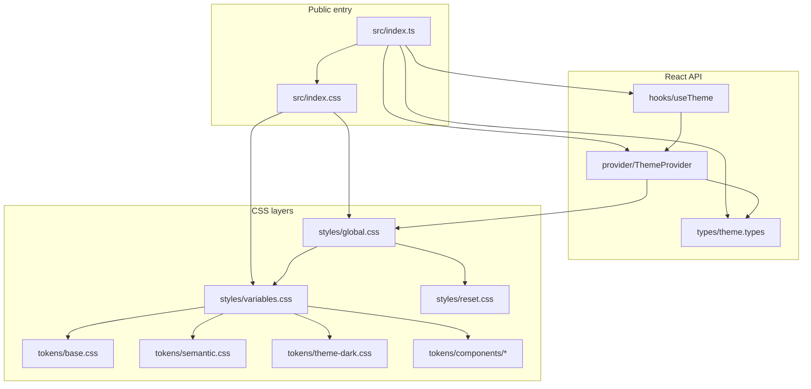
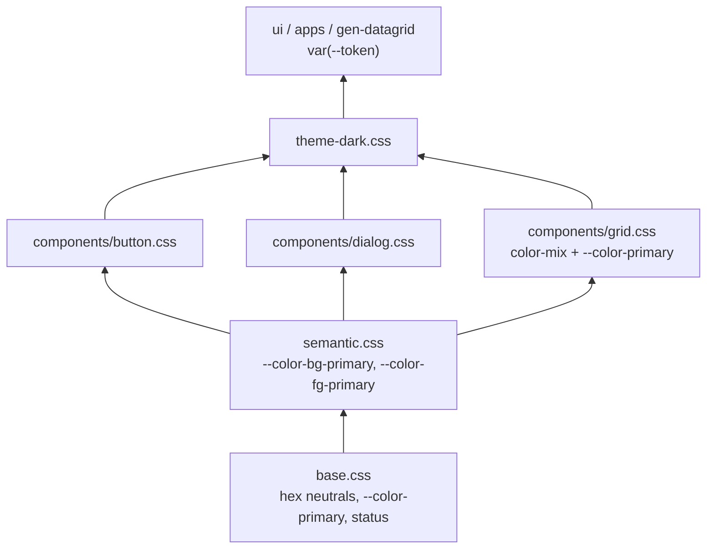
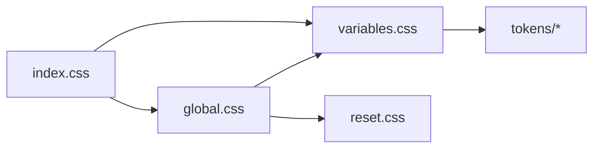
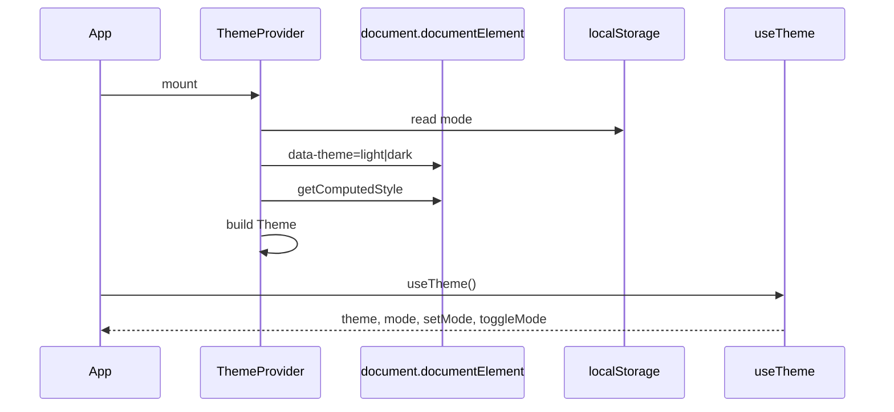
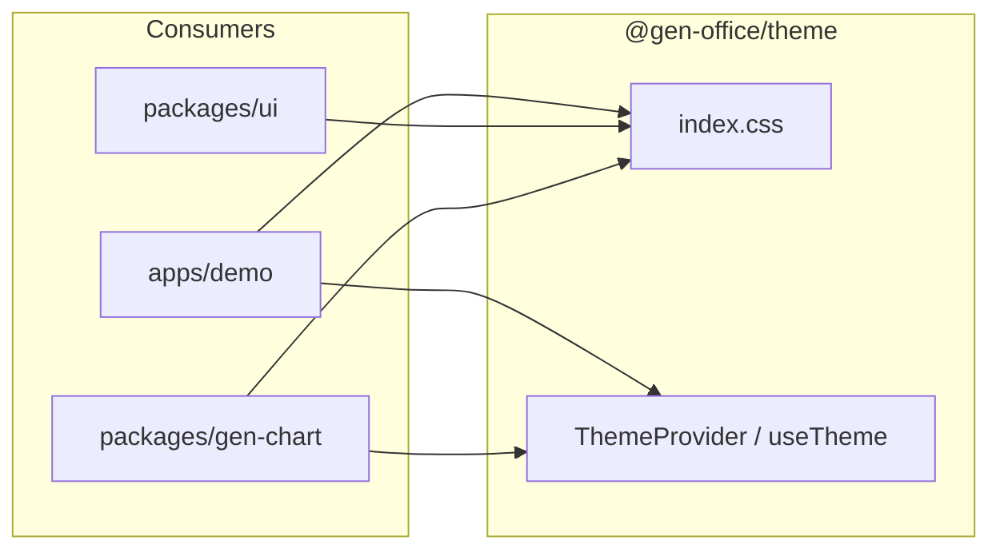
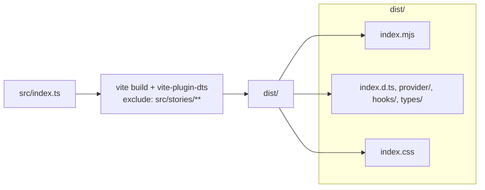

<!--
 @file packages/theme/.docs/architecture.md
 @description Package structure, token layers, runtime flow, and build exports for @gen-office/theme.

 @created 2026-06-22
 @updated 2026-06-23
-->
# @gen-office/theme 아키텍처

GenOffice V2의 디자인 토큰·글로벌 스타일·테마 React API를 제공하는 **기반 패키지**입니다.  
`ui`, `gen-chart`, `apps/demo` 등 상위 패키지는 **CSS 변수**와 **ThemeProvider / useTheme**에 의존합니다.

### 색상 정책 (2026-06-23 확정)

| 원칙 | 내용 |
| --- | --- |
| Source of truth | **CSS 변수만** (`index.css` → `styles/tokens/*`) |
| 색 표기 | 1층·semantic **#rrggbb hex** |
| 강조색 | **`--color-primary` = `#C6004D`** (light `#FDE8EF`, dark `#9E003E`; dark hover `#EC008B`) |
| status | Bootstrap (`#28a745`, `#ffc107`, `#dc3545`, `#17a2b8`) |
| brand | **`--color-brand` 없음**. V1 ui 이식용 `--button-brand-*`는 `--button-primary-*` alias |
| JS 색 상수 | **`lightTheme` / `ChartTokens` export 없음** — `useTheme()`만 |
| 차트 | `ChartTokens`·preset은 **`@gen-office/gen-chart`** 소유 |

상세 배경: [ref/token-sources-and-decisions.md](./ref/token-sources-and-decisions.md) · 결정 로그: [`.docs/logs/decisions.md`](../../.docs/logs/decisions.md)

---

## 1. 디렉터리 구조

```text
packages/theme/
├── .docs/
│   ├── README.md
│   ├── architecture.md                 본 문서
│   ├── ref/
│   │   ├── token-sources-and-decisions.md
│   │   └── token-mapping.md
│   └── logs/implementation-log.md
├── src/
│   ├── index.ts                        public JS 진입점
│   ├── index.css                       public CSS 진입점
│   ├── provider/                       ThemeProvider, ThemeContext
│   ├── hooks/                          useTheme
│   ├── types/                          theme.types.ts
│   ├── stories/                        Storybook (lib·dts 빌드 제외)
│   └── styles/
│       ├── variables.css               토큰 레이어 집계
│       ├── global.css                  body·scrollbar·focus
│       ├── reset.css
│       ├── fonts/lg-smart.css          선택
│       └── tokens/
│           ├── base.css                1층 hex 팔레트·spacing·typography
│           ├── semantic.css            --color-bg-*, --color-fg-* …
│           ├── theme-dark.css          [data-theme=dark] override
│           └── components/             button, dialog, grid
├── test/                               Vitest
├── package.json
├── tsconfig.json
├── vite.config.ts
└── vitest.config.ts
```

### 모듈 관계 (개요)



---

## 2. CSS 토큰 계층

토큰은 **아래 → 위** 순으로 쌓입니다. 복잡한 UI(그리드 hover·선택 행 등)는 **2층 component 토큰**과 `color-mix`로 처리합니다.



### 2.1 1층 (base + semantic) 요약

| 그룹 | 대표 변수 | light 예 |
| --- | --- | --- |
| 배경 | `--color-background` → `--color-bg-primary` | `#ffffff` |
| 전경 | `--color-text` → `--color-fg-primary` | `#1d1d1b` |
| 테두리 | `--color-border` → `--color-border-default` | `#e0e0e0` |
| 강조 | `--color-primary` | `#c6004d` |
| status | `--color-success` … `--color-status-*` | Bootstrap hex |

`--color-brand`는 정의하지 않습니다. Primary 버튼·링크·그리드 selection tint는 모두 `--color-primary` 계열을 참조합니다.

### 2.2 2층 (component)

| 파일 | 역할 |
| --- | --- |
| `button.css` | variant별 배경·테두리·focus ring. `--button-brand-*`는 primary alias (V1 ui) |
| `dialog.css` | 모달 chrome |
| `grid.css` | 헤더·행·셀·selection·row-status. hover/selected는 `color-mix(in srgb, var(--color-primary) …)` |

### CSS import 체인



| 파일 | 역할 |
| --- | --- |
| `index.css` | `variables` + `global` 로드 |
| `variables.css` | base → semantic → components → theme-dark 집계 |
| `global.css` | reset + variables + body/scrollbar/focus/selection |
| `theme-dark.css` | `[data-theme="dark"]` 시 1·2층 값 교체 |

선택 (`index.css` 주석 해제): `fonts/lg-smart.css`

---

## 3. React 런타임

### ThemeProvider

CSS 변수가 **유일한 색 정의**입니다. Provider는 `data-theme`을 설정한 뒤 `getComputedStyle`로 읽어 `Theme` 객체를 만듭니다.



### `Theme` 객체 ↔ CSS 변수

| `theme.colors` | CSS 변수 |
| --- | --- |
| `background.primary` | `--color-bg-primary` |
| `background.secondary` | `--color-bg-secondary` |
| `background.tertiary` | `--color-bg-tertiary` |
| `foreground.primary` | `--color-fg-primary` |
| `foreground.secondary` | `--color-fg-secondary` |
| `foreground.tertiary` | `--color-fg-tertiary` |
| `foreground.inverse` | `--color-fg-inverse` |
| `primary.default` | `--color-primary` |
| `primary.light` | `--color-primary-light` |
| `primary.dark` | `--color-primary-dark` |
| `status.*` | `--color-status-success` 등 |
| `border.*` | `--color-border-default` 등 |

브라우저가 `rgb(...)`로 반환할 수 있습니다. hex 문자열이 필요하면 소비자에서 변환합니다.

### Public React API

| export | 위치 |
| --- | --- |
| `ThemeProvider`, `ThemeContext` | `provider/ThemeProvider.tsx` |
| `useTheme` | `hooks/useTheme.ts` |
| `Theme`, `ThemeMode`, `ThemeContextValue` | `types/theme.types.ts` |



`ChartTokens`·차트 preset·`resolveChartTokens`는 **gen-chart**에서 export합니다 ([`.docs/05-GEN-CHART.md`](../../.docs/05-GEN-CHART.md)).

---

## 4. 빌드·배포

Vite library mode — 진입점 `src/index.ts` (side-effect: `index.css`).



### package.json exports

| import | 파일 | 용도 |
| --- | --- | --- |
| `@gen-office/theme` | `dist/index.mjs`, `dist/index.d.ts` | React API |
| `@gen-office/theme/index.css` | `dist/index.css` | 스타일 진입 (앱·Storybook) |

`react`, `react-dom`은 **external**입니다.

### Storybook

- 앱: `apps/storybook` — `packages/*/src/**/*.stories.*` glob
- theme 스토리: `src/stories/Theme.stories.tsx` (Mode, Semantic, Component, Typography)
- preview: `ThemeProvider` + theme `index.css`

---

## 5. 상위 패키지 연동

### 앱 / Storybook

```tsx
import { ThemeProvider } from '@gen-office/theme';
import '@gen-office/theme/index.css';

export function App() {
  return (
    <ThemeProvider defaultMode="light">
      {/* ... */}
    </ThemeProvider>
  );
}
```

### ui

- CSS Modules: `var(--button-primary-bg)`, `var(--color-bg-primary)` 등
- 새 코드는 `--button-brand-*` 대신 **primary** 토큰 사용
- 토큰 변경 시 [token-mapping.md](./ref/token-mapping.md) 갱신

### gen-chart

- `index.css` + `useTheme().mode`로 light/dark
- 렌더용 `ChartTokens`는 gen-chart `themes/` 모듈에서 정의·파생

### gen-datagrid

- `components/grid.css` 토큰 직접 참조
- 행 hover/selected tint는 `--color-primary` 기반 `color-mix`

---

## 6. 관련 문서

| 문서 | 내용 |
| --- | --- |
| [ref/token-sources-and-decisions.md](./ref/token-sources-and-decisions.md) | CSS/JS 정책·결정 이력 |
| [ref/token-mapping.md](./ref/token-mapping.md) | 토큰 ↔ 사용처 (ui 이식 시 갱신) |
| [logs/implementation-log.md](./logs/implementation-log.md) | 패키지 변경 로그 |
| [../../.docs/logs/decisions.md](../../.docs/logs/decisions.md) | 저장소 결정 로그 |
| [../../.docs/06-PACKAGE-REVIEW-PLAN.md](../../.docs/06-PACKAGE-REVIEW-PLAN.md) | 패키지 검토 순서 |
| [../../.docs/05-GEN-CHART.md](../../.docs/05-GEN-CHART.md) | gen-chart·ChartTokens 경계 |

---

## 7. 변경 시 체크리스트

- [ ] `src/index.ts` / `src/index.css`
- [ ] `package.json` `exports`
- [ ] `ThemeProvider` CSS 변수 매핑 ↔ `theme.types.ts`
- [ ] `pnpm -C packages/theme build` · `pnpm -C packages/theme test`
- [ ] 본 문서 · token-sources-and-decisions · implementation-log · decisions.md

---

## 8. 자동 테스트

```bash
pnpm -C packages/theme test
pnpm -C packages/theme test:watch
```

| 파일 | 검증 |
| --- | --- |
| `test/useTheme.test.tsx` | Provider 밖에서 throw, `toggleMode` |
| `test/ThemeProvider.test.tsx` | `data-theme`, localStorage, `primary.default` ≈ `#c6004d` |
| `test/cssTokens.test.ts` | semantic/component 변수, hex primary, `--color-brand` 부재 |
