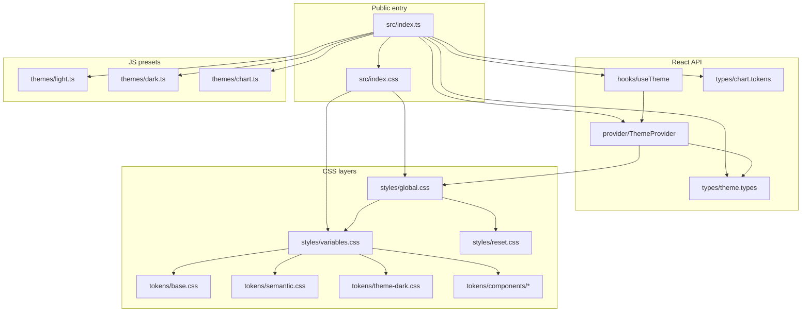
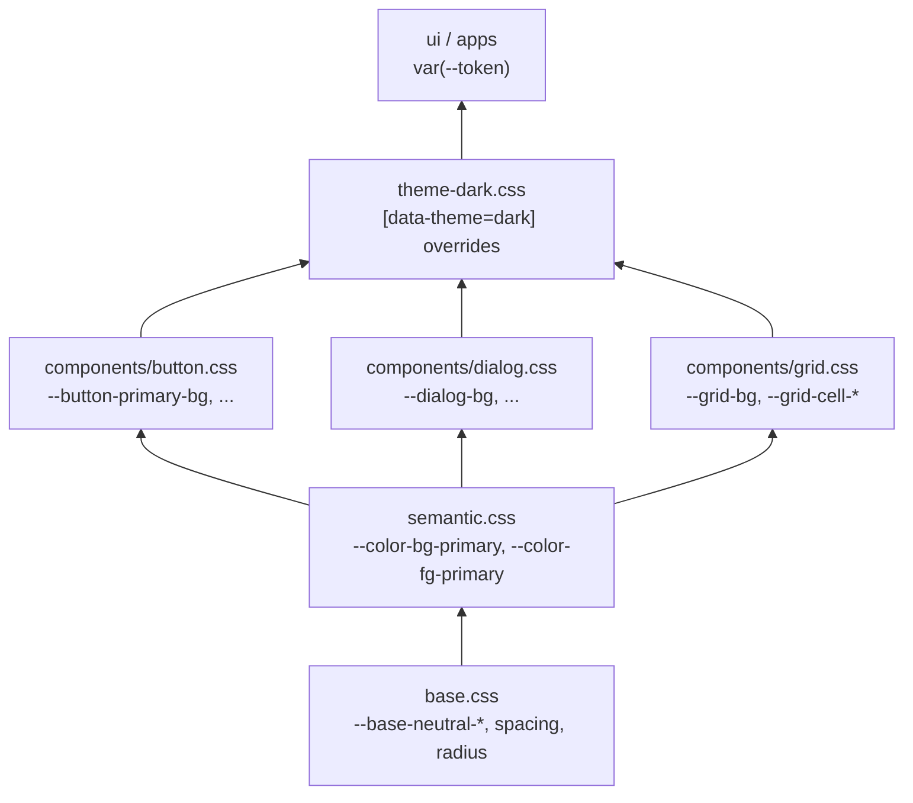
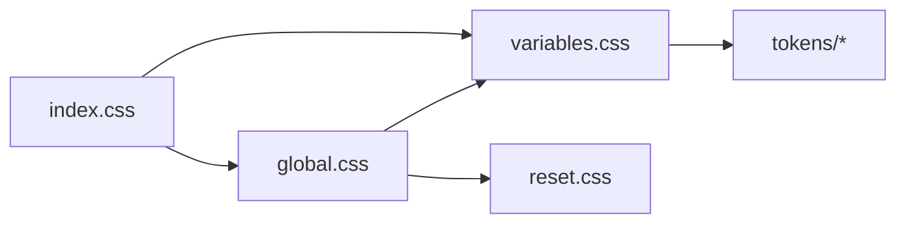
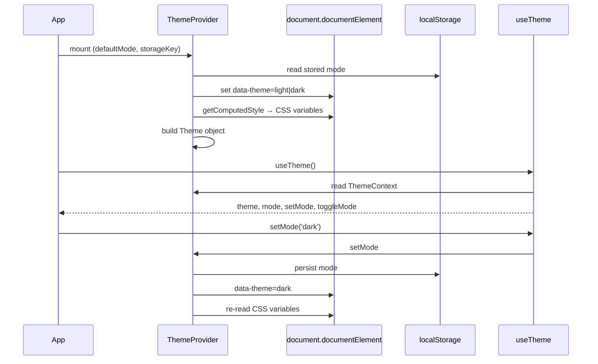
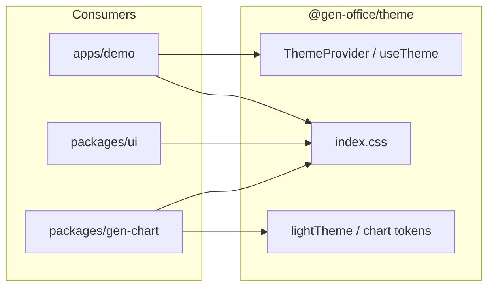
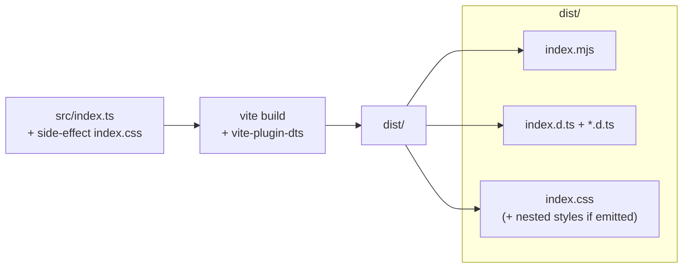

<!--
 @file packages/theme/.docs/architecture.md
 @description Package structure, token layers, runtime flow, and build exports for @gen-office/theme.

 @created 2026-06-22
-->
# @gen-office/theme 아키텍처

GenOffice V2의 디자인 토큰·글로벌 스타일·테마 React API를 제공하는 기반 패키지입니다.  
`ui`, `gen-chart`, `apps/demo` 등 상위 패키지가 **CSS 변수**와 **ThemeProvider**에 의존합니다.

---

## 1. 디렉터리 구조

```text
packages/theme/
├── .docs/                    패키지 문서
│   ├── README.md             문서 목차
│   ├── architecture.md       본 문서
│   ├── ref/token-mapping.md  토큰 ↔ 사용처 매핑
│   └── logs/implementation-log.md
├── src/
│   ├── index.ts              public JS 진입점
│   ├── index.css             public CSS 진입점
│   ├── provider/             ThemeProvider, ThemeContext
│   ├── hooks/                useTheme
│   ├── types/                Theme, ChartTokens 타입
│   ├── themes/               light/dark/chart JS 프리셋
│   └── styles/
│       ├── variables.css     토큰 레이어 집계
│       ├── global.css        body·scrollbar·focus 등
│       ├── reset.css         CSS reset
│       ├── fonts/            lg-smart.css (선택)
│       └── tokens/
│           ├── base.css          팔레트·spacing·typography 원시 토큰
│           ├── semantic.css      UI 의미 토큰 (--color-bg-primary 등)
│           ├── theme-dark.css    [data-theme=dark] 오버라이드
│           └── components/       button, dialog, grid 컴포넌트 토큰
├── package.json              exports 정의
├── tsconfig.json
└── vite.config.ts            lib 빌드 (ESM + d.ts + CSS)
```

### 모듈 관계 (개요)



---

## 2. CSS 토큰 계층

토큰은 **아래 → 위** 순으로 쌓입니다. 컴포넌트 패키지(`ui`)는 주로 **semantic**·**component** 변수를 참조합니다.



### CSS import 체인

앱에서 `import '@gen-office/theme/index.css'` 한 번으로 토큰·글로벌 스타일이 로드됩니다.



| 파일 | 역할 |
| --- | --- |
| `index.css` | 패키지 CSS 진입점. `variables` + `global` 로드 |
| `variables.css` | base → semantic → component → dark 토큰 집계 |
| `global.css` | reset + variables + body/scrollbar/focus/selection |
| `reset.css` | box-sizing, margin reset 등 |
| `theme-dark.css` | `document.documentElement[data-theme="dark"]` 시 값 교체 |

선택 옵션 (`index.css` 주석 해제):

- `reset.css` — `global.css`가 이미 import하므로 보통 중복 불필요
- `fonts/lg-smart.css` — LG Smart 브랜드 폰트 스택

---

## 3. React 런타임

### ThemeProvider 동작

`ThemeProvider`는 **CSS 변수를 source of truth**로 두고, 런타임에 computed style을 읽어 `Theme` 객체를 만듭니다.



### Public React API

| export | 위치 | 설명 |
| --- | --- | --- |
| `ThemeProvider` | `provider/ThemeProvider.tsx` | 앱 루트 래퍼. `data-theme` 설정 |
| `ThemeContext` | 동일 | Context 직접 접근 (고급) |
| `useTheme` | `hooks/useTheme.ts` | `theme`, `mode`, `setMode`, `toggleMode` |
| `Theme`, `ThemeMode`, `ThemeContextValue` | `types/theme.types.ts` | 타입 |
| `ChartTokens`, `DeepPartial` 등 | `types/chart.tokens.ts` | gen-chart 연동 타입 |
| `lightTheme`, `darkTheme` | `themes/light.ts`, `dark.ts` | JS 색상 프리셋 (CSS와 별도) |
| `lightChartTokens`, `darkChartTokens` | `themes/chart.ts` | 차트 기본 토큰 |



---

## 4. 빌드·배포 산출물

Vite library mode로 `src/index.ts` 하나에서 JS·타입·CSS를 빌드합니다.



### package.json exports

| import 경로 | 실제 파일 | 용도 |
| --- | --- | --- |
| `@gen-office/theme` | `dist/index.mjs` + `dist/index.d.ts` | React API |
| `@gen-office/theme/index.css` | `dist/index.css` | 앱·Storybook 스타일 진입 |
| `@gen-office/theme/styles` | `dist/styles/global.css` | global 스타일만 필요할 때 |
| `@gen-office/theme/styles/global.css` | 동일 | 명시적 global 경로 |

`react`, `react-dom`은 **external** — 번들에 포함되지 않습니다.

---

## 5. 상위 패키지 연동 가이드

### 앱 / Storybook 최소 설정

```tsx
import { ThemeProvider } from '@gen-office/theme';
import '@gen-office/theme/index.css';

export function App() {
  return (
    <ThemeProvider defaultMode="light">
      {/* ... */}
    </ThemeProvider>
  );
}
```

### ui 패키지

- CSS Modules에서 `var(--button-primary-bg)` 등 **component·semantic** 토큰 참조
- 토큰 이름 변경 시 [ref/token-mapping.md](./ref/token-mapping.md) 갱신

### gen-chart

- `ChartTokens` 타입 (`types/chart.tokens.ts`)
- `lightChartTokens` / `darkChartTokens` 프리셋 (`themes/chart.ts`)
- 렌더 시 `useTheme().mode`에 맞는 프리셋 선택

---

## 6. 관련 문서

| 문서 | 내용 |
| --- | --- |
| [ref/token-mapping.md](./ref/token-mapping.md) | 토큰별 소스·사용 파일 |
| [logs/implementation-log.md](./logs/implementation-log.md) | 변경 이력 |
| [../../.docs/06-PACKAGE-REVIEW-PLAN.md](../../.docs/06-PACKAGE-REVIEW-PLAN.md) | V2 패키지 검토 순서 |
| [../../../frontend/packages/theme](../../../frontend/packages/theme) | V1 참조 구현 |

---

## 7. 구조 변경 시 체크리스트

- [ ] `src/index.ts` / `src/index.css` export·import 경로
- [ ] `package.json` `exports` 필드
- [ ] `pnpm -C packages/theme build` 통과
- [ ] 본 문서·token-mapping·implementation-log 갱신
