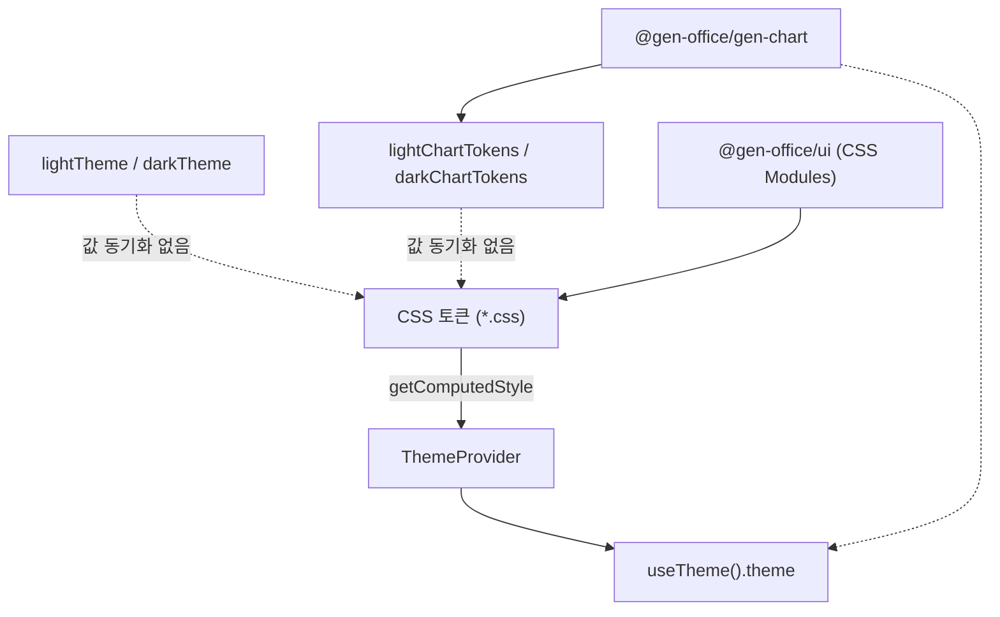

<!--
 @file packages/theme/.docs/ref/token-sources-and-decisions.md
 @description CSS 토큰·JS 프리셋·useTheme 관계 정리 및 미결정 사항.

 @created 2026-06-23
-->
# CSS 토큰과 JS 프리셋 — 정리 및 결정 사항

이 문서는 `@gen-office/theme`에서 **색상 정보가 여러 경로로 존재하는 이유**와, **어디를 기준으로 삼아야 하는지**를 차근차근 정리합니다.

> **상태:** 결정 확정 (2026-06-23) · 구현 반영됨  
> **대상:** theme 패키지 검토자, `ui` / `gen-chart` 이식 담당  
> **관련 문서:** [architecture.md](../architecture.md), [token-mapping.md](./token-mapping.md), [`.docs/logs/decisions.md`](../../../.docs/logs/decisions.md)

---

## 확정된 결정 요약

| 항목 | 결정 |
| --- | --- |
| Source of truth | **CSS 변수만** (`index.css` → tokens) |
| 색 표기 | **#rrggbb hex** (1층·semantic) |
| 강조색 | **`--color-primary` = `#C6004D`** (light `#FDE8EF`, dark `#9E003E`; dark mode hover `#EC008B`) |
| status | **Bootstrap** (`#28a745`, `#ffc107`, `#dc3545`, `#17a2b8`) |
| brand | **제거** (`--color-brand` 없음). V1 ui용 `--button-brand-*`는 primary alias |
| JS 프리셋 | **`lightTheme` / `darkTheme` 제거**. `useTheme()`만 사용 |
| ChartTokens | **`gen-chart` 패키지**에서 정의 (theme export 없음) |
| Theme 타입 | `colors.primary` (`default` / `light` / `dark`) |

아래 본문은 검토 당시 배경·FAQ입니다. 미결정 체크리스트(D1~D5)는 위 표로 대체되었습니다.

---

## 목차

1. [먼저 읽을 요약](#1-먼저-읽을-요약)
2. [용어 정리](#2-용어-정리)
3. [색상이 흐르는 세 가지 길](#3-색상이-흐르는-세-가지-길)
4. [각 길의 역할과 사용처](#4-각-길의-역할과-사용처)
5. [지금 겹치거나 어긋나는 부분](#5-지금-겹치거나-어긋나는-부분)
6. [`primary`와 `brand`는 다른 색입니다](#6-primary와-brand는-다른-색입니다)
7. [결정이 필요한 항목](#7-결정이-필요한-항목)
8. [결정이 나면 할 일](#8-결정이-나면-할-일)
9. [관련 소스 파일](#9-관련-소스-파일)

---

## 1. 먼저 읽을 요약

### 한 줄로

**화면에 실제로 보이는 색은 CSS 변수가 기준**입니다.  
그런데 패키지에는 CSS와 값이 다른 **JS 상수(`lightTheme`, `lightChartTokens`)** 도 함께 export 되어 있어, 이름은 같아도 색이 다를 수 있습니다.

### 지금 당장 기억할 것 (3가지)

| # | 경로 | 한 줄 설명 | UI에 반영? |
| --- | --- | --- | --- |
| 1 | **CSS 토큰** (`*.css`) | `var(--color-bg-primary)` 등으로 컴포넌트 스타일 | ✅ **기준** |
| 2 | **`useTheme().theme`** | ThemeProvider가 CSS 변수를 읽어 만든 JS 객체 | ✅ CSS와 연동 (단, 매핑 일부 수정 필요) |
| 3 | **`lightTheme` / `darkTheme` / `ChartTokens`** | 파일에 박아 둔 hex 상수 | ⚠️ CSS와 **자동 동기화 안 됨** |

### 아직 결정되지 않은 것

- V1 LG 팔레트를 유지할지, 현재 CSS(oklch + brand 분리)를 유지할지
- `lightTheme` / `darkTheme` export를 계속 둘지
- `Theme` 객체에서 `brand`와 `primary`를 어떻게 구분할지
- 차트 색(`ChartTokens`)을 CSS와 맞출지

아래 [7절](#7-결정이-필요한-항목)에 선택지를 적어 두었습니다.

---

## 2. 용어 정리

| 용어 | 의미 |
| --- | --- |
| **CSS 토큰** | `--color-bg-primary` 같은 CSS 사용자 정의 속성. `base.css` → `semantic.css` → `components/*.css` 순으로 쌓임 |
| **semantic 토큰** | UI가 직접 참조하는 이름 (`--color-fg-primary`, `--button-primary-bg` 등) |
| **JS 프리셋** | TypeScript 파일에 적어 둔 색상 상수 (`lightTheme`, `lightChartTokens`) |
| **`Theme` 객체** | `useTheme()`이 돌려주는 구조. `colors.background`, `colors.brand` 등 |
| **source of truth** | “이 값이 맞다”고 정하는 단일 기준. 현재 UI 기준은 **CSS** |

---

## 3. 색상이 흐르는 세 가지 길

### 경로 1 — CSS (UI 렌더링)

```text
index.css
  → variables.css
      → tokens/base.css        (원시 팔레트)
      → tokens/semantic.css    (UI용 이름)
      → tokens/components/*    (버튼, 그리드, 다이얼로그)
      → tokens/theme-dark.css  ([data-theme="dark"] 때 덮어쓰기)
  → global.css                 (body, scrollbar 등)
```

앱·`ui` 패키지는 보통 `import '@gen-office/theme/index.css'` 한 번과 `var(--토큰이름)`으로 스타일합니다.

### 경로 2 — ThemeProvider → useTheme()

```text
ThemeProvider
  → document.documentElement 에 data-theme="light|dark" 설정
  → getComputedStyle() 으로 CSS 변수 읽기
  → Theme 객체로 context에 제공
  → useTheme() 으로 소비
```

JS 안에서 “지금 배경색이 뭐지?”가 필요할 때 씁니다. **원칙상 CSS와 같아야** 합니다.

### 경로 3 — 정적 JS 프리셋

```text
themes/light.ts   → export const lightTheme
themes/dark.ts    → export const darkTheme
themes/chart.ts   → export const lightChartTokens / darkChartTokens
```

파일에 hex를 직접 적어 둔 값입니다. **CSS를 읽지 않습니다.**  
`architecture.md`에는 “CSS와 별도”라고 되어 있지만, **소비자가 언제 써야 하는지**는 아직 명확하지 않습니다.

### 관계도



---

## 4. 각 길의 역할과 사용처

### CSS 토큰 — UI의 기준

- **누가 쓰나:** `ui` 컴포넌트 CSS, 앱 레이아웃, Storybook 미리보기
- **예:** `background: var(--button-brand-bg);`
- **장점:** light/dark 전환이 `data-theme`만으로 동작
- **파일:** `packages/theme/src/styles/tokens/**`

### useTheme().theme — 런타임 JS용

- **누가 쓰나:** React 컴포넌트에서 색 문자열이 필요할 때 (인라인 스타일, 차트 연동 등)
- **예:** `const { theme } = useTheme(); theme.colors.background.primary`
- **주의:** Provider가 **어떤 CSS 변수를 읽느냐**에 따라 의미가 달라짐 ([6절](#6-primary와-brand는-다른-색입니다) 참고)

### lightTheme / darkTheme — 정적 상수

- **현재 export:** `@gen-office/theme` public API
- **실제 사용:** 테스트(`themePresets.test.ts`)와 문서 예제 수준. 앱/`ui`에서 직접 참조하는 코드는 없음
- **값의 출처:** V1 시절 LG 계열 hex에 가깝게 수작업 이관된 것으로 보임

### ChartTokens — 차트 전용

- **누가 쓰나:** `gen-chart` (SVG/canvas는 CSS `var()`를 그대로 쓰기 어려움)
- **파일:** `packages/theme/src/themes/chart.ts`
- **문서 원칙:** [`.docs/05-GEN-CHART.md`](../../../.docs/05-GEN-CHART.md) — “`@gen-office/theme` 토큰에서 파생”
- **현실:** palette가 generic hex(`#2563eb` 등)라 CSS 브랜드색과 맞지 않음

---

## 5. 지금 겹치거나 어긋나는 부분

### 5-1. 팔레트 철학이 다름

| 항목 | CSS (`base.css` 기준) | JS (`lightTheme`) |
| --- | --- | --- |
| 배경 primary | `oklch(1 0 0)` (흰색에 가까움) | `#FFFFFF` |
| 전경 primary | `oklch(0.145 0 0)` (거의 검정) | `#1D1D1B` |
| 브랜드색 | `--color-brand` = `#a50034` | `brand.primary` = `#C6004D` |
| status.success | `#28a745` | `#0096AA` |
| status.error | `#dc3545` | `#C6004D` |
| 색 표기 | oklch + 일부 hex | hex만 |

- **CSS:** 중립 UI 색 + 별도 브랜드색 (Radix/shadcn 스타일에 가까움)
- **JS 프리셋:** V1 LG 팔레트 hex

배경·전경은 비슷하지만, **브랜드·상태색은 체계가 다릅니다.**

### 5-2. 같은 이름, 다른 값 — 브랜드색 예시 (light mode)

| 가져오는 방법 | brand에 해당하는 값 | 비고 |
| --- | --- | --- |
| CSS `--color-brand` | `#a50034` | `--button-brand-bg`가 참조 |
| `lightTheme.colors.brand.primary` | `#C6004D` | JS export |
| `useTheme().theme.colors.brand.primary` | `oklch(0.205 0 0)` ≈ 어두운 회색 | Provider가 `--color-primary`를 읽음 |

세 값이 **모두 다릅니다.** “브랜드색”이라는 말만 같습니다.

### 5-3. ChartTokens도 제3의 팔레트

| 항목 | CSS semantic | `lightChartTokens` |
| --- | --- | --- |
| 배경 | oklch white | `#ffffff` |
| 본문 텍스트 | oklch dark gray | `#111827` |
| 시리즈 색 | (정의 없음) | 파랑·초록 등 `#2563eb`, `#16a34a`… |

차트 기본 palette에 LG 브랜드색이 들어가 있지 않습니다.

### 5-4. 작은 불일치들

| 항목 | 내용 |
| --- | --- |
| `--color-border-subtle` | semantic에서 `--color-border`와 동일 alias. JS `lightTheme`의 `subtle`/`default`는 서로 다름 |
| `--color-fg-tertiary` | `--color-fg-secondary`와 동일 alias |
| chart `fontFamily` | `var(--font-family, …)` 참조. CSS 실제 이름은 `--font-family-primary` |

---

## 6. `primary`와 `brand`는 다른 색입니다

CSS와 버튼 토큰에서는 **의도적으로 역할을 나눴습니다.**

| CSS 변수 | light mode에서의 역할 | 버튼에서 |
| --- | --- | --- |
| `--color-primary` | UI 강조색 (거의 검정) | `--button-primary-bg` |
| `--color-brand` | LG 브랜드색 (`#a50034`) | `--button-brand-bg` |

그런데 `ThemeProvider`는 `theme.colors.brand.primary`를 **`--color-primary`에서 읽고** 있습니다.

```ts
// packages/theme/src/provider/ThemeProvider.tsx (현재)
brand: {
  primary: getVar('--color-primary'),      // ← UI primary 색
  secondary: getVar('--color-brand-secondary'),
},
```

그래서 Storybook의 “brand.primary” 스와치는 **실제 브랜드 버튼 색과 다를 수 있습니다.**

**정리:** 이건 “팔레트를 뭘 쓸지” 결정과 별개로, **매핑 버그에 가깝습니다.**  
다만 `Theme` 타입에 `primary`와 `brand`를 둘 다 둘지는 [D3](#d3-theme-객체에서-brand와-primary-를-어떻게-구분할까)에서 함께 정하는 것이 좋습니다.

---

## 7. 결정이 필요한 항목

결정할 때 옆에 ✅와 선택한 옵션, 날짜, 메모를 적어 두면 됩니다.

### D1. UI 팔레트 기준을 무엇으로 할까?

**질문:** CSS를 V1 LG 느낌으로 맞출까, 현재 V2 CSS(oklch + brand 분리)를 유지할까?

| 옵션 | 설명 | 장점 | 단점 |
| --- | --- | --- | --- |
| **A** | **V2 CSS 유지** — oklch 중립 + `--color-brand` | `ui`(Radix) 패턴과 잘 맞음. dark 구조 이미 있음 | V1 화면과 색감 차이 |
| **B** | **V1 LG로 CSS 회귀** — hex 팔레트 중심 | 기존 제품과 비슷한 색 | CSS 구조 대폭 수정 |
| **C** | **혼합** — UI 골격은 V2, brand/status만 V1 값 | 절충 | 문서·유지보수 부담 |

**추가로 정할 것:** 공식 브랜드색을 `#a50034`와 `#C6004D` 중 어느 쪽으로 통일할지.

- [ ] 결정: ___
- [ ] 결정일: ___
- [ ] 메모: ___

---

### D2. `lightTheme` / `darkTheme` export를 어떻게 할까?

**질문:** CSS와 동기화되지 않는 JS 상수를 public API로 둘까?

| 옵션 | 설명 |
| --- | --- |
| **A** | **제거 또는 비공개** — `useTheme()`만 사용 |
| **B** | **CSS와 동기화** — 빌드 스크립트 또는 수동으로 hex 유지 |
| **C** | **SSR/테스트 전용** — 이름을 `*Fallback` 등으로 바꾸고 “UI 색 아님” 문서화 |
| **D** | **V1 호환용 유지** — V2 신규 코드에서는 사용 금지 명시 |

- [ ] 결정: ___
- [ ] 결정일: ___
- [ ] 메모: ___

---

### D3. `Theme` 객체에서 `brand`와 `primary`를 어떻게 구분할까?

**질문:** `useTheme().theme.colors`에 무엇을 넣을까?

| 옵션 | `brand.primary` 의미 | 비고 |
| --- | --- | --- |
| **A** | `--color-brand` 읽기 | 브랜드 버튼과 일치 |
| **B** | `--color-primary` 읽기 | primary 버튼과 일치 (이름이 `brand`라 혼란) |
| **C** | **`brand` + `primary` 필드 분리** | `Theme` 타입 확장. 가장 명확 |

- [ ] 결정: ___
- [ ] 결정일: ___
- [ ] 메모: ___

---

### D4. `ChartTokens`를 CSS와 어떤 관계로 둘까?

**질문:** 차트 색은 CSS를 따를까, 독립 팔레트를 둘까?

| 옵션 | 설명 |
| --- | --- |
| **A** | **CSS에 맞춤** — chart.ts의 hex를 semantic/brand 값에 수동 정렬 |
| **A′** | **런타임 생성** — gen-chart 또는 theme에서 `getComputedStyle`로 ChartTokens 생성 |
| **B** | **독립 유지** — 차트만 generic palette (제품 색과 다를 수 있음) |
| **C** | **A + override** — 기본은 CSS 정렬, `tokens` prop으로 덮어쓰기 (gen-chart 문서 원칙) |

**추가로 정할 것:** 시리즈 palette에 브랜드색을 포함할지.

- [ ] 결정: ___
- [ ] 결정일: ___
- [ ] 메모: ___

---

### D5. JS에 넘기는 색 문자열 형식

**질문:** `useTheme()`이 돌려주는 색은 `oklch(...)` 그대로일까, hex로 변환할까?

| 옵션 | 설명 |
| --- | --- |
| **A** | CSS computed 문자열 그대로 (`oklch(...)`, `#rrggbb` 혼재 가능) |
| **B** | 항상 hex로 변환 |
| **C** | CSS 토큰도 hex로 통일 |

보통 D1·D3이 정해지면 **A(그대로)** 가 자연스럽습니다.

- [ ] 결정: ___
- [ ] 결정일: ___
- [ ] 메모: ___

---

### 권장 결정 순서

```text
D1 (팔레트 기준)
  → D3 (Theme 필드 의미)
  → D2 (lightTheme/darkTheme 정책)
  → D4 (ChartTokens)
  → D5 (문자열 형식, 대부분 자동)
```

---

## 8. 결정이 나면 할 일

아래는 **구현 체크리스트**입니다. 결정 전에는 코드를 맞추지 않는 것이 좋습니다.

### 코드

- [ ] `ThemeProvider` CSS 변수 매핑 수정 (D3 반영)
- [ ] 필요 시 `Theme` 타입 확장 (`primary` vs `brand`)
- [ ] `themes/light.ts` / `dark.ts` — D2에 따라 수정·제거·이름 변경
- [ ] `themes/chart.ts` — D4에 따라 palette 정렬
- [ ] `semantic.css` — `--color-brand-primary` alias 추가 여부 검토

### 테스트

- [ ] `useTheme()` 값이 CSS 변수와 일치하는지 통합 테스트 추가
- [ ] `themePresets.test.ts` — D2 정책에 맞게 조정

### 문서

- [ ] [architecture.md](../architecture.md) — “JS 프리셋 역할” 문단 갱신
- [ ] [`.docs/logs/decisions.md`](../../../.docs/logs/decisions.md) — D1~D5 결정 기록
- [ ] 본 문서 상단 **상태**를 “결정 완료”로 변경

---

## 9. 관련 소스 파일

| 파일 | 내용 |
| --- | --- |
| `src/styles/tokens/base.css` | 원시 팔레트, `--color-primary`, `--color-brand` |
| `src/styles/tokens/semantic.css` | `--color-bg-*`, `--color-fg-*`, status alias |
| `src/styles/tokens/theme-dark.css` | dark mode override |
| `src/styles/tokens/components/button.css` | primary vs brand 버튼 토큰 |
| `src/provider/ThemeProvider.tsx` | CSS → `Theme` 객체 매핑 |
| `src/types/theme.types.ts` | `Theme`, `ThemeContextValue` 타입 |
| `src/themes/light.ts`, `dark.ts` | JS hex 프리셋 |
| `src/themes/chart.ts` | `ChartTokens` 프리셋 |
| `test/themePresets.test.ts` | JS 프리셋 형태 테스트 |
| `test/ThemeProvider.test.tsx` | Provider·CSS 연동 테스트 |

---

## 부록 — 빠른 FAQ

### Q. `ui` 패키지는 뭘 쓰면 되나?

**CSS 변수만** 쓰면 됩니다. `lightTheme` export는 필요 없습니다.

### Q. `gen-chart`는?

D4 결정 전까지는 `lightChartTokens` / `darkChartTokens`를 쓰되, **제품 색과 다를 수 있음**을 알고 있어야 합니다.

### Q. `useTheme()`과 `lightTheme` 중 뭐가 맞나?

**화면 기준으로는 `useTheme()`** (CSS 연동)이 맞습니다.  
다만 현재 `brand` 매핑은 수정이 필요합니다 ([6절](#6-primary와-brand는-다른-색입니다)).

### Q. V1 `frontend/packages/theme`와 비교는?

V1 소스는 참고용입니다. V2 CSS는 이식 과정에서 팔레트 구조가 바뀐 상태로 보이며, JS 프리셋만 V1 hex에 더 가깝습니다.

---

*문서 작성: 2026-06-23 — theme 패키지 검토 중 발견된 CSS/JS 이중 체계 정리*
