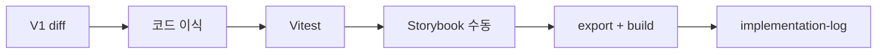

<!--
 @file packages/ui/.docs/migration-plan.md
 @description Phased V1→V2 migration plan for @gen-office/ui core and composed components.

 @created 2026-06-23
-->
# @gen-office/ui 이관 Plan

V1 [`frontend/packages/ui`](../../../frontend/packages/ui) → V2 `packages/ui`  
**한 컴포넌트 = 한 Gate** (자동 test + Storybook 수동 + 로그)

---

## 0. 진행 방식



| 단계 | 명령 | 통과 기준 |
| --- | --- | --- |
| 자동 test | `pnpm -C packages/ui test` | 해당 컴포넌트 test green |
| 수동 test | `pnpm -C apps/storybook dev` | Gate 체크리스트 (architecture §8.2) |
| 빌드 | `pnpm -C packages/ui build` | dist·d.ts 생성 |

---

## 1. Wave 0 — 패키지 스캐폴드 (코어 이전에 1회)

**선행:** `theme`·`utils` 검토 완료 ✅

| # | 작업 | 산출 |
| --- | --- | --- |
| 0.1 | `vite.config.ts` V2 정리 (`GenOfficeUi`, external, stories dts 제외) | 빌드 가능 |
| 0.2 | `vitest.config.ts` + `test/setup.ts` (theme 패턴) | test runner |
| 0.3 | `src/index.ts`, `src/index.css` | theme import |
| 0.4 | `package.json` test script · RTL devDeps | `pnpm test` |
| 0.5 | `.docs/logs/implementation-log.md` 생성 | 로그 시작 |

**완료 기준:** 빈 export로 `build` / `test` (passWithNoTests 또는 smoke 1건) 통과.

---

## 2. Wave 1 — Core Phase 1 (leaf · 의존 최소)

Radix 없음 또는 단일 primitive. **패턴 확립용** — Button을 1번으로 두어 Slot·variant·theme 연동 템플릿으로 삼습니다.

| 순서 | 컴포넌트 | V1 Radix | 비고 |
| --- | --- | --- | --- |
| 1 | **Button** | `@radix-ui/react-slot` | variant·loading·asChild — **템플릿** |
| 2 | Label | `@radix-ui/react-label` | form baseline |
| 3 | Separator | `@radix-ui/react-separator` | |
| 4 | Badge | — | CSS only |
| 5 | Input | — | native + theme |
| 6 | Textarea | — | |

### Gate 체크리스트 (각 컴포넌트)

- [ ] V1 → V2: `cn` → `clsx`
- [ ] `*.types.ts` / `forwardRef` / `displayName`
- [ ] `test/core/<Name>.test.tsx` (render + 1 interaction 또는 state)
- [ ] `UI/Core/<Name>` story · autodocs
- [ ] Storybook: light/dark · focus · disabled
- [ ] `src/index.ts` export
- [ ] `implementation-log.md` 항목 추가

---

## 3. Wave 2 — Core Phase 2 (form toggles)

| 순서 | 컴포넌트 | V1 Radix |
| --- | --- | --- |
| 7 | Checkbox | `@radix-ui/react-checkbox` |
| 8 | Switch | `@radix-ui/react-switch` |
| 9 | Radio (+ StandardRadioGroup) | `@radix-ui/react-radio-group` |
| 10 | Slider | `@radix-ui/react-slider` |

**추가 test 포인트:** keyboard · `aria-checked` / `aria-valuenow`

---

## 4. Wave 3 — Core Phase 3 (overlay · menu)

| 순서 | 컴포넌트 | V1 Radix | 비고 |
| --- | --- | --- | --- |
| 11 | Dialog (+ **StandardDialog**) | `@radix-ui/react-dialog` | focus trap |
| 12 | Drawer | V1 custom / dialog 계열 | V1 구현 확인 후 이식 |
| 13 | Popover | `@radix-ui/react-popover` | |
| 14 | DropdownMenu | `@radix-ui/react-dropdown-menu` | |
| 15 | Select (+ **StandardSelect**) | `@radix-ui/react-select` | portal · 키보드 |

**추가 test 포인트:** open/close, Escape (RTL `userEvent`)

---

## 5. Wave 4 — Core Phase 4 (navigation · data display)

| 순서 | 컴포넌트 | V1 Radix | 비고 |
| --- | --- | --- | --- |
| 16 | Tabs | `@radix-ui/react-tabs` | |
| 17 | Breadcrumb | — | |
| 18 | Tree | — | 복잡도 높음 — story 비중 크게 |
| 19 | Calendar | — | `@daypicker/react` v10 (DayPicker) 의존 (core 내 Calendar) |

> **Calendar**는 V1에서 `react-day-picker` 사용. V2는 **`@daypicker/react` v10** 패키지명으로 교체. core에 두되 DatePicker(composed)와 API 경계를 story에서 명시.

---

## 5b. Wave 5-ext — Core feedback (Radix extensions)

V1 parity 밖이지만 백오피스에서 반복 사용되는 Radix primitive를 core에 추가.

| 순서 | 컴포넌트 | Radix | 비고 |
| --- | --- | --- | --- |
| 20 | Tooltip | `@radix-ui/react-tooltip` | `TooltipProvider` 앱 루트 |
| 21 | Toast | `@radix-ui/react-toast` | compound · `ToastViewport` 필수 |
| 22 | Progress | `@radix-ui/react-progress` | `variant` · indeterminate (`value={null}`) |

Story title: `UI/Core5-feedback/<Name>`

---

## 5c. Wave 5-pre — MaskedInput (C5a · DatePicker 선행 core)

V1에 없었으나 V2에서 DatePicker·폼 공통 기반으로 **composed C5b 전에** Gate 완료.

| 순서 | 컴포넌트 | depends on | 비고 |
| --- | --- | --- | --- |
| 23 | **MaskedInput** | Input; `@gen-office/utils` `format/mask` | 1차 preset `ymd` · `ym`; 범용 mask는 [deferred.md](./deferred.md) D-003 |

Story title: `UI/Core/maskedInput/MaskedInput`  
상세: [core/masked-input.md](./core/masked-input.md)

---

## 6. Wave 5 — Composed (`@gen-office/ui`)

core export 안정 후 진행. **소스는 `core/` + `composed/` 두 층**만 유지합니다.

```text
packages/ui/src/
├── core/
└── composed/          ← core 조합 (폼·레이아웃·피커·트리 패널 포함)
```

Story title: `UI/Composed/<Name>` · test: `test/composed/`

| 순서 | 컴포넌트 | src | depends on | 비고 |
| --- | --- | --- | --- | --- |
| C1 | AlertDialog | `composed/alertDialog` | Dialog | |
| C2 | ConfirmDialog | `composed/confirmDialog` | Dialog | |
| C3 | **SplitLayout** | `composed/splitLayout` | — | ✅ Gate 완료 |
| C4 | **FilterBar**, **StandardFilterBar** | `composed/filterBar` | Input, Button, Select | combo 필드 C6 이후 |
| **C5a** | *(core)* **MaskedInput** | `core/maskedInput` | Input, utils `format/mask` | **C5b 선행** |
| **C5b** | DatePicker 계열 | `composed/datePicker` | Calendar, Popover, MaskedInput | |
| C6 | Combobox / MultiCombobox | `composed/combobox` | Popover, Input | ✅ |
| C7 | TreeCombobox | `composed/treeCombobox` | Tree, Combobox | ✅ |
| C8 | **ModalInput** | `composed/modalInput` | Dialog, Input | ✅ |
| C9 | **TreeView** | `composed/treeView` | core `Tree` | ✅ Gate 완료 |

> **제외:** V1 `MasterDetailLayout` — `SplitLayout` + `PageHeader`로 조합. [decisions.md](../../../.docs/logs/decisions.md).
>
> **C4 명명:** V1 `SimpleFilterBar` → **`StandardFilterBar`**. `SearchInput` — **public export 없음**.
>
> **C5 순서:** **C5a MaskedInput** → **C5b DatePicker** ([date-picker.md](./composed/date-picker.md)).
>
> **UX 구분 (폴더 분리 없음):** `TreeCombobox` = dropdown 필드 · `TreeView` = 영역 탐색 패널. 둘 다 `composed/`.

### Wave 5 이후 — `@gen-office/html-editor` (ui 밖)

| 항목 | 방향 |
| --- | --- |
| V1 **RichTextEditor** | **`@gen-office/ui` composed Gate 아님** |
| V2 | 별도 패키지 `@gen-office/html-editor` (가칭) — TipTap·sanitize·toolbar |
| ui | `@gen-office/theme`·`Button` 등 **선택적 peer**; demo는 필요 시 의존 |

상세: [architecture.md](./architecture.md) · repo [`.docs/04-ROADMAP.md`](../../../.docs/04-ROADMAP.md).

---

## 7. V1 public export 대조

V1 `src/index.ts` 기준 core 18 + composed 14 (**`MasterDetailLayout` 제외 시 13**). Wave 1~4로 core, Wave 5로 composed 커버.

| V1 core | Wave |
| --- | --- |
| Button, Label, Separator, Badge, Input, Textarea | 1 |
| Checkbox, Switch, Radio, Slider | 2 |
| Dialog, Drawer, Popover, DropdownMenu, Select | 3 |
| Tabs, Breadcrumb, Tree, Calendar | 4 |

---

## 8. 컴ponent별 test 최소 템플릿

```tsx
/**
 * @file packages/ui/test/core/Button.test.tsx
 * @description Tests for Button.
 * @created 2026-06-23
 */
import { describe, expect, it } from 'vitest';
import { render, screen } from '@testing-library/react';
import userEvent from '@testing-library/user-event';

import { Button } from '../../src/core/Button';

describe('Button', () => {
  it('renders and handles click', async () => {
    const user = userEvent.setup();
    let clicked = false;
    render(<Button onClick={() => { clicked = true; }}>Save</Button>);
    await user.click(screen.getByRole('button', { name: 'Save' }));
    expect(clicked).toBe(true);
  });

  it('respects disabled', () => {
    render(<Button disabled>Save</Button>);
    expect(screen.getByRole('button')).toBeDisabled();
  });
});
```

Radix 컴포넌트는 `getByRole('checkbox' | 'switch' | 'tab' …)` 우선.

---

## 9. Storybook 수동 Gate (공통)

컴포넌트 이관마다 `implementation-log`에 **수동 결과**를 한 줄 기록 (예: `Button — dark theme·a11y OK`).

| # | 확인 |
| --- | --- |
| 1 | 모든 variant story 렌더 |
| 2 | Controls로 prop 변경 |
| 3 | Tab / Shift+Tab focus visible |
| 4 | `data-theme=dark` (Storybook decorator) |
| 5 | addon-a11y — critical 0 |

---

## 10. 리스크·결정

| 항목 | 결정 |
| --- | --- |
| `cn` | 이식 시 `clsx`로 치환 (utils `cn` import 제거) |
| `MasterDetailLayout` | V2 **미이관** — V1 export만 존재·앱 미사용; `SplitLayout` 직접 사용 |
| Filter composed | **`FilterBar`** compound + **`StandardFilterBar`** (V1 `SimpleFilterBar`); `SearchInput` 비공개 |
| DatePicker / MaskedInput | **C5a MaskedInput** 선행 → **C5b DatePicker**; raw input split chrome **미사용** (Input suffix) |
| RichTextEditor | **`@gen-office/html-editor` 별도 패키지** — `ui` composed Gate 제외 |
| ui package storybook script | 통합 `apps/storybook` **주**; package script는 디버그용 |
| V1 자동 test 없음 | V2 Gate부터 **필수** — 회귀 방지 |

---

## 11. 다음 액션

**@gen-office/ui V1 이관 마감 (2026-06-25).** 이하는 ui 밖·후속 트랙.

1. **`@gen-office/html-editor`** 패키지 설계 (V1 RichTextEditor)
2. **`mdi`** 패키지 리뷰 — [06-PACKAGE-REVIEW-PLAN.md](../../../.docs/06-PACKAGE-REVIEW-PLAN.md)
3. ui enhancement: [deferred.md](./deferred.md) (GroupedSelect, Slider tooltip, …)

상세 아키텍처: [architecture.md](./architecture.md)
